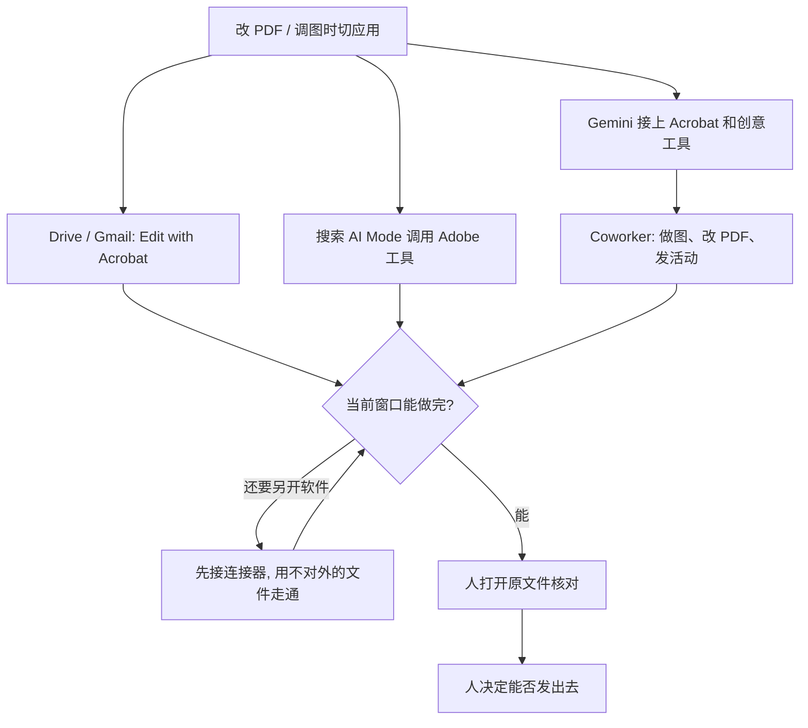

### 结论

[Google](https://blog.google/company-news/inside-google/company-announcements/adobe-google-partnership-integration) 这篇不是再讲一遍「两个办公套件互相嵌插件」。写的是 **Adobe MAX** 上宣布的扩展合作：改一份 PDF、微调一张图，就要在 Google 和 Adobe 之间切窗口，注意力会被切掉。合作要把 Adobe 的创意和生产力工具直接放进每天用的 Google 产品，也把 Google 的前沿 AI 模型放进 Adobe 应用。马上能对上号的活有三件：Google Drive 和 Gmail 里预览文件会出现通往 **Adobe Acrobat** 的建议入口，含「Edit with」；Adobe 会把 Acrobat 和更多创意工具接到 **Gemini** 和 **Gemini Enterprise** 的连接器上，并带进 Google 搜索的 **AI Mode**；企业团队能在 Gemini Enterprise 里用 Adobe 的 **CX Enterprise Coworker** agent 做图、改 PDF、发营销活动，不必切应用。和 **Google DeepMind** 给 Photoshop 做近实时修图模型，原文写成「探索」，不是今天的验收。

### 要点

- **先拆掉「改 PDF、调图就要离开当前窗口」这层，不是再换一个更会修图的模型。** 原文把问题写得很具体：在应用之间切换去编辑 PDF 或微调图片，会很快打断注意力。合作的方向是把 Adobe 工具放进你每天已经打开的 Google 产品，而不是让你再学一套新界面。人还是决定哪份文件能改、哪张营销图能发出去的人。

- **Drive 和 Gmail 里的 PDF，预览就可以走 Acrobat，不要先下载再另开软件。** 原文说很快会有从 Drive、Gmail 直达 Acrobat 的路径，会在两个服务里作为建议应用出现，文件预览里带「Edit with」入口。验收是「预览里能进 Acrobat 改」，不是「我们宣布了合作」。

- **做图、改 PDF、问 Gemini 应在同一处，不要把聊天、搜索和创意工具拆成三套窗口。** Adobe 会扩展它在 Gemini 和 Gemini Enterprise 里的连接器，接上 Acrobat 和更多创意工具；创意工具也会进 Google 搜索的 AI Mode。人在搜索或对话里就能调用，而不是复制到另一款软件再贴回来。

- **营销团队的图、PDF 和活动，应能在 Gemini Enterprise 里交给 Coworker 起草，人再放行。** 企业可用 Adobe 的 CX Enterprise Coworker agent：帮团队设计图形、处理 PDF、发起营销活动，不必切换应用。这是「谁在用 AI 解决什么活」最清楚的一句：营销和创意岗位，活是做图、改文件、上活动。Agent 可以起草，对外发出去仍要人点头。

- **Photoshop 近实时修图还在探索，不要把它写成已经上线的效率数字。** Adobe 和 Google DeepMind 会探索面向创意专业人士的新编辑能力，先从给 Photoshop 的图像模型开始，目标是接近实时的修改。原文用的是「explore」「could enable」。没有客户账单、没有已上线工期，就不要写成已经省下多少时间。

### 怎么做

面向每天泡在 Drive、Gmail 或 Gemini 里改 PDF、做图、发活动，却还在两个套件之间来回切的 junior：不必复制 Acrobat 或 Coworker 这个名字，按同一组顺序挡一遍。

1. **先写清哪一步会打断你。** 「预览里的合同 PDF 要另开 Acrobat」「活动主视觉要导出再上传」「营销文案在 Gemini 里，版式却在另一套软件里」。写成对方能听懂的一句话：起草和改格式可以在当前窗口做，对外发出去必须人点头。这是应用问题，不是再换一个更会修图的模型。

2. **PDF 从 Drive / Gmail 预览走「Edit with」，不要先下载。** 等建议应用出现后，用一份不对外的文件走通：预览 → Edit with → Acrobat。走不通就先别把生产合同扔进去。原文写的是「You'll soon have」，能力落地前先记在现有流程旁，不要假设今天就能点。

3. **Gemini 和搜索里先接上 Acrobat / 创意工具，再谈「AI 会做设计」。** 连接器没接上，聊天窗口只能空谈；接上之后，改 PDF、调图应能在对话或 AI Mode 里发起，结果回到你正在看的那份文件。

4. **企业侧把做图、改 PDF、发活动这三件常做的活交给 Coworker 起草，接到 Gemini Enterprise，不要另开一个设计聊天窗。** 验收是「活动草稿出现在现有企业 Gemini 里」，不是「我们买了新 agent 名」。

5. **用一次真的文件或活动验收，不要只看合作新闻。** 「这份 PDF 不用离开 Drive 就能改」「这张图不用切到另一套软件」「这次活动主视觉是在 Gemini Enterprise 里起草的」。人能打开原文件、核对改动、决定发不发。

6. **人还是放行的人。** Agent 可以建议用哪个 Adobe 工具、起草图形和活动。哪份 PDF 能改、哪张图能对外、Photoshop 新模型能不能进生产，仍由负责人看过再定。DeepMind 那条近实时修图，等真正可点的能力再测，不要把「探索」当成已经交付。

### 关键图表

*Google 原文的用法：把 Adobe 工具放进每天用的 Drive、Gmail 和 Gemini，营销团队用 Coworker 起草活动和版式；DeepMind 给 Photoshop 的近实时修图还在探索，人还是放行文件和活动的人*
