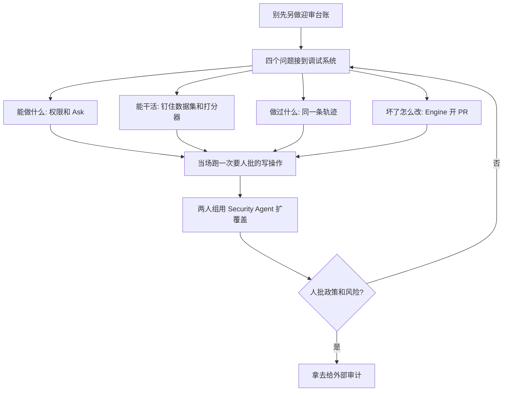

### 结论

[LangChain](https://www.langchain.com/blog/ai-governance-iso-iec-42001-langsmith) 这篇不是再发一遍「Agent 上线前先写一份治理文档」。**Ashwin Amardeep** 和 **Arthur Stromquist** 写的是两人合规组已经怎么处理「审计要看 Agent 能碰什么、测过没有、跑过什么、坏了怎么改」：证据就放在工程师本来用来调试的 **LangSmith** 里——权限和审批设置、**traces**（轨迹：一次运行里模型说了什么、调了哪些工具、有没有报错）、以及 **evaluations**（评测：用固定例子和打分器看 Agent 表现）。认证范围是所有正式发布、且推理跑在他们自己管的模型上的 LangSmith 功能。他们还用 **Deep Agents**（LangChain 的深度 Agent 框架）做了 **Security Agent**，同样跑在 LangSmith 上。验收写在原文里：外部审计拿到了 **ISO/IEC 42001**（人工智能管理体系的国际标准）；给 Agent 配了要人批的发 Slack 工具后，运行会停住，他们拒了并写原因，Agent 汇报拒绝、没有重试；复杂问题几分钟能给得出处。政策仍由人写，风险仍由人拍板。

### 要点

- **先拆掉「另做一套给审计看的台账」这层，不是再换一个更会写政策的模型。** 原文把每套在范围内的 AI 系统收成四个问题：Agent 被允许做什么；怎么证明它能干活；怎么证明它做过什么；坏了怎么改。答案要能指回 Fleet 里的权限、评测实验和同一条轨迹，而不是会和线上漂移的 Word。认证每年还要 **surveillance audit**（监督审核：证书有效期内每年再查一遍），新功能进范围，所以这套证据得跟发版走，不能只在迎审前补。人还是决定哪份权限模型和哪条风险能对外说的人。

- **「能做什么」验收的是一次真的审批，不要把 Ask 写成墙上的原则。** **LangSmith Fleet** 里有三层：工作区权限决定能接哪些集成、谁能加能力；Agent 设置决定用共享凭证还是调用者的 **OAuth**（一种授权登录，让 Agent 用「当前这个人」的身份去调外部系统），创建时钉死；工具设置是 **Auto**（自动跑）还是 **Ask**（先停下来等人批）。他们当着审计的面，让 Agent 往 Slack 频道发消息，这个工具配成必须批准。运行暂停，他们拒了并写原因，Agent 汇报拒绝、没有重试。同一条轨迹里能看见暂停和恢复，审计不必再对两份日志。提示词谁能看、谁能改，也在 Fleet 里打开给审计看。提示词若不住在代码仓库，**Prompt and Context Hub** 提供带版本的提交和可移动的标签，用来跟踪发版和回滚。

- **「能干活」验收的是数据集和打分器能复现，不要指望同一句输入每次吐同一句输出。** 审计要两样：某次发版的测试结果，以及测试数据从哪来。Agent 评测很难「同一输入同一输出」；能钉住的是数据集和 **evaluator**（打分器：用代码或另一个模型给回复打分）。评测数据只来自他们自己跑的系统，不来自客户工作区。每条评测记下例子出处和打分代码，改动走 **PR**（拉取请求：给同事审的改动），仓库历史加上 LangSmith 实验，就是这次发版怎么测的记录。测 **Engine**（扫轨迹、找根因、开修复 PR 的 Agent）时，他们查它能不能把有问题的轨迹和干净的分开，以及会不会动已经在板上的内容；**Fleet** 则按能力各做一套评测。他们还测评测本身：空白答案也能过的扔掉，重复轨迹删掉；拿一条已知正确答案喂给打分器，没给满分就先查打分器，再信分数。有写权限的 Agent 还要测提示注入、数据泄漏这类风险；LangSmith 带了预置评测，也可以用代码做确定性检查、用 **LLM-as-judge**（让另一个模型按量表打分）做需要判断的项，再用标注队列给人看。

- **「做过什么」和「坏了怎么改」验收的是同一条生产轨迹，不要生产一套日志、评测另写一份。** 审计抽一条运行，轨迹里有输入输出、工具调用和错误；要审批的调用，暂停和恢复也在同一条记录里。发版前用的评测可以打在生产轨迹上，结果变成这条运行的反馈分。比如幻觉评测会标出「回答对不上出处」的回复，评审改过的内容跟轨迹一起存，还能进以后的评测。改进环在 Engine：把反复出现的失败归组，对着 Agent 源码查根因，开出修复 PR，还可以先在预览部署上测，再走团队平时的代码评审。审计顺着一次改动看过评审、进仓库，以及促使这次改动的生产行为和用来判断修复的证据。这些轨迹还会变成评测集里的例子，让这次失败变成以后发版的回归题。

- **Security Agent 扩的是两人组的覆盖面，不要让它替你写政策和拍风险。** 标准里还有政策、角色、风险和影响评估、以及每套系统和条款背后的文档。他们把 Security Agent 建在 Deep Agents 上、跑在 LangSmith 里，它自己的运行也被记轨迹，工具也走同一套审批。重复活收成技能：政策和条款对照（一项控制只文档化一次）；证据叙述，能从 API 读到的就在 **GRC**（治理、风险与合规）平台上持续盯；风险和影响先读代码再给控制记功，超过阈值的进发现登记册；清单和功能评审给路线图上每个 AI 功能钉主人和范围，每月看一遍，新功能发版前先评估。他们还要撑 **SOC 2**、**ISO 27001**、**GDPR**、**HIPAA**。快只是一部分，更大的是覆盖：别的团队抛来的复杂问题，几分钟能给得出处。每一条政策、每一次风险判断仍由他们写、由他们定；他们审 Agent 的产出，改过的内容再喂回去。

### 怎么做

面向已经让 Agent 碰内部系统和客户数据，却一听到「合规 / 审计」就先新开一份文档库的 junior：不必复制 LangSmith、Fleet 或 Security Agent 这个名字，按同一组顺序挡一遍。

1. **先点名一套有主人、会改外部系统、审计真会问的 Agent。** 「它能调哪些工具」「谁能调用」「哪次写操作必须人批」。写成对方能听懂的一句话：权限、轨迹和评测可以自动收集，政策和风险必须人点头。这是应用问题，不是再换一个更会写制度的模型。

2. **把四个问题接到你已经用来调试的系统上，不要另做迎审台账。** 允许做什么、测过没有、跑过什么、坏了怎么改。不确定就标「未核实」。拿这四条和系统负责人对过，再谈补文档。

3. **当着人的面跑一次要审批的写操作，不要只展示 Auto。** 配成 Ask，让它试图发消息、改记录或调付款。停住、批准或拒绝、看它会不会重试。轨迹里要能看见暂停和恢复。提示词谁能改，也要能当场打开。

4. **钉住数据集和打分器，再谈「这次发版测过」。** 同一句输入不必每次同一句输出。记下例子从哪来、打分代码在哪、谁在 PR 里审过。空白答案能过的扔掉；拿已知正确答案抽查打分器。评测数据用来自你们自己的系统，不要把客户工作区当测试集。

5. **用一件真的活验收，不要只看「证书页能打开」。** 「拒了的 Slack 会不会还发」「审计能不能顺着一条轨迹看完工具调用」「Engine 开出的 PR 有没有先在预览上测过再进人审」「别的团队问一句复杂的，几分钟能不能指回政策和代码」。原文验收 LangChain 的是：同一套权限和轨迹既给工程师调试，也给外部审计；两人组用 Security Agent 把政策和证据的覆盖撑起来。

6. **人还是放行的人。** Agent 可以起草控制说明、归组失败、开修复 PR、回答「这条条款我们覆盖了没」。哪条政策能对外、哪项风险过线、何时宣布某功能进认证范围，仍由负责人看过再定。证书可以证明管理体系被查过，不能证明每一个 Agent 每次都对。

### 关键图表

*LangChain 原文的用法：Ashwin 和 Arthur 用 LangSmith 里已有的权限、轨迹和评测当审计证据。发 Slack 配成 Ask，拒了不再试；Security Agent 让两人组把复杂问题在几分钟内给得出处。政策仍由人写*
