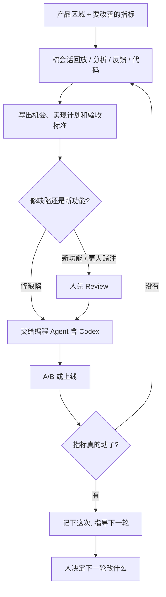

### 结论

[OpenAI](https://openai.com/business/customer-stories/amplitude) 这篇不是再讲一遍「产品分析该接上 Agent」。写的是产品分析公司 **Amplitude** 已经怎么用主动产品 Agent **Wave**，把「用户实际怎么用产品」变成能上线的改动。Wave 大约 **80%** 跑在 OpenAI 模型上，包括 **GPT-6.1 Sol**、**GPT-6 Luna** 和 **GPT-Image-2.5 Flare**。团队给它一块产品区域和要改善的指标，它从 Amplitude 数据、会话回放（session replay：把用户点击和页面操作录下来回看）、客户反馈和代码里找出机会，写出实现计划和验收标准，交给编程 Agent（含 **Codex**）去做，再量效果。CEO **Spenser Skates** 的原话是：AI 现在能找到你从没想过要派给它的活。验收写在原文开头：产品改动从大约一个月压到估计 **1–2 天**；自家首页建议卡片在对照实验里，一天后经卡片发出的消息相对对照组提升 **160%**。

### 要点

- **先拆掉「洞察堆着、改动要排队一个月」这层，不是再换一个更会写分析报告的模型。** Amplitude 一直帮团队看人怎么用产品。Wave 要做的是把这些洞察变成已上线的改进。Principal AI Product Manager **Jacob Newman** 说，想法是让 Agent 去梳大量会话回放、分析和代码，找出能改进产品的机会。人还是决定哪条改动能发的人。

- **被忽略的入口往往比新功能更值得先改：100 段回放里 80 人自己打字，只有 12 人点建议卡片。** Amplitude 拿自家首页做试验。通用建议卡片本想帮用户开始和 AI Agent 对话，Wave 发现人们常绕过它们。它建议按最近看过的图表、仪表盘或从哪一页进来，把卡片个性化；同时保留自由输入，没有个性化上下文时仍显示通用建议。团队简短 Review 后交给编程 Agent，再做 A/B 测试。实验读数：经首页建议卡片发出的消息，一天后相对对照组提升 160%。Senior Principal AI Engineer **Eric Carlson** 说，这是那种不起眼、一直被忽略、却能意外拉高功能采用的改动。

- **机会一旦够清楚，应带着实现计划和验收标准直接交给编程 Agent，不要再写成一份没人做的需求。** 原文写：机会准备好构建时，团队可以从 Wave 直接发给编程 Agent（含 Codex），附上技术计划和验收标准。多数团队把修缺陷直接交给编程 Agent；新功能和更大的赌注先人 Review。客户已上线的实验、功能开关和引导里：四分之一在 Wave 提出机会的当天就上线，一半不到四天，三分之二一周内。

- **调查用重模型、反复小检查用轻模型、线框用图像模型，这是给不同活配不同成本。** Wave 的活对模型要求不一样：深挖需要能站住脚的结论；同一类小检查要跑几百次，就要又快又便宜。Opportunity Investigator 评测里，GPT-6.1 Sol 总分 **4.06/5**，对照三个备选是 3.62、3.52、2.94，中位调查时间 **54 分钟**最快；Data Science Agent 评测里它 **67.5/100**，对照另一家领先模型 69.3，但每次调度的平均模型费用 **1.28 美元**对 **2.63 美元**（约低 51%）。高频扫代码和小检查用 GPT-6 Luna；线框和 mockup 用 GPT-Image-2.5 Flare，15 个机会上 **80.3/100**，对照 63.9。Skates 的原话是：既有强推理模型，也有更小更快的模型，才能在质量、延迟和推理成本之间平衡。

- **人还是放行的人：修缺陷可以直达编程 Agent，新功能先 Review，上线后再看有没有真的变好。** Wave 已经在 beta 里给各行业客户找机会、写建议修复、技术计划和验收标准。自动化程度由团队自己控。变化上线后，Wave 跟踪结果，用来指导下一轮。

### 怎么做

面向已经有产品数据和回放、但改进还在排期里躺一个月的 junior：不必复制 Wave 或 Amplitude 这个名字，按同一组顺序挡一遍。

1. **先写清哪一块产品、哪条指标在停着。** 「首页建议没人点」「功能开关排期要一个月」「回放里看见问题，没有人把它变成改动」。写成对方能听懂的一句话：找机会和起草计划可以自动，对外上线必须人点头。这是应用问题，不是再换一个更会写分析的模型。

2. **给 Agent 一块产品区域和要改善的目标/指标，把回放、分析、反馈和代码放在同一处。** Wave 不是另开一个聊天窗写想法，而是梳现有数据。没有回放和指标，它只能空谈。

3. **先看它有没有证据，再谈「AI 会改产品」。** 首页那个例子的证据是 100 段回放里 80 人自己打字。没有证据的机会，不要直接丢给编程 Agent。

4. **机会够清楚时，带着技术计划和验收标准交给编程 Agent；修缺陷可以直送，新功能先人看。** 验收是「PR 上有计划和验收标准」，不是「我们接了 Wave」。

5. **用一次真的改动验收，不要只看分析报告。** 「建议卡片发出的消息有没有增加」「这次改动是 1–2 天还是又排了一个月」「上线后指标有没有动」。人能打开原回放、核对改动、决定发不发。

6. **人还是放行的人。** Agent 可以找机会、画线框、起草实现。哪张卡片能改、哪个实验能上、哪次调度该用贵模型，仍由负责人看过再定。

### 关键图表

*OpenAI 原文的用法：Amplitude 用 Wave 从回放和数据里找出该改什么，带着计划和验收标准交给编程 Agent，再量效果；自家首页建议卡片互动提升 160%，产品改动估计 1–2 天能上，人还是放行的人*
