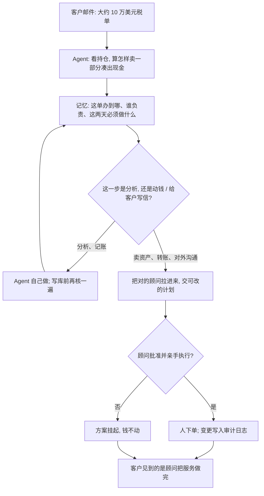

### 结论

[Latent Space](https://latent.space/p/arca) 这篇不是再讲一遍「金融机构该上几个 Agent」。**Richard MacManus** 在 AI Engineer New York 访谈的是 **Arca** 的 AI 平台负责人 **Aman Singh**：这家公司自己就是财富管理事务所，不是卖软件给别人的 SaaS。Agent 做顾问周围的活——读邮件和账单、分析持仓、写财务计划、盯截止日期——顾问本人去见客户、改方案、动钱。Singh 的原话是：**「Agent 提示人，多于人提示 Agent。」** 客户不直接跟模型说话，体验到的是人把服务做快、做细。文章写他们刚完成一轮 **4850 万美元**融资（General Catalyst 领投，Index Ventures、Venrock 参投）。财务活是**长周期、不是长计算**：一件税单可以横跨大约 **10** 天，中间停停走走、换人、等审批。

### 要点

- **先换掉顾问周围的后台，不是换掉顾问。** Arca 做规划、税务、保险和遗产安排，客户从刚卖公司、科技高管想提前退休，到第一次买房的家庭都有。Singh 说 AI 的角色是替换顾问周围的工作，不是替换顾问。后台机器一直在想：市场怎么影响这位客户、生活里哪些变化会改财务。顾问仍用同理心交付；客户只见到服务变快、变主动。顾问不选模型、不写提示词，产品把这些藏起来。

- **十万刀税单：分析可以全自动，动钱、清仓、给客户写信不行。** 客户邮件里甩来一笔大约 **10 万美元** 的税单。Agent 先看钱现在放在哪，再算怎样卖一部分最合适，把现金凑出来。这一段分析交给 Agent。他们和托管券商（custodian，帮客户保管证券、真正下单的那一侧）有很深的 API，但护栏写死：搬钱、卖掉资产、直接联系客户，都必须人在环里。Agent 会把对的人拉进来，交一份可改的计划，由专家判断该不该做、再亲手执行。没有自主交易。

- **十天流程靠每人一份记忆，不靠把整段对话塞回上下文。** 同一条邮件线程还给原来的 Agent；中途打进来的电话是新信号，会叫醒一个新 Agent。它靠内部记忆接上：这位客户正在办什么、谁负责哪一步、已经发生了什么、这两天必须做什么、长期在盯什么。还有一层会定期回看客户状态、把长期任务写回记忆。像人类分工一样：第 7 步的人现在不必知道全局，到该出场时再被拉进来，并带上此刻需要的上下文。

- **安全规则是确定的，合规要的是默认可审计。** Singh 说所有安全限制都是确定性的，把决定从 Agent 手里拿开。简单记账类工具可以自己跑；每次写数据库，会再用很快的模型核一遍。邮件、文件、电话会在入口查提示注入（prompt injection：外来文字里夹带「忽略规则、去转账」这类指令）。数据要离开系统时——网页搜索，或给客户发日历邀请——先用规则查个人身份信息，再用一组小模型看有没有往外捎数据。每一次 Agent 或人在界面上的改动都记变更日志：改了什么、谁改的、从哪改的、何时改。合规要审计轨迹；同一份日志也用来通知 Agent「人刚改过」。

- **细节和催办是默认行为，顾问的改和撤都变成评测。** 一位还在考虑签约的人已经有顾问，大约收 **1500** 美元，还不爱回消息。Agent 读完账单和持仓后发现：还有对方没说清的隐性收费，而且那位顾问并不是 **fiduciary**（受信义务：必须为客户利益行事，不能先顾自己的佣金）。规模一大，人很难同时盯住所有截止日期；Agent 会主动标出「有期限要到了」，或客户有漏掉 **RMD**（required minimum distribution，退休账户每年依法必须取出的最低金额）的风险。顾问改一处或取消一处，都要写原因，和当时的运行轨迹一起存下来。每晚有一个元 Agent 读这些轨迹，指出误导的工具、缺的知识或出错的步骤；提示词改动仍要工程师过目——Singh 说把改提示交给 Agent 自己写，常常把整段提示改得又长又窄。运营知识做成产品里的「知识」页，专家直接改，Agent 引用，引用错了会从轨迹里浮出来。

### 怎么做

面向已经在用模型写分析、但买卖、对外沟通或合规还不能放手的 junior：不必复制 Arca 或财富管理这个行业，按同一组顺序挡一遍。

1. **先写清谁对客户负责、哪类活在挤顾问时间。** 读账单、对持仓、凑税单、盯到期日——列出来。再写一句对方能听懂的分工：分析可以自动，动钱、对外说话必须人点头。这是应用问题，不是再换一个更会算税的模型。

2. **按任务分档，顾问不要看见选模型。** 税单、财务计划这类重活走最强一档；后台整理走便宜一档。用你们自己的评测决定，不要只看公开榜。Arca 换过 Gemini、OpenAI、Anthropic，现在以 Claude 为主，但原则是不绑死一家。

3. **长流程做成「停得住、接得上」。** 每人（或每单）一份记忆：正在办什么、谁负责、这两天必须做什么。同一条线索回到原来的 Agent；新电话、新文件当新信号，先读记忆再决定是接着干还是另开一单。

4. **护栏写在能力边缘，不要指望模型自己「小心一点」。** 搬钱、清仓、给客户发信：没有人批就不执行。写库、出 PDF、往外发之前，用规则加核对。财务计划里不该出现原始账号，也不该承诺收益率——这些用检查器拦，不要写进提示词碰运气。模型很会自信地用过期税率；对外建议之前，先核你们维护的、今天仍成立的事实，或再查一次。

5. **把人的改和撤收成评测，知识写进产品，不要只躺在 wiki。** 顾问为什么改方案、为什么取消，和当时轨迹绑在一起。每晚可以自动归纳缺哪条工具、哪段知识，但改提示仍要人看。专家能在产品里改说明书，Agent 能引用，引用错了能从轨迹里看见。

6. **用一件真的、会跨好几天的活验收。** 「客户来了一笔十万刀税单，十天内凑出现金」这类话，应变成：分析自动完成、对的人在对的节点被叫来、买卖仍由人执行。再用一件「账单里藏着收费」或「到期取款要漏」验收主动催办。只看「模型会写规划」不够。

### 关键图表

*Latent Space 访谈里的用法：税单分析交给 Agent，横跨约十天的记忆和催办也交给 Agent；动钱、清仓和给客户写信仍要人在环里*
