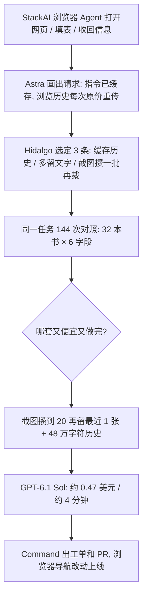

### 结论

OpenAI 这篇客户故事写的是 **Asana** 怎么用 **GPT-6 Astra**（跑在 **Codex** 里的编码 Agent）去压自己的**浏览器 Agent** 成本，不是再发一篇「换个更强模型就便宜了」。Asana 收购了 **StackAI**：客户不用写代码，也能搭出「打开网页、填表、把信息收回来」的工作流。规模一大，工作流里多传一次页面文字或截图，钱和时间都会叠上去。StackAI CTO **Frank Hidalgo** 让 Astra 先查请求怎么拼、再改缓存和截图策略、再跑对照。他估手工要 **1–2 个月**，实际大约 **一周**。144 次实验里，优化后的 **GPT-6.1 Sol** 工作流平均每次模型成本约 **0.47 美元**、大约 **4 分钟** 跑完：比原来生产用的 Model B 设置便宜 **76 倍**、快 **5 倍**。CPO **Arnab Bose** 的说法是：工程师定方向，Astra 跑实验，结果经 **Command**（Asana 的交付平台）进生产。

### 要点

- **贵的不是模型名字，是每次都把整段浏览历史原价重传。** Astra 先画出代码怎么组请求：固定指令和工具定义已经缓存，但页面文字、截图组成的历史没有。每一步都把越来越长的历史再发一遍，按全价计。Agent 还几乎每步丢掉旧截图、裁一段文字——历史一变，就算后来想缓存也命中不了；丢掉的事实又逼它回已经看过的页。先画清「每次请求里什么在涨价」，再谈换模型。

- **三处改动一起验：把历史也缓存、多留文字、截图攒一批再裁。** Hidalgo 从 Astra 的方案里挑了这三条。代码本来不好做对照实验，Astra 先改成同一套前后端能并行跑多种设置。任务固定：从一个公开演示目录给 32 本书各收 6 个字段，接近部分客户在 StackAI 上的活。历史预算试了 **12 万** 和 **48 万** 字符；缓存和截图策略试了 6 种，4 个模型各跑 3 次。最好的策略是截图攒到 **20** 张再裁回最近 1 张——中间更长一段时间历史不变，缓存才站得住。配上更大的历史预算，就是后来上线的工作流。

- **验收看三件事：钱、时间和有没有答对。** 原来的 Model B 设置，单次估计至少 **36.21 美元**（有的跑到步数上限还没做完）、至少 **22.5 分钟**；同一模型优化后到 **1.24 美元**（约 29 倍）。Sol 优化后再降到 **0.47 美元**，大约 **4 分钟**。单看 Sol、大历史预算：新缓存和截图策略把成本从 **1.97** 降到 **0.47**（约 4 倍），因为大约 **89%** 的输入走缓存，价格大约是未缓存的 **5%**。小历史预算时 18 次里只有 3 次给出答案；加大预算后 18 次都给出正确答案。Hidalgo 的判断：以前成本卡住了能给客户开哪些模型；Agent 省了，才能在可控成本下给更快、更强的模型。

### 怎么做

面向正在跑「打开网页、读页面、再决定下一步」这类 Agent 的 junior：不必复制 Astra 或 Sol 这个名字，按同一组问题挡一遍。

1. **先让 Agent 画出请求账单，再动手改。** 问清楚：固定指令、工具定义、页面文字、截图，各走不走缓存？每一步有没有把整段历史再发一遍？不要先换模型。

2. **截图和文字不要每步都裁。** 每裁一次，缓存前缀就断。先定「攒到多少张再裁」「文字最多留多少」，让中间许多步的历史保持不变。

3. **对照实验用同一件真实活。** 固定任务（例如同一批页面收同一组字段），改一两个变量，每个设置多跑几次。记录请求、用量和输出，方便人复核。

4. **三个数一起看：单次成本、时长、答对/做完率。** 只报「便宜了」不够。Asana 的优化工作流每次都做完并答对；有的旧跑法是撞上限才停。

5. **人定方向，Agent 跑夜班实验。** Hidalgo 的用法是睡前设一个 `/goal`，早上审结果。改动经 Command 变成工单和 PR 再进生产。破坏性发布和能不能给客户开更贵的模型，仍由人拍板。

### 关键图表

*OpenAI 原文的用法：先查清浏览历史为何每步重传，再用对照实验换缓存和截图策略；模型成本降下来，才能给客户开更快的模型*
