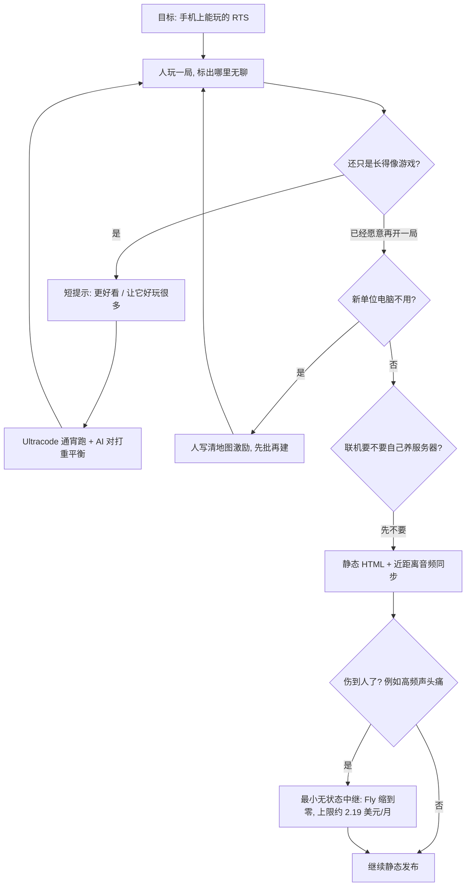

### 结论

[Simon Willison](https://simonwillison.net/2026/Oct/20/battledrones) 写的不是又一篇「Agent 也能做游戏」。他要的是一款能在手机上玩的 **RTS**（即时战略，像《命令与征服》那样边造兵边抢资源）。他自己几乎不会 TypeScript，也几乎没审代码，却用 **Claude Code** 做了 **12** 个大版本、**321** 次由编码 Agent 提交的改动，得到了 [Battle Drones](https://simonwillison.net/2026/Oct/20/battledrones)——能玩、有多张地图，还能两台靠近的设备用声音同步对战。真正把他从「看起来像游戏、玩起来无聊」里拉出来的，是一条难为情的提示：「**让它好玩很多**」（Make it a LOT more fun）。**Ultracode**（Claude Code 一次编排许多子 Agent 的动态工作流）通宵跑完，还用 **1200** 场 AI 对打把平衡改掉。后面音频对战让人头痛，他才加了一台最便宜的 [Fly.io](https://fly.io/) 中继，账单上限大约 **2.19** 美元/月。人的活是玩、挑哪里不好玩、写清新地图的规则；代码、贴图、3D 模型和配乐交给 Agent。

### 要点

- **验收看「自己愿不愿意再开一局」，不看仓库里有多少提交。** Willison 几乎不审代码，但自己玩了很多遍。前几版已经能造建筑、选中单位、有基础电脑对手，他仍很快觉得无聊。v4 才第一次承认：以前他觉得编码 Agent 能做出「长得像游戏的东西」，做不出真好玩的东西；这条假设被「让它好玩很多」推翻了。junior 这边也一样：能编译、能点，不等于能玩。

- **「让它好玩很多」能生效，是因为后面跟了可量化的对打，不是一句空话。** Ultracode 从晚上跑到第二天早上。Agent 自己开了一千多场模拟，再改单位、加机制。Willison 让它写的发布说明里有两组数：普通难度 **1200** 场 AI 对打里，25 分钟还分不出胜负的对局从 **14%** 降到 **0.9%**；曾经落后 **800** 以上废料的一方最终翻盘，从 **24%** 升到 **46%**。战斗更长、比分会晃，输的一方还有回来的路。提示很短，验收很长。

- **人只在「规则会改谁该用哪种兵」时下场写长提示。** v1 到 v7 大多是「更好看、更好玩、搬到 3D」。到 v8，他发现新做的步兵和运兵机 **Condor** 电脑几乎不用——地图上没有非用它们不可的理由。于是他写了目前最长的一版需求：资源少、上行链路在岛上、陆上车和步兵到不了、飞机也不能直接占，**只有** Condor 运步兵才能占；两座总部隔水，靠两座桥相连。先研究、先批设计，同意后再建。这张热带群岛图后来成了最好玩的一张。人设计激励，Agent 落地。

- **静态页面先把托管成本压到接近零；真伤到人，再花每月两美元级的中继。** 他喜欢一份 HTML 就能玩，不想自己养一台服务器、还得一直负责它活着。v12 把上周的 [Chirp Pong](https://simonwillison.net/2026/Oct/15/chirp-pong/) 声音对战实验搬过来：两台设备在麦克风距离内，用声音同步状态。和 Natalie 一玩，高频调制声让她头痛。这才加警告，并改成无状态的 WebSockets 中继（浏览器之间传消息的小转发服务），跑在最便宜的 Fly `shared-cpu-1x` 上、可缩到零。就算一直热着，一个月大约不超过 **2.19** 美元。静态站本身还能当 **PWA**（能缓存到手机、断网还能打开的网页应用）——他没专门要求，飞机上也能玩。

- **剩下来的额度也可以变成一小时功能；工具默认当免费的。** 有一天周额度还剩 **25%**、**45** 分钟后重置，他就拿「随机地图」当目标，限定 45 分钟。Ultracode 很烧 token，但复杂问题（声音对战、通宵 3D 移植）常常一条提示就能开工。探测带宽的 Radio Probe、模型浏览器、Agent 对打调试器，都是顺手提示出来的。他不会把现在这版拿去 Steam Next Fest 充独立游戏——自己也觉得还太省力——但已经能看出：真有品味、真想做成的人，可以用同一条路做出能被认真对待的东西。

### 怎么做

面向几乎没做过游戏、却想用编码 Agent 交一版「自己愿意再玩」的东西的 junior：不必复制无人机或群岛，按同一组分工挡一遍。

1. **先写清谁在什么设备上玩、玩多久会觉得无聊。** Willison 的目标是手机上的命令与征服。第一版只要求能认出来：能造、能指挥、有对手。不要第一句就「做 3D、做联机、做赛季」。

2. **人负责玩，Agent 负责改。** 你几乎可以不审 TypeScript，但必须自己点完一局。哪里无聊、哪张图电脑不用新单位，写成下一句提示。没有这轮，仓库只会堆「看起来更像」的提交。

3. **好玩要用对打数字验收，不要停在形容词。** 「让它好玩很多」能写，但要留下能复盘的数：多少场、多久还没分出胜负、落后一方有没有回来的路。只有观感、没有对打，下一版还会漂。

4. **新机制先改地图激励，再改模型。** 电脑不用步兵，不是再画一个更酷的机甲就能解决。先写清：不坐运输机就占不到的点、不走桥就过不去的水。先研究、你批完，再让 Agent 建。

5. **能静态托管就先静态；伤到人再加最小服务器。** 声音对战省掉了长期运维，也制造了头痛。先警告，再上可缩到零、不存状态的中继。把月费上限写进 README，不要一上来就申请常驻集群。

6. **额度快重置时，只开一个有时限的功能。** 45 分钟、一张随机地图、要能用种子复现。不要在倒计时里同时开联机、做活动、重做引擎。

### 关键图表

*Willison 原文的用法：人玩、人写激励和成本上限；Agent 写代码、跑模拟、做模型和配乐。先静态，伤到人再花每月两美元级的中继*
