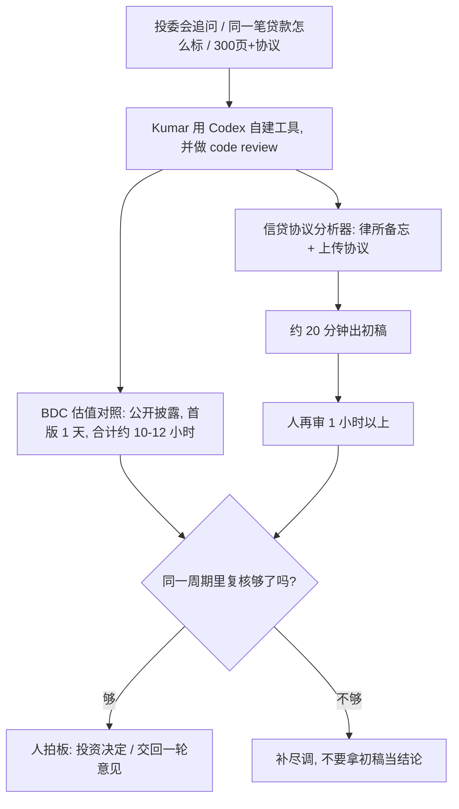

### 结论

[OpenAI](https://openai.com/index/benefit-street-partners) 这篇不是再发一遍「金融机构也上了编码 Agent」。写的是信贷基金 **Benefit Street Partners（BSP）** 的组合经理 **Anant Kumar** 自己用 **Codex**（OpenAI 写代码、改代码的 Agent）搭工具：以前投委会一轮追问要几天到几周，现在分析师能在一天内交回一轮意见，会上也常能当场答。他做了两件具体的活：用美国证监会公开披露，对照各家 **BDC**（商业发展公司，公开交易的信贷机构）对同一笔贷款的估值；把动辄 **300** 页以上的信贷协议收成初稿分析。首版估值对照一天搭出，后续改功能和界面合计大约 **10–12** 小时；协议上传后大约 **20** 分钟出初稿，人再审 **1** 小时以上。Kumar 的标准是：同一周期里加复核能力和严谨程度，不是多做几单；投资决定仍由人拍板。

### 要点

- **验收看一轮追问能不能当天交回，不看「我们上了 Codex」。** 尽调通常是多轮：每一轮要补材料、改备忘、回答投委会。交易周期从几天到几周不等。Kumar 说分析师现在能在一天内交回一轮，会上也常能当场答。先有这条前后对比，再谈换模型。

- **业务岗自己搭对照表，数据走公开披露，代码要过 Review。** 以前做能给同事看的看板，要找会写网站、会拉数的人。Kumar 现在自己写：Codex 起草代码并做 **code review**（对照改动查错误）。工具读各家 BDC 的公开披露，对照同一笔贷款别人怎么标、自己怎么标。他的原话是：自己从分析师和组合经理，多了一层「能把东西做出来」的开发者。

- **长协议先收成「第二大脑」，初稿和人审必须分开计时。** 信贷协议常超过 300 页，要找可能把价值从贷款人这边挪走的条款。以前是请外部律师一页页过。Kumar 先把主流律所关于条款和风险的备忘收在一起，再做成分析器，称它是组织里的「第二大脑」。上传后大约 20 分钟出初稿，后面至少再花 1 小时由人审。工具已用 **GPT-6 Astra** 重构，挂在公司自己的门户上。他说：AI 擅长归拢、读入、合成分析；最终投资决定必须由人做。

- **省下的时间回到更高层判断，不是去堆交易量。** BSP 明确写：这些工具用来在同一时间窗口里加复核，不是多做几单。Kumar 说分析质量更快也更好，因为手里的信息更多；Codex 把他从例行活里拉开，把小时数还给更高层工作。下一步想把各笔交易的信息连起来，并做持续核贷：新闻一出就看对组合的影响，而不是出事后再重做一遍。

### 怎么做

面向正在把编码 Agent 接到尽调、对照或长文档审阅上的 junior：不必复制 BDC 或信贷协议这个名字，按同一组问题挡一遍。

1. **先写这周投委会或同事反复追的那件事。** 写成：同一标的别人怎么估值、一份长协议里哪几类条款会改分配。Kumar 是从自己的核贷活写起，不是先申请「最强金融模型」。

2. **能公开拿到的数据，自己搭对照，不要每次求软件组。** 披露文件、公开估值、已有备忘。首版允许一天交出来，再用大约 10–12 小时改功能和界面。起草和 Review 都留给 Codex，你要能讲清表上每一列从哪来。

3. **长文档强制分栏：初稿 / 人审 / 未核。** 协议分析大约 20 分钟出初稿，至少再留 1 小时给人。模型标出的条款默认是初稿。混在一起，后面的人会按假结论做决策。

4. **把领域备忘接进同一条工作流，不要另开空白聊天。** Kumar 先收主流律所关于条款和风险的备忘，再做成分析器。只丢一份 PDF 进通用窗口，外部律师那一轮该做的活还在。

5. **验收写「同一周期里多核了什么」，不要写「多做了几单」。** BSP 的选择是加严谨，不是加交易量。你这边也先量：一轮追问从几天变成几天、人审还剩多少小时。

6. **人还是拍板的人。** 模型归拢和合成。这笔贷款该不该做、条款能不能接受，仍由投委会和组合经理决定。

### 关键图表

*OpenAI 原文的用法：组合经理用 Codex 把估值对照和长协议初稿收成自己的工具；验收看一轮追问和人审时间，投资决定仍由人做*
