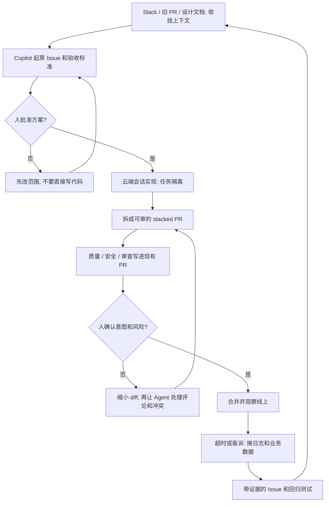

### 结论

[GitHub](https://github.blog/ai-and-ml/github-copilot/beyond-code-generation-a-developers-guide-to-agentic-engineering) 这篇不是再讲一遍「Copilot 写代码很快」。**Nick Liffen** 和 **Philip Holleran** 写的是开发者已经怎么把 [GitHub Copilot](https://github.com/features/copilot) 接到计划、写码、审查和线上排查——实现变快了，周围的活没有。今年 10 月 GitHub 一周提交超过 **12 亿** 次，比一年前多 **400%** 以上，比 2025 年全年还多。Faros AI 的研究：团队从低 AI 采用走到高采用，**PR**（拉取请求：给同事审的改动）在审查里待的时间长了 **441%**。他们把工作流写成四段：Plan、Build、Verify、Observe。验收不是「我们开了 Copilot」，而是计划能从 Slack 和旧 PR 里收拢、改动能拆成可审的 PR、线上超时能带着证据开 Issue。人还是拍板的人。

### 要点

- **先拆掉「写码变快、计划和审查还在排队」这层，不是再换一个更会补全的模型。** 需求在一个工具、兼容性约束埋在 Slack、旧 PR 里写着现在为什么这么实现。看起来是一次接口改动，先变成几小时的搜索和交叉核对。审查队列上，标成「小重构」的 PR 改了 47 个文件，你真正想问的共享校验逻辑埋在格式化、生成测试和每个调用点的改动里。这就是 441% 的现场版。Agent 可以在 Plan、Build、Verify、Observe 上提高效率，判断仍在人这边。

- **计划要在团队已经开会的地方收拢，写成带验收标准的 Issue，再让人批方案。** 在 Slack 或 Teams 里用 Copilot，把连上的工具里的上下文拉到一处，核对假设、改需求。谈拢之后让它开 GitHub Issue，带上实现需要的上下文和验收标准，能拆开的任务拆开。例行分诊用 **GitHub Agentic Workflows** 贴标签、估复杂度，低复杂度可以直接派给 Copilot，人把时间留在更难的决定上。复杂活用 **Plan Mode**（先出方案再动手的模式）比较路径、改实施计划，人看过、批准后再交给 Copilot 写。原文的收束是：以前要几天找上下文，现在能交出一份可审的计划、明确的验收和划好范围的 Issue。

- **写码要让任务自己往前走，不要把人和没写完的工作区绑在同一台电脑上。** 会话连续性可以换设备接着同一条 Copilot 会话。任务在云端跑，合上笔记本也能回来。Copilot app 给每个会话一份隔离的仓库副本，实现任务和文档更新不会抢同一棵没提交的工作树。仓库说明记下约定和验证命令，共享记忆记下可复用的事实；**Copilot Dreaming** 会看合格会话和 PR 反馈，更新记忆、提出说明或技能修改。**Copilot Fusion** 按任务选模型和推理深度，需要时再拉别的模型审一版方案。企业托管设置把公司策略和配好的工具带到各个 Copilot 入口，换客户端不必重新配一遍。

- **审查要先变小、再清掉例行项，人只看「这段是不是你想要的」。** 用 **stacked PR**（把互相依赖的改动叠成更小的 PR）拆开，每张可单独审，依赖看得见，下游可以在合并前接着做。**GitHub Code Quality** 按编码实践和公司标准先拦一层。Copilot 代码审查按改动复杂度给反馈，深度可以自己设，也可以让它按 PR 选。**AI Scan** 覆盖 CodeQL 照顾不到的语言和文件；AI 密钥检测抓口令这类非固定格式的秘密。许可证合规在合并前对照公司规则；面向 npm 公开预览的 package firewall 能拦住违规下载。**Agentic Autofix** 给安全问题起草修复；**Agent Merge** 处理失败检查、审查评论和合并冲突。配好之后，验证步骤过了 Copilot 也可以合并。人要盯的是意图和会出什么错，不是格式和冲突。

- **线上出事要把可观测数据和仓库证据接到同一处，教训写回下一轮计划。** 「所有检查都过了」挡不住第二天值班板上的间歇超时。Copilot 通过 Fabric 这类连接器读可观测工具和业务数据，帮你看哪些请求或客户群被打到。让它起草带证据和验收标准的 Issue，并补上这次失败的回归测试。再看 Dreaming 提出的记忆、技能和代码审查指引。下一份计划从线上真实行为开始，而不是从「模型说做完了」开始。

### 怎么做

面向已经用 Copilot 写代码、但计划和审查还在排队、线上排查还要自己拼日志的 junior：不必复制 Copilot Fusion 或 Dreaming 这个名字，按同一组顺序挡一遍。

1. **先写清这周最堵的那一段。** 计划找不到旧约束、PR 太大没人敢审、合并后值班要对日志。写成对方能听懂的一句话：起草计划和例行修复可以自动，方案批准、合并和回滚必须人点头。这是应用问题，不是再换一个更会写补丁的模型。

2. **计划接进现有 Slack / Issue，不要另开一份 AI 需求文档。** 先在人已经讨论的地方收拢上下文，再开带验收标准的 Issue。低复杂度可以派给 Copilot；复杂改动必须先出方案再动手。GitHub 原文是 Plan Mode 批过才开始实现。

3. **一次只推一类改动，会话和仓库副本隔开。** 实现和文档不要挤在同一棵没提交的工作树。仓库说明写清约定和怎么验证，免得每条会话都重讲一遍。换设备或合上电脑，要能回到同一条会话，而不是重新贴 prompt。

4. **审查默认变小。** 「小重构」改了 47 个文件，就是 441% 的来源。先拆 stacked PR，再让质量检查、代码审查和安全扫描写进现有 PR。人核对的是共享逻辑对不对，不是生成测试有没有齐。

5. **用一次真的线上故障验收，不要只看「Agent 会读 diff」。** 「间歇超时、几个大客户被打到」应变成：Copilot 对着日志和发布记录给出影响面、开出带回归测试的 Issue、人核对出处后再修。检查全绿不是证据。

6. **人还是拍板的人。** Agent 可以贴标签、写代码、提修复、处理冲突。方案能不能开写、PR 能不能合、生产要不要回滚，仍由负责人决定。GitHub Universe 2026 那场 *Agentic Engineering: Past the Pilot* 的用法也是这一句：先拿本周最烦的一段试，再慢慢扩到整条工作流。

### 关键图表

*GitHub 原文的用法：把 Copilot 接到计划、写码、审查和线上排查；提交量涨了不可怕，PR 审查变长和线上对不上证据，才是要拆的活，人还是放行的人*
