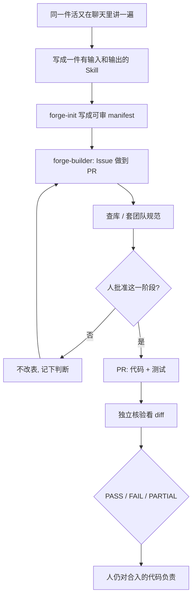

### 结论

[GitHub](https://github.blog/ai-and-ml/github-copilot/build-once-run-on-any-agent-a-practical-guide-to-agent-skills) 这篇不是再讲一遍「给 Agent 写一份更长的系统提示」。**Andrea Griffiths** 写的是工程团队已经怎么处理「同一件活这周又在聊天里讲了一遍」。她在 GitHub Universe 2026 上和 Procore 数据工程负责人 **Shishir Tewari** 一起讲：**Agent Skill**（一份以 `SKILL.md` 为中心的版本化目录，写清何时、如何做一件可重复的活）把判断从聊天和人头里拆出来，你和同事的 Agent 都能复用。工具、凭证和权限仍由运行它的那台环境提供——Skill 可以写「怎么查库」，但不会因此拿到库的钥匙。正文用两件真实工作流当例子：**Proof Agent** 让另一只核验去看改动，不让写代码的那只自己给自己打分；**Data Forge** 把客服台「建了多少、关了多少」这类指标管道拆成发现、搭建、查库、规范，人在每一阶段点头，最后开出带测试的 **PR**（拉取请求：给同事审的改动）。人还是决定哪条能合、哪张表能改的人。

### 要点

- **先拆掉「同一件事每周重讲、管道对不对还要等人在」这层，不是再换一个更会写 SQL 的模型。** 原文开头连问：这周你把同一件任务对 Agent 解释了几次？那个最熟仓库的同事，你又问了几次？这些上下文不该只活在聊天记录或某个人脑子里。今晚你给自己写的 Skill，以后可以进团队流水线。人还是决定这条管道能不能上线的人。

- **Skill 只描述一件有输入、有输出、知道何时该上场的活；工具和权限仍在宿主那边。** 一份 Skill 适合清单、发布、迁移、指标管道这类边界清楚、会反复做的工作。它不负责给数据库开权限、也不负责当长期跑着的控制系统。原文写得很干脆：如果活需要稳定接口、共享状态、审计轨迹、长时间编排，或必须在模型外强制权限，那更适合做成应用，而不是再堆一份说明。

- **自己核验自己的产出，不算核验。** Proof Agent 的规则是：写代码的 Agent 若再评估自己的改动，解释会影响结论。另起一只核验，只看原始需求和 diff（改动对比），给出 **PASS / FAIL / PARTIAL**，并且必须在改动文件里引用证据。演示工作流里 `block-on-fail: false`，发现只当建议；默认 FAIL 会让检查失败，若仓库把该检查设为必过，就不能合。GitHub Action 做的是静态看 diff，不跑代码、不跑测试——测试和合并门仍走你们现有的 CI。

- **项目名、用哪个库、表怎么叫，不要写进 Skill 正文。** Data Forge 的客服台例子里，`forge-init` 先去发现源表和命名习惯，写成一份 **manifest**（项目配置清单）；`forge-builder` 从 Issue 做到 PR，中间调 `forge-dbx` 查数、调 `forge-lint` 套团队规范。Manifest 可以选本地 **DuckDB** 做演示，但不能替你安装命令行或授权。仓库里看到的旧写法，也不自动等于要保留的规范——发现结果要给人确认。验收可移植性的问法是：换一个团队、换一份 manifest，这些 Skill 还能否不改正文就用。

- **一份 `SKILL.md` 当源，再打包给 Copilot / Cursor / Claude；人在每步把关，检查用来验收。** Data Forge 客服台流程有七个阶段，每阶段有人检查点：上一阶段没完成不能往下，改 schema（表结构）前要先批准。打包脚本从 `skills/*/SKILL.md` 生成各客户端文件，CI 里跑 `node scripts/package.mjs --check`。装上之后还要核对：客户端认不认这件活、引用能不能加载、工具能不能用、有没有按 Skill 要求给出证据。

### 怎么做

面向已经让 Agent 写代码或搭数据管道，却发现「同一句规范每周重讲、指标管道还锁在四个人脑子里、写代码的那只自己说没问题」的 junior：不必复制 Proof Agent 或 Data Forge 这个名字，按同一组顺序挡一遍。

1. **先写清你这周已经讲烦的那件活。** 「客服台建了多少、关了多少怎么算」「AI 改完谁来核对有没有瞎说」「发布前那张清单每次都要口播一遍」。写成对方能听懂的一句话：说明可以复用，库权限、合并权和改表仍由人批。这是应用问题，不是再换一个更会写管道的模型。

2. **给 Skill 一件活、何时上场、输入和输出是什么。** 像 Proof Agent 那样，名称和描述写在 frontmatter 里；「何时核验」单独成段，剩下的才写核验看什么、证据长什么样。边界清楚，别的 Agent 才知道该不该调用它。

3. **项目细节放进一份人能审的 manifest，不要写进 Skill。** 项目名、指标库名、用 DuckDB 还是 Databricks、管道框架叫什么，集中一处。发现用的 Skill 可以去扫现有表和代码习惯；规范用的 Skill 只提供「生成前要遵守的规则」。看到仓库里的旧模式，先问人这是不是还要保留。

4. **相关 Skill 共用一条访问平台的路。** 查数、跑作业、改 schema 走同一个适配层，不要每份 Skill 各写一套连接命令。Manifest 只负责选引擎；安装客户端、发凭证、授权，仍是环境和使用者的事。

5. **用一次真的 PR 验收，不要只看「Agent 会读 SKILL.md」。** 「发现结果有没有写成可审的 manifest」「改表前有没有停下来等人批」「核验是不是没看到写代码那只的自评」「FAIL 该不该挡住合并」。演示可以先当建议；要挡合并，把检查设成仓库必过项，并继续用现有测试，不要指望静态看 diff 代替跑测试。

6. **人还是放行的人。** Agent 可以读 Skill、查 manifest、起草管道和核验意见。哪张表能改、哪条 PR 能合、权限给到哪、Skill 何时该闭嘴，仍由负责人看过再定。原文的收束是：从你已经讲烦的那件任务写起，写清它需要什么、在哪停、评审的人看到什么；再拿到另一只 Agent 上试，按实际效果改。

### 关键图表

*GitHub 原文的用法：把可重复的活写成 Skill，项目细节放进 manifest，客服台指标管道分阶段等人批；独立核验只看需求和 diff，人还是决定哪条能合的人*
