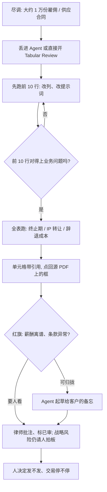

### 结论

[Latent Space](https://latent.space/p/building-ai-for-lawyers-jacob-lauritzen-cto-of-legora) 这篇不是再讲一遍「律所该上几个 Agent」。**Basil Chatha** 访谈的是 **Legora** 的 CTO **Jacob Lauritzen**：律师在真实项目里用它起草、改 **Word**、一次审几千上万份合同，并和客户、同事、别的 Agent 对活。产品从斯德哥尔摩地下室起步——当时就是 **ChatGPT**、瑞典法和一个搜索工具（公司原名 **Leya**）。今天律师可以把大约 **1 万** 份雇佣合同丢进 **Tabular Review**（表格式审阅：一行一份文件、一列一个问题），先看前 **10** 行对不对，再全表跑；单元格带引用，能点回源 **PDF** 上的框。他们自己做收购尽调也用这套：能自己找出红旗、踩过刹车，战略风险仍请外部律师拍板。Jacob 估计模型已经能把大约 **60%** 的法律活做好；剩下的是费用、延迟，以及跨百万 token 合同的复杂分析和改稿。上线不到 **18** 个月，今年 4 月 **ARR**（年度经常性收入）过 **1 亿美元**，客户超过 **1800** 家。

### 要点

- **先换掉翻合同、改 Word、对活这几件挤时间的事，不是换掉律师。** Jacob 说产品做两件事：把活做完，以及把活编排起来。Agent 会检索先例、起草、改 Word、整理文件、跑复杂分析。律所和公司法务还用 **Word / Outlook 插件**、**intake**（Slack 里丢来的请求变成工单）和 **lists**（类似 Notion 数据库，改一行可以叫醒 Agent）。客户见到的是律师把服务做快、做细；律师不该自己判断这份合同是 Sonnet-high 还是 Opus-mid。

- **一万份合同先审 10 行，再全表跑；红旗和备忘仍要人看。** 尽调时把雇佣、供应等合同丢进去：列可以是终止期、有没有 IP 转让条款、辞退要付多少。表最多大约 **100 万** 格。只丢给 Agent 说「做尽调」，它会自己拉起一张表、跑完、标红旗（比如 CEO 薪酬离谱、奖金结构奇怪），再起草给客户的备忘。律师可以批注、标已审。验收不是「模型会读合同」，而是前 10 行提示词改对了、全表对得上、人能点进源文件核对。

- **起草必须能点回出处，空话稿不能交差。** 法律稿最怕编造条款或假判例。Legora 给 Agent 写下的每句话加引用，点开会在源 PDF 上框出位置；如果结论来自表格式审阅，还能点回那一格，再往下追到原文。一次模型更新把引用从大约 **70%** 做到大约 **99%**。起草上，Jacob 觉得 **Fable**、**Opus** 太啰嗦，**Astra** 更短。百万 token 级合同的跨全文改定义、改顺序，今天仍吃力，他们按模型能力在整篇塞进去和分段改之间换脚手架。

- **计时收费挡不住这套用法，钱转到并购、诉讼和见客户。** Jacob 当年看 YC 申请时的担心是：律师按小时收费，做得快等于少赚钱。美国这边已经变了：小额审阅在改成项目一口价，有的律所为留客户直接免。钱留在并购、诉讼和陪客户的时间。他自己带的法务也用 intake 和表格式审阅做收购尽调（瑞典的 **Qura** 更简单；加拿大、澳大利亚还要人看薪酬结构）。找到红旗会停；战略怎么搭、要不要踩刹车，仍找律师当对手盘。初级律师没有消失：好的初级像好的工程师，能做完的活比两年前多，更值钱。

- **客户文件看不了，也不能假装「上了 Agent」就完事。** 上传的几乎都是机密，很多属于律所的客户，不是律所自己的。团队不能读生产轨迹，只能用模拟的 **1 万** 份文件资料室做评测，并按业务线和任务画热力图。大约 **100** 名法律工程师（多为大型律所干过三四年、常有计算机背景）帮着对评测和教客户。基础设施走 **Azure**，因为起步时律所已经批过微软 365，不批 AWS / GCP。这些是能让律师天天用的条件，不是当天主话题。

### 怎么做

面向已经在用模型读合同、改稿或做尽调，但对外交付和风险判断还不能放手的 junior：不必复制 Legora 或律师这个行业，按同一组顺序挡一遍。

1. **先写清谁对客户负责、哪类活在挤专家时间。** 检索先例、改 Word、从几千份合同里抽同一组问题、把 Slack 里的请求收成工单。再写一句对方能听懂的分工：抽取和初稿可以自动，红旗、风险偏好和给客户的结论必须人点头。这是应用问题，不是再换一个更会写条款的模型。

2. **大批量审阅先跑一小批，再全量。** 做成「一行一份文件、一列一个问题」。先看大约 10 行：列问的是不是业务要的、抽出来的像不像、引用能不能点回去。提示词不对就先改，不要一上来对一万份跑完再返工。

3. **每句初稿强制带出处，空话稿默认未核。** 点开应落到源页上的框；从表里来的结论要能点回那一格。Fable / Opus 这类偏长的稿，先压短再给人看。混在一起，后面的人会按假条款做决策。

4. **把请求、列表和 Agent 接成同一条工作流，不要另开空白聊天。** Slack 或邮件进来变成工单；人在自己的工具里分派、改、标完成，再回给对方。Agent 可以建列表，列表变更可以再叫醒 Agent。律师（或你们的业务岗）继续待在自己熟悉的 Word / 邮箱里。

5. **用一件真的尽调或收购验收，不要只看「模型会读合同」。** 「一万份雇佣合同，抽出终止期和 IP 转让，标出离谱薪酬」这类话，应变成：前 10 行改对、全表跑完、红旗能点回原文、人决定要不要写给客户的备忘。自家交易也适用：常规抽取自己做，战略结构仍请专业人士看。

6. **人还是拍板的人。** 模型归拢、抽取、起草。这笔交易的风险能不能接受、备忘能不能发出去，仍由律师或负责人决定。计时收费的常规审阅会变便宜或免；省下的时间应回到判断和客户，而不是假装初级岗可以取消。

### 关键图表

*Latent Space 访谈里的用法：律师把大批合同收成表格式审阅，先改前 10 行再全跑；引用必须点回原文，尽调红旗和给客户的结论仍要人在环里*
