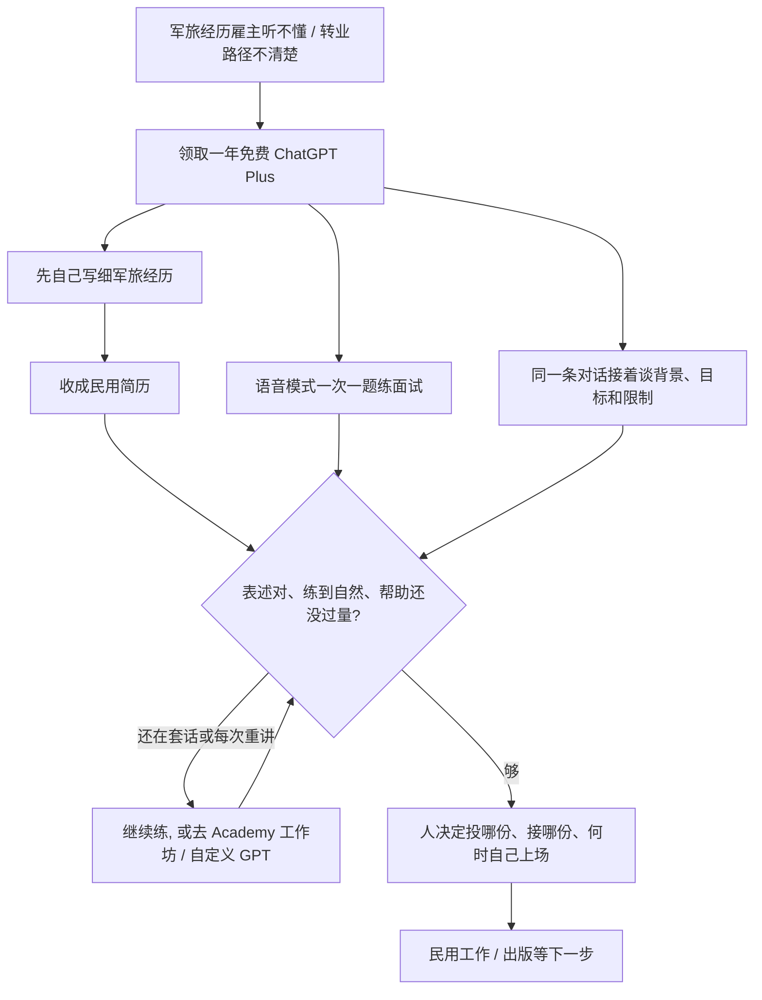

### 结论

[OpenAI](https://openai.com/index/chatgpt-plus-for-veterans) 这篇不是再发一遍「退伍军人节送会员」。写的是过去一年里，逾 **2 万** 名正在转业的服役人员和退伍军人已经领取了一年免费的 **ChatGPT Plus**，用来准备民用工作、想清楚自己和家人下一步做什么。这件事从 OpenAI 内部的退伍军人同事起头：他们每天用这些工具，也知道转业有多难。账号之外，**OpenAI Academy** 和社区伙伴已经办了十多场培训，覆盖近 **1000** 名军人社区成员，年底前还有 **7** 场。马上能对上号的活有三件：把多年军旅经历改成雇主听得懂的简历、用语音模式逐题练面试、在同一条对话里接着谈背景、目标和限制，而不是每次重讲一遍。

### 要点

- **先拆掉「军旅经历雇主听不懂」这层，不是再换一个更会写求职信的模型。** 离开军队，往往意味着走进不熟悉的就业市场，还要把多年服役翻译成民用岗位。原文写很多人用 ChatGPT 做三件事：把求职安排清楚、排练面试、看看自己没想过的路。人还是决定投哪份、接哪份、什么时候够了可以自己上场的人。

- **同一条对话要接着谈，不要每场面试都从头解释自己是谁。** 空军退伍军人 **Tilak Bhatnagar** 用这一年免费额度准备了十几场面试，找合适的词向民用雇主讲军旅经历，并权衡互相竞争的聘用意向。这些对话也帮他弄清退伍后到底想过什么样的生活。他最后去了一家科技公司。自己最看重的是能从上次停下的地方继续：同一条线索里谈背景、目标和限制。他的原话是：每次对话都建立在上一次之上。

- **面试可以对着语音模式逐题练到自然，也要知道什么时候该停、信自己的判断。** 同为空军退伍的 **Sadarian Bell** 在离开部队一年多以前就开始规划。他用 ChatGPT 画出转业路径，把近十年军队医疗经历写成民用简历。准备面试时，他打开语音模式（对着模型说、听它回），一次只练一题，直到回答听起来自然。他说这已经真正成了自己的职业教练；他也学会识别「帮助已经够了」，可以信任自己的判断。

- **转业不一定是找下一份工，同一套工具也能补上出版流程里的空白。** 海军退伍军人 **Kelli Ramirez** 把转业当成去追做了很久的梦：成为出版作者。她已经上过写书课，ChatGPT 补上缺口：整理想法、问出版相关的问题、走通 **Amazon Kindle Direct Publishing**（亚马逊让作者自己上架电子书的流程）。她后来出版了两本书，写的是希望帮助女性更有信心地接近技术，并（对同有基督信仰的读者）把智慧落在信仰上。

- **只发免费账号不够，要有人一起学、先自己写经历、再做成可复用的助手。** 不是每个人一来就敢用 AI。Academy 给退伍军人、正在转业的服役人员和军人配偶一个能一起学的地方。OpenAI 刚和 **Veterans Forge** 做完第一轮六场系列，再加上与 **AI Collective Hampton Roads**、**NPower** 的工作坊，用来决定下一步给退伍军人什么。弗吉尼亚 **Reston** 一场有近 **100** 名退伍军人和现役军人；参加者 **Ryan Kaono-Wedemeyer** 学到的做法是：先自己把军旅经历写细，再请 AI 收成民用简历。讲师 **Erin Marie** 带着大家做 **自定义 GPT**（针对一类活固定好指令的对话助手）来撑转业，并看到进门时还半信半疑的人开始找到真能帮上忙的用法。肯塔基 **Louisville** 的美国退伍军人协会全国大会上，逾 **80** 名会员参加了三场 AI 培训。去不了现场的，可以用网上的退伍军人合集和「100 条给退伍军人的对话」自己试。身份核验和领取免费年，原文写感谢 **ID.me** 帮忙。

### 怎么做

面向要把一段外人听不懂的专业经历翻译给下一份工作听、却还在每次重讲自己是谁的 junior：不必复制 ChatGPT Plus 或退伍军人这个名字，按同一组顺序挡一遍。

1. **先写清哪一句对方听不懂。** 「军旅职称对不上民用岗位」「医疗经历写进简历像内部手册」「面试一紧张就回到部队里的说法」。写成对方能听懂的一句话：起草和排练可以自动，投递、接受聘用和对外署名必须人点头。这是应用问题，不是再换一个更会写求职信的模型。

2. **先自己写细经历，再让模型收成给外人看的稿。** Reston 工作坊里的做法是：先写一份详细的军旅（或你自己的领域）经历，再请 AI 帮着收成民用简历。不要一上来丢一个军衔缩写，让模型猜你干过什么。

3. **背景、目标和限制放在同一条对话里接着谈，不要每场面试新开一窗。** Bhatnagar 准备十几场面试、权衡多份意向，靠的是还能回到同一条线索。换工作、换城市、家里有什么限制，都应写进这条对话，而不是每次重贴简历。

4. **面试用语音模式一次只练一题，练到自然再上场。** Bell 不是让模型代答，而是自己说出来、听到别扭再改。一次一题，比一次丢一整份题库更接近真场。

5. **帮助够了就停，人还是决定接哪份、出哪本书的人。** Bell 明确写了：要识别何时已经够了，并信任自己的判断。模型可以建议用词、画出路径、走一遍 Kindle 上架步骤；哪份聘用能接、哪段经历能写进对外稿、书能不能署自己的名，仍由负责人看过再定。

6. **账号之外要有一起练的场和可复用的助手。** 工作坊、自定义 GPT、网上的对话示例，是近 1000 人一起学过的原因。只发一年 Plus、没有人示范「先写经历再收简历」，多数人不会自己摸到 Tilak、Sadarian、Kelli 那种用法。领取入口若需要核验身份，按官方和 ID.me 的路径走，不要把验证材料贴进聊天。

### 关键图表

*OpenAI 原文的用法：退伍军人用免费一年 Plus 写民用简历、练面试、规划转业；账号之外还有 Academy 培训和自定义 GPT。人还是决定接哪份工作、帮助何时够了的人*
