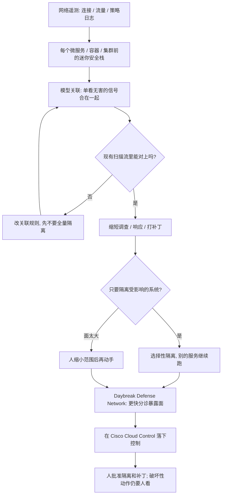

### 结论

[OpenAI](https://openai.com/index/cisco-cyber) 这篇不是再讲一遍「安全该上几个模型」。写的是 **Cisco** 已经怎么把自家网络上的遥测（telemetry：链路上持续采到的连接、流量和策略日志）接到 OpenAI 的模型上，让防守方按机器速度做关联、调查和补丁。总裁兼首席产品官 **Jeetu Patel** 的判断很硬：攻击方已经用 AI 批量自动化攻击、按机器速度写利用；防守如果还靠人一条条翻告警，就会一直慢半拍。「AI 把速度和规模交给了攻击方。用 AI 做防御，是继续安全的前提。」他们能放心把前沿模型接到关键系统上，是因为企业侧按零数据留存、客户数据边界和可验证隔离来接——敏感遥测不会拿去当训练料。验收不是「我们上了安全大模型」，而是调查、响应、补丁变短，现有扫描流不用推倒重来。

### 要点

- **先解决的是攻击已经按机器速度扩，调查和打补丁还在等人，不是再换一个更会写事故说明的模型。** Cisco 做的是组织和客户赖以连网、防护的基础设施。Patel 说防守必须从「一个大门口」换成控点铺到微服务、容器和集群前面：「我们可以在每个微服务、每个 Kubernetes 容器、每个 Kubernetes 集群前面放一套迷你安全栈，把安全焊进网络本身。」应用层只放行这个服务真正需要的连接，攻击能横向挪的路就少了；出事时也可以只隔离受影响的系统，别的服务继续跑，人接着查。

- **单看无害的两条信号，合在一起才是模式；关联要在网络尺度上做。** Patel 的原话是：两条信号单独看都像正常，合在一起才能露出有意义的模式。网络情报用来跨网关联、抽出能指导安全运营的判断。模型在这里干的是把 Cisco 已经采到的遥测收成可行动的线索，不是另开一个聊天窗让分析师自己粘日志。

- **调查、响应、补丁要塞进现有扫描流，不要另起一套值班台。** 防守方最紧的缺口，是攻击利用漏洞的速度，和组织打上补丁的时间差。Patel 把 **Daybreak**（OpenAI 面向行业客户的合作项目，把前沿模型和对方的领域知识接在一起）和 **GPT-6 Astra** 写成台阶式的改进：自己和客户的安全态势都受益，因为能更高效地找洞、打补丁，并缩短调查、响应和修复所需的时间。落地路径是接进团队已经在用的扫描工作流，「不必从根本上改团队怎么干活」。

- **Agent 越自己跑，越要分清「被人搅了」和「目标合法但走歪了」。** 安全遥测和可观测数据要一起看：既看威胁，也看 Agent 实际在干什么。Patel 列了三件优先事项：保护 Agent 不被恶意攻击、发现并拦住非预期行为、近实时运转。策略和控点要跟着 Agent 的动作改，而不是只守一条固定边界。

- **暴露分诊要落到 Cisco Cloud Control，不要停在一份建议备忘。** Cisco 和 OpenAI 在 **Daybreak Defense Network** 里探索的是：帮安全团队更快分诊暴露面，并在 **Cisco Cloud Control** 里落下该有的控制。Patel 的收束是：OpenAI 让防守方能按机器速度和规模运转，优势才可能回到防守这边。

### 怎么做

面向已经在跑漏洞扫描、看网络告警，或开始让 Agent 碰生产系统的 junior：不必复制 Cisco 或 Daybreak 这个名字，按同一组顺序挡一遍。

1. **先写清谁在值班、哪类活在挤分析师时间。** 跨网关联两条单独看都像正常的信号、缩小该隔离的范围、在现有扫描结果上决定先打哪几个补丁。写成对方能听懂的一句话：关联和初判可以自动，隔离范围和破坏性处置必须人点头。这是应用问题，不是再换一个更会写威胁情报的模型。

2. **控点放到每个服务前面，不要只守一个大门。** 每个微服务、容器或集群只放行它真正需要的连接。出事时先问：能不能只隔离受影响的那一块，让别的服务继续跑。这是后面模型关联能对上的现场，不是架构口号。

3. **把模型和已经在采的遥测接上，不要另开空白聊天。** 分析师应看到「这两条信号合在一起像什么、建议查哪一段」，而不是自己把日志贴进对话框。单条无害、合在一起有模式——这句要能在你们的告警里复述出来。

4. **调查和补丁接进现有扫描流，不要另做一张值班台。** 团队已经在用的扫描、工单、补丁窗口继续当主路径。模型负责更快找洞、起草调查和修复建议；人继续按原窗口批准。Patel 的验收是时间变短，不是流程换皮。

5. **给 Agent 单独写三件事：防攻击、拦误操作、近实时看得到。** 安全日志和可观测数据放在一起看。要分清「被人搅了」和「目标合法但走歪了」。拦下来的动作要能在近实时里生效，不能等第二天早会。

6. **用一次真的漏洞或暴露面验收，不要只看「模型会读告警」。** 「两条单独看都像正常的信号被关联出来、受影响服务被选择性隔离、补丁建议回到现有扫描工单、暴露面在 Cloud Control 这类控制面落下」应变成：人能核对出处、批准隔离范围、并决定补丁先打哪几个。破坏性动作仍由人放行。

### 关键图表

*OpenAI 原文的用法：Cisco 把网络遥测接上模型做关联，控点铺到每个服务前面；调查和补丁走现有扫描流，暴露分诊要落到 Cloud Control，人还是拍板的人*
