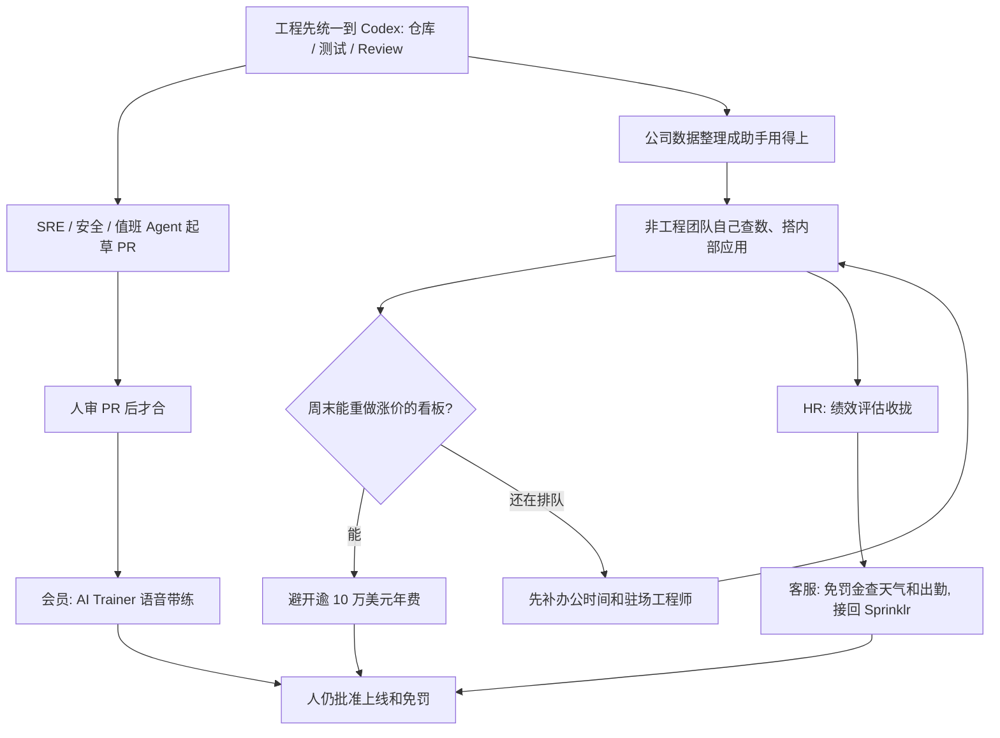

### 结论

[OpenAI](https://openai.com/index/cultfit-builds-with-codex) 这篇不是再讲一遍「全员该开编程 Agent」。写的是印度科技健身公司 **cult.fit** 已经怎么把 **Codex** 先在工程侧收成同一套开发习惯，再交给运营、HR、客服自己查数、搭工具。CTO **Santhosh Kumar** 要问的是三句：运营能不能按 AI-first 来跑、能给会员什么新体验、组织自己怎么转。公司有 **708** 家健身中心、覆盖 **77** 座城市、近 **100** 万付费会员。验收写在原文开头：近几个月非工程团队做出 **20+** 个内部应用；看板软件涨价后，一名工程师周末用 Codex 重做，避开逾 **10 万美元** 年费；客服成本降 **50%+**。

### 要点

- **先拆掉「小事也要排队等工程或分析师」这层，不是再换一个更会写代码的模型。** 公司长大以后，运营和产品上的问题越来越多，他们不想再叠流程。Kumar 的原话是想把运营改成 AI-first，并问能给会员什么新体验。Codex 先成为工程的共同平台，再让各职能自己分析数据、把想法做成能上线的工具。和 Codex 并行，他们还用 OpenAI API 做更个性化的会员体验，包括 **AI Trainer**（给会员带练的产品）。

- **工程先统一到一套 Codex，SRE 和安全 Agent 才能接到现有值班，而不是每人一套助手。** 标准化之前，开发者混用多种编程 Agent，仓库结构、Agent 说明、技能和开发流程对不齐，知识很难复用。选定 Codex 之后，仓库、技能、测试、Code Review 和反馈按同一套约定走。接着才延伸到更专的活：**SRE**（网站可靠性工程：盯线上稳不稳）Agent 汇总可观测数据和日志、查事故，很多时候直接开出带修复建议的 **PR**（拉取请求：给同事审的改动）等人看；安全 Agent 找漏洞；值班 Agent 查反复出现的生产问题。他们还在往「规格驱动」走：一份规格带着活走完开发生命周期，最后仍是工程师审 PR。最近一个例子是 App 里的社交动态：Kumar 估计以前要一年以上，新流程端到端两个月就上线。

- **数据和分析师不再当关卡，非工程团队才能自己把流程做成应用。** cult.fit 把公司数据整理成 Codex 用得上的样子，小查询不必再排队等中央分析师。Kumar 说这是走向数据民主化最大的一步。HR 用 Codex 搭了绩效评估流程：排期、收反馈、把信息收拢。近几个月非工程团队做出 20+ 个内部应用。内部看板软件大幅涨价时，一名工程师周末用 Codex 重做，现在跑在自己的应用上，避开逾 10 万美元年费。

- **只开账号不够，要有黑客松、管理层一天上手、办公时间和驻场工程师。** 公司先办大型黑客松，让人看见能做什么；再把管理团队拉到一天的会里，让各职能领导用 Codex 做和自己工作相关的东西。工程每周两次办公时间，帮员工把想法推到生产；部分职能还驻场工程师，补技术和业务两边的缺口。Kumar 的收束是：软件被民主化了，人能围绕自己团队真正需要的东西搭应用。

- **会员侧和客服侧也要接到现有产品里，不要另开一个聊天窗。** 超过 **45%** 的会员是第一次进健身房，引导很关键。几年前就做了 AI Trainer，给没有私人教练的会员带个性化训练；大约 **20%** 的到店用户在用。新一版做成语音优先，用 **GPT Realtime**（能双向实时说话的接口）通过 OpenAI API 给口令、帮记训练。客服上，缺席团课要不要免罚金，以前要人逐单看；现在 Agent 查当地天气和该课出勤，再判断该不该免，接到已有的 **Sprinklr** 客服平台和后台。下一目标写成两句：运营侧是「自动驾驶的运营组织」，会员侧是「口袋里的教练」。

### 怎么做

面向已经有编程助手、但分析和内部工具还在排队等工程的 junior：不必复制 Codex 或 cult.fit 这个名字，按同一组顺序挡一遍。

1. **先写清谁在排队、哪类活在堵。** 小数据查询要等中央分析师、HR 收绩效反馈要拼表格、看板涨价却没人重做、缺席团课的免罚要客服逐单看。写成对方能听懂的一句话：起草和初判可以自动，合并、免罚和破坏性改动必须人点头。这是应用问题，不是再换一个更会写内部工具的模型。

2. **工程先收成一套约定，再谈全员都能搭。** 仓库结构、Agent 说明、测试和 Review 对不齐，后面的 SRE 和安全 Agent 对不上同一套 PR。cult.fit 是先选定 Codex，再把开发生命周期围着这一套建。

3. **值班和安全接进现有事故流，人还是审 PR 的人。** SRE Agent 可以汇总日志、起草修复；安全 Agent 可以标漏洞。验收是「事故单里出现带建议的 PR」，不是另开一张 AI 值班表。人核对后再合。

4. **把公司数据整理成助手用得上的样子，让非工程团队先做自己的分析。** 小查询不应再排队。HR 那种「排期、收反馈、收拢」应能变成他们自己维护的流程，而不是提给工程排期。

5. **用一次真的成本或工期验收，不要只看「我们开了 Codex」。** 「看板涨价 → 周末重做成自己的应用、避开年费」「社交动态从一年以上变成两个月上线」「免罚金查天气和出勤后回到 Sprinklr」应变成：人能核对出处、批准上线、并决定哪笔钱可以停付。

6. **办公时间和管理层上手要跟上，不要只发账号。** 黑客松让人看见能做什么；各职能领导自己做一件相关的事；工程每周有固定时间把想法推到生产。没有这层，20+ 个非工程应用不会自己长出来。

### 关键图表

*OpenAI 原文的用法：先把工程收成一套 Codex，再让各职能自己搭工具；看板年费、社交动态工期和客服免罚，验收看省下的钱和时间，人还是放行的人*
