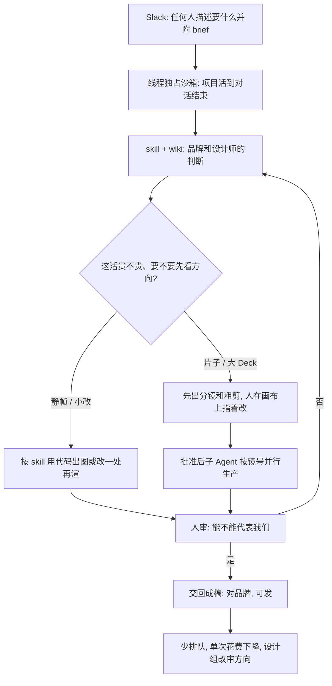

### 结论

[LangChain](https://www.langchain.com/blog/design-agent) 这篇不是再讲一遍「模型会不会设计」。**Amal Irgashev** 和 **Shreya Talegaonkar** 写的是自家 **GTM Engineering**（把获客、内容和活动做成可跑流水线的工程组）怎么和设计组一起，把重复出片、出图、出 PPT 从「排队等设计」改成 Slack 里一句话就能拿到成稿。产品叫 **Content Studio**：人在线程里说要什么、附上 brief，Agent 交回带品牌的成片、社媒图、复刻界面和幻灯片，而且每件物料都用代码写出来，改一处时间轴不必整段重做。四个多月后，全公司已经交出 **3000** 多件资产（含 **80** 多份幻灯片），X 上带这些图的帖大约 **450 万** 次浏览；自家账号上，带它视觉的帖大约 **2 倍** 赞、**3.7 倍** 收藏。中位一次请求的模型花费从今年 9 月中的大约 **8 美元** 降到大约 **50 美分**。四分之三请求来自市场部以外，**75%** 用户每周会再来。设计组从「每张图自己画」挪到定方向和审稿，PM、工程师、创始人也能出能发的品牌物料。

### 要点

- **先解决的是设计组被挤满，不是「再做一个更会画的模型」。** LangChain 产品发布、研讨会、博客和活动不断，每场都要头图、示意图、Deck、视频和广告。设计组被重复需求占满，战略活被挤掉。他们要的是：任何人都能低摩擦地做出高质量、对品牌的成品。Content Studio 就住在 Slack 里，不另开一个设计站。搭它要三件套：设计师的判断写成 Agent 的 **skill**（按工种写的说明书）和检查；模型外面一套能剪视频、出图、看自己渲染结果的环境；以及整队能在一条跑几小时的线程里一起改方向的界面。底层用 **Managed Deep Agents**（LangChain 托管的长任务 Agent 运行时）：沙箱、Slack、工具、作用域记忆和定时跑都已经有了，小组把时间花在品味、工具和 Slack 体验上，而不是再写一遍水管。

- **模型会执行，但没有你们的品味就会长成「谁都见过」的 AI 俗套。** 模型本来就会写 HTML/CSS、图表规格和动画时间轴，缺的是公司上下文，于是去抓见得最多的样子——Anthropic 叫 **distributional convergence**（往训练分布里最常见的样子靠）。Stripe 设计负责人 **Katie Dill** 把软件里这种空心现代风叫 **zombie UI**：看起来干净，但没有立场。只给本地编码 Agent 一份品牌 skill（颜色、字体、Logo），仍可能锁版不对、对齐错、主色次色反了；同一句提示在 Content Studio 里能出对品牌的图，因为它把 brief 没写死的空填成「我们的选择」，不是「网上最多的选择」。他们加上的是：每帧一个焦点、挡住常见 AI 设计套路，以及每条反馈背后的理由。能自动量的（比如默认大小写）写成代码门禁；「这个 campaign 够不够硬」这类主观判断，设计师拍板后把推理收进 skill，下次草稿就能用。

- **给 Agent 一台设计师的电脑，物料用代码写，改一处不必整段重渲。** 每个 Slack 线程独占一台 **LangSmith Sandbox**（隔离的 Linux 机，有文件系统和 shell），项目在线程生命周期里一直活着。brief、计划、分镜代码、音频和渲染都在同一个项目文件夹，子 Agent 共用。静帧用网页、图表用数据规格、片子用动画时间轴——有人说「鹦鹉再早两秒出场」，改一个时间值再渲即可。剪辑走 **HyperFrames**（HeyGen 开源的视频框架，把片子当网页改，GSAP 时间轴驱动）；原创动画走自研 **motion-studio**（按像素画每一帧，最多把 16 个瞬间混进一帧，做出快门那种运动模糊）。两条引擎都按时间戳渲帧，Agent 可以只抽查某一秒，不必整片重跑。没有这套环境，品味写得再好也只是「会说话的提示词」。

- **补偿模型弱点的硬规则会过期；能留下来的是环境和品味。** 第一版 harness（套在模型外面的工作环境）替模型做了太多设计决定：115 个可复用标题、版式、动画组件，品牌稳住了，但每帧都在重复同一套动作。他们一边加规则一边试着删规则。**Opus 5.5** 到了之后质量跳了一截，于是删掉大部分硬编码，只留设计原则和高层指导，多样性和创意决定反而回来了。作者把它写成自己的 Bitter Lesson：补短板的规则会随模型变强而失效；该投资的是工具、上下文和人怎么中途改方向。技能侧现在大约 **48** 个 skill、近 **1000** 个文件，按工种而不是按主题切；**wiki** 放品牌、语气和大约 **70** 部参考片，skill 只链过去，改字体规则改一处即可。

- **长任务要多人能中途改，而且先在便宜的分镜上拍板。** 一张分镜大约 **50 毫秒** 渲完，成品片子一秒要 **8–40 秒**。所以先在分镜上试方向，批准后再进 **animatic**（贴上音频的粗剪，用来看节奏），最后才让子 Agent 按镜号生产。这条顺序后来写进代码，避免 Agent 为了省事跳过评审。Slack 线程是线性文字，分镜是空间的，于是他们用 **Paper** 画布让人指着某一帧留言，而不是把「左上角再偏一点」写成又一条提示。主 Agent 改成「参谋长」：异步派活、汇报进度、任何人都能在跑的过程中插一嘴。一次过夜重做 **52** 页 PPT：先出三页样张自审，再按批请人批；主 Agent 大约跑了 **1 小时**，子 Agent 合计超过 **6 小时**，对话没有被堵住。记忆分快慢两环：当场把人口头规则存成文件；做完一个活再抽最多五条有证据的教训挂到对应 skill。早期 `AGENTS.md` 胀到 **50 万** token，现在限制成 **200** 行索引。

### 怎么做

面向设计组已经被重复出图占满、或已经让编码 Agent「按品牌出一张图」却总出 AI 俗套的 junior：不必复制 Content Studio 或 parrot 片子这个名字，按同一组顺序挡一遍。

1. **先写清谁在排队、哪类活在挤战略设计。** 头图、Deck、活动短片、社媒图——列出来，并写清「谁都能在聊天里要、设计组只审方向」。这是应用问题，不是再换一个会画的模型。

2. **把设计师的判断收进 skill 和检查，不要只丢一份色板。** 色票、字体、间距是底。再加上：每帧一个焦点、禁止哪些 AI 套路、每条反馈为什么这样改。能量化的写成代码门禁；主观判断记下推理，给下一次草稿用。

3. **给每个请求一台能留下项目的电脑，物料用代码出。** 线程级沙箱、共享项目文件夹、能抽查某一帧的渲染。改文案或时间轴时只改对应代码再渲，不要从一张扁图或整段生成视频上重做。

4. **贵的片子先在分镜上拍板，顺序用代码卡住。** 分镜（想法和镜头）→ 带音频的粗剪（节奏）→ 批准后再生产。Agent 想跳过评审时，流水线应拒绝组装。

5. **模型变强就删补偿规则，只留原则和环境。** 组件库和「必须用这套动画」这类补短板规则，定期拿新模型试一次：还在挡俗套的留下，在限制多样性的删掉。

6. **长任务的 Slack 线程要能看到计划、进度和花费，发出去之前必须有人点头。** 子任务异步跑，主线程给人插话。个人偏好可以跨线程记住，公司频道仍走公司语气。人仍对「这张图能不能代表我们」负责。

### 关键图表

*LangChain 原文的用法：重复物料从「等设计」改成 Slack 里出成稿；品味写进 skill，贵活先在分镜上拍板，发出去仍要人点头*
