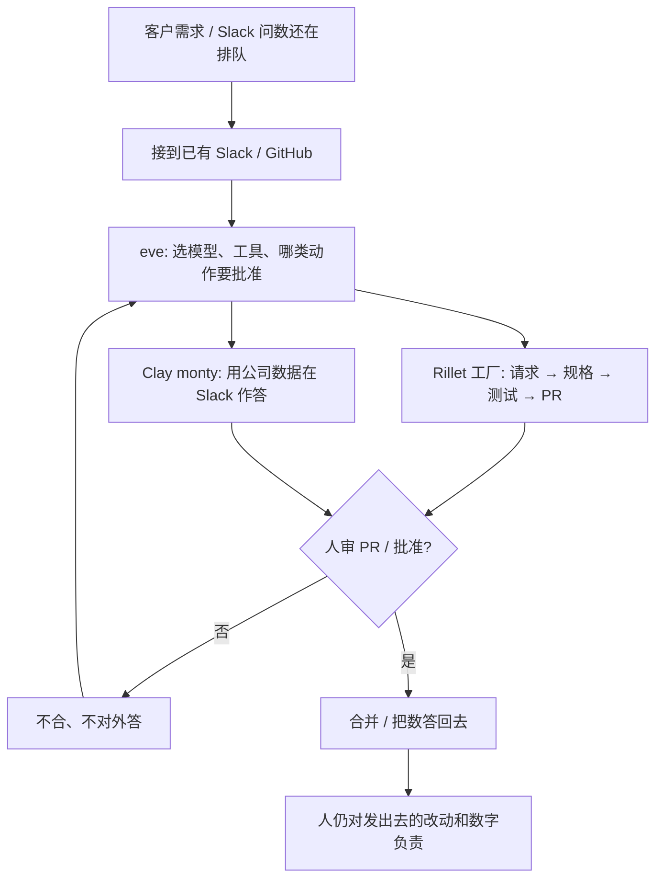

### 结论

[Vercel](https://vercel.com/blog/eve-is-now-generally-available) 这篇不是再发一遍「该上一个 Agent 框架」。**Andrew Barba**、**Shar Dara**、**Casey Gowrie** 等人写的是已经有人怎么处理两件真活：客户需求变成可审的改动，还要人一条条写；同事在 Slack 问数，还要排队等懂数据的人。开源框架 **eve** 在 6 月公开预览之后发了 **230+** 次、合并了数千个 **PR**（拉取请求：给同事审的改动），现在 **1.0** 正式可用。验收写在原文里：**Rillet** 用 eve 搭软件工厂，收客户需求、写成规格、跑测试、开出等人审的 PR，三个月出货速度提到原来的 **3** 倍；**Clay** 做了 Slack 里的数据 Agent **monty**，刚过两个月，全公司每周有 **30%–40%** 的人在用。人还是决定哪条 PR 能合、哪次操作要批准的人。

### 要点

- **先拆掉「需求变 PR、问数还排队」这层，不是再换一个更会写代码的模型。** 原文把卡住的点写成三类能直接上生产的 Agent：把请求做成测过、可审改动的 **software factory**（软件工厂）；用公司数据回答问题的 **company brain**（公司大脑）；嵌进产品里给用户用的 Agent。已经有数千家企业在生产里跑 eve，做内部和面向客户的 Agent。人还是决定哪条能发出去的人。

- **Rillet 和 Clay 验收的是出货和每周有没有人在用，不要只看「框架开关能打开」。** Rillet 的工厂把客户请求收进来，转成规格，测改动，再开 PR 给人审；三个月出货速度提到 3 倍。Clay 的 monty 在 Slack 里答员工的数据问题；刚过两个月，每周有 30%–40% 的人在用。Lindy 的框架盘点把 eve 写成「最适合做可持久跑的后端 Agent」。

- **迁过去也要量代码量和账单，不要只听「我们换了 harness」。** **harness**（套件：调用模型、跑工具、派子 Agent 的那层循环）由你选模型、加减工具、改说明、决定哪类动作要批准。开源 **Workflow SDK** 会在 Agent 跑的时候存进度，崩溃后从上一件做完的步骤接着干。Evisions 的工程师 **Chris Fleissner** 写迁到 eve 之后马上有结果：砍掉 **2.5 万** 行代码，AI 成本砍一半，运行时间改善 **66%**。**Mitchell Hashimoto** 的原话是：用 eve 加 Vercel workflows 做自定义 Agent，不是上头摊派，是他们觉得最合适。

- **接到已经在用的 Slack、GitHub，不要另开一个只有 Agent 看得到的窗口。** 多人可以进同一场会话。原生 Slack 频道里，每条 **thread**（线程：把一次活的对话和结果钉在一起）就是一场共享会话；批准做成按钮，只有对的人能点；任务卡片现场显示进度和耗时。还可以开 **ambient mode**（旁听模式：在你指定的频道里听，不必每次 @）：按频道目标决定开口、帮忙、领任务还是闭嘴。为了限制模型花费，先用一个小决策模型筛每条消息，只有可能是给 Agent 的才开一轮。Slack 只是其中一个通道，旁边还有 Microsoft Teams、Discord、Telegram、GitHub、Linear、Twilio、网页聊天和 iMessage。

- **周转和长会话账单是 Vercel 自己压测出来的，不要把它当成 Rillet 的出货数字。** 9 月 1 日托管压测中位一轮 **3.036 秒**（p95 **3.692 秒**）；11 月 15 日 1.0.0 同一套 **100** 轮、一次一条、立刻返回的假模型、不调工具的负载，中位 **414 毫秒**（p95 **633 毫秒**）。一次 **50** 轮的 Evo Docs 会话，估算的 Vercel Workflows 费用从 **5.4 美分** 降到 **1.3 美分**，大约低 **76%**。这量的是套件和 Workflow 开销，不含模型真正生成的时间。合不合并、批不批准，仍要人点头。

### 怎么做

面向已经让 Agent 改仓库或在 Slack 里答数，却发现「客户需求还要人写成 PR」「问数还要排队等分析师」的 junior：不必复制 eve 或 Vercel 这个名字，按同一组顺序挡一遍。

1. **先写清卡在哪一步。** 「客户一提需求，规格、测试和 PR 还要人串」「Slack 里问数，懂数据的人排不上」。写成对方能听懂的一句话：起草、测试和初答可以自动，对外改仓库和发出去的数必须人点头。这是应用问题，不是再换一个更会写 Agent 的模型。

2. **先接到已经在用的 Slack 和 GitHub，不要从空白对话开始粘流程。** 原文入口是终端里 `npx eve@latest init`，或后台的 Agent 构建器，或直接用软件工厂 / 公司大脑这类模板。Rillet 那条线对应「请求 → 规格 → 测试 → 等人审的 PR」；Clay 那条线对应「Slack 里问公司数据」。通道各是一个文件，同一只 Agent 可以跨通道干活。

3. **把要人点头的动作写成批准，不要让 Agent 自己合 PR、自己对外答数。** 原文写安全控制让你决定哪类动作要批准、收集哪些数据。Rillet 的工厂开完 PR 仍等人审。Slack 里的批准做成只有对的人能点的按钮。

4. **崩溃要能从上一件做完的步骤接着干，不要一场会话断了就重来。** 用会存进度的工作流，而不是把状态只放在进程内存里。自托管也可以走同一套 Workflow SDK。托管的话，Vercel Workflows 负责可持久执行，Sandbox 隔离 Agent 生成的代码。

5. **用一件真的活验收，不要只看「init 能打开」。** 「三个月出货速度有没有到 3 倍」「Slack 数据 Agent 每周有没有 30%–40% 的人在用」「迁过去有没有少掉一批样板代码、账单和运行时间」。原文验收 Rillet 的是出货速度提到 3 倍；验收 Clay 的是刚过两个月的周活；验收 Evisions 的是 2.5 万行、成本砍半、运行时间改善 66%。套件自身的周转从 3.036 秒降到 414 毫秒、50 轮会话大约省 76% 工作流费用，是 Vercel 的压测，不要和出货数字混成一笔。

6. **人还是放行的人。** Agent 可以收需求、写规格、跑测试、开 PR、在 Slack 里答数。哪条能合、哪次批准能过、旁听模式开在哪个频道、eve 何时该闭嘴，仍由负责人看过再定。

### 关键图表

*Vercel 原文的用法：Rillet 用 eve 工厂三个月把出货速度提到 3 倍，Clay 的 monty 刚过两个月每周有 30%–40% 的人在用。人还是决定哪条能合的人*
