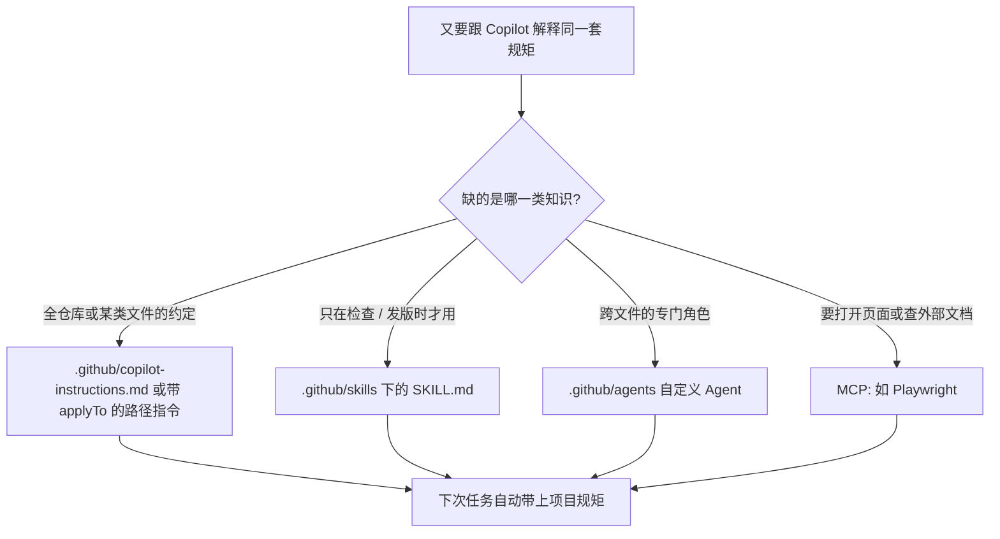

### 结论

GitHub 工程师 **Christopher Harrison** 在 Copilot app 入门系列里写的是一件很具体的活：每个仓库都有自己的规矩——组件怎么拆、跑哪条脚本、不同框架和文件类型怎么写。Copilot 能跨项目改代码，但你每次开新任务都把同一套标准再说一遍，时间就耗在解释上。他把这些知识写进仓库，让 Copilot **自己捡起来**：自定义指令管约定，Agent 技能包装复用流程，自定义 Agent 扛跨文件的大任务，**MCP**（Model Context Protocol，模型上下文协议：把外部工具和数据接到 Agent 上的标准接口）再接 Playwright 这类浏览器工具。

### 要点

- **先写全仓库都适用的规矩，再按路径补特例。** 加页面尺寸这种改动，代码能跑只是一半；还得跟上团队已有的架构、命名和测试习惯。全仓库基线放在 `.github/copilot-instructions.md`；只对某类文件生效的规则放进 `.github/instructions`，用 `applyTo` 标明何时启用。匹配到文件时，Copilot 可以同时用两层，不必把所有文件类型塞进同一套模具。

- **反复走的流程做成技能，不要写进每次都加载的总规矩。** 质量检查、发版、排失败工作流，只在那一步才需要。技能是一个文件夹：说明、可选脚本和其他材料。项目级技能放在 `.github/skills`，每个技能一个子目录。例如 `.github/skills/quality-checks/SKILL.md` 写清何时用、跑哪些测试和 lint、各检查什么、常见失败怎么排。`description` 帮 Copilot 判断该不该加载；改完界面后，它按项目既定流程测，而不是猜命令。

- **跨很多文件、需要专门视角的活，再开自定义 Agent。** 无障碍审查可能要同时看组件、模板、样式和交互。仓库级 Agent 配置放在 `.github/agents`，写明职责、指令、工具和相关上下文。适合「这类活经常出现，值得一个固定角色」，而不是一次性的小改动。

- **仓库内的知识不够时，用 MCP 接外部工具。** 指令、技能、Agent 解决「怎么在这个项目里干活」；MCP 扩大它能碰到的东西。文档服务器可提供框架指南；Playwright 能打开应用、像人一样点页面。配好后可以直接说：用 Playwright MCP 手动测功能。这样 Copilot 不但看自动化是否通过，还能核对改完的界面是不是真的能用。

### 怎么做

面向已经能打开 GitHub Copilot app 的 junior：不必一次上齐四样，先停掉「每次口头解释」。

1. **写下你反复解释的那条约定。** 架构、命名、测试要求，放进 `.github/copilot-instructions.md`。只对某类文件成立的，再加带 `applyTo` 的路径指令。下一件任务看 Copilot 有没有按这个写。

2. **把多步骤流程收进技能。** 测试、lint、发版各做一个 `.github/skills/<名字>/SKILL.md`：何时用、跑哪条脚本、失败怎么排。描述写具体，Copilot 才知道该不该加载。

3. **只给反复出现的大任务做自定义 Agent。** 无障碍、安全审查这类跨文件活，在 `.github/agents` 写清角色和工具。一次性小改动不必再开一个 Agent。

4. **需要打开页面或查外部文档时，再接 MCP。** 在 Copilot app 里浏览现成服务器，或加自定义的。接上 Playwright 后，明确说让它打开应用、点一遍关键路径。

5. **从最小的一条开始，或先改编社区成品。** 不确定从哪下手时，到 [Awesome Copilot](https://github.com/github/awesome-copilot) 找接近的指令、技能或 Agent，按本仓库的脚本和标准改。Harrison 带走的四个问题：哪条约定我总在解释？哪段流程我反复走？哪件复杂活值得一个专用 Agent？Copilot 还缺哪样外部工具？

### 关键图表

*GitHub 原文的用法：先把口头规矩写进仓库，再按「约定 / 流程 / 角色 / 外部工具」选落点；从一条约定开始即可*
