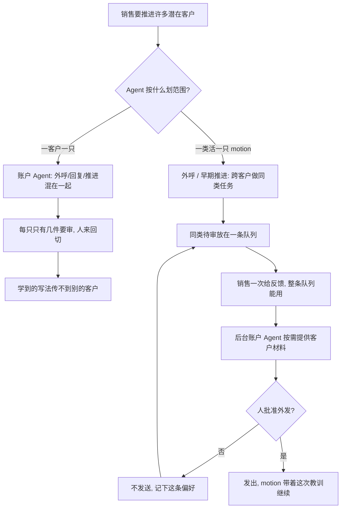

### 结论

[LangChain](https://www.langchain.com/blog/goal-engineering) 这篇不是再讲一遍「给 Agent 写一个更大的目标」。**Harrison Chase** 和 Actively AI 的 **Mihir Garimella**、**Anshul Gupta** 写的是销售团队已经怎么给 Agent 划活。**Actively AI** 给销售做 Agent：第一版按 **account**（一个潜在客户）拆，每个账户一只 Agent，目标是把这个客户往前推，动作交给销售批准。听起来范围窄、结果清楚。用下来销售很难高效用、也很难给反馈——同一时刻每只 Agent 只有几件要审的，人在 Agent 之间切来切去；外呼、回复、怎么进攻这些做法学到一次，却不好传到别的客户那只 Agent。第二版改成 **motion**（一类要反复做的活，比如外呼或早期推进）：同一类任务跨很多客户做。销售把同类活放在一起审，脑子里没写下来的偏好一次能传开。账户事实另有 Agent 在后台收集。人还是批准外发的人。

### 要点

- **先拆掉「按客户拆 Agent，销售审不动、学到的做法传不走」这层，不是再换一个更会写开发信的模型。** 第一版直觉合理：目标受约束，账户上下文好像最重要。真正卡住的是另一类上下文：怎么外呼、怎么回复、怎么谈、进攻到什么程度、在大公司里怎么找人。这些很少写在 CRM 里，而且在多个账户上是同一套。人还是决定哪封能发出去的人。

- **没写下来的上下文，只能在人审的时候喂给 Agent。** 文档和 API 相对好补。难的是销售自己的口味、品牌能多出格、这一步该多狠——原文写成「只存在于人脑子里」。Agent 做主观活时，范围如果让人很难给高质量反馈，它很快会变得没用。广告优化也是同一类：数字之外还有「听起来像不像我们」。

- **按「一类活」划范围，不要按「一个客户」划范围，这样同类任务才能一起审。** Motion 是一件岗位上的活，做法因人而异。同一 motion 里的任务长得像，销售可以一次看完；在这个客户上学到的回复方式，直观上就能用到下一个客户。第一版把很多不同岗位的活塞进同一只账户 Agent，活还摊在很长时间里，审的人既要切换，又很难把教训共享出去。

- **账户资料往往已经写在系统里，不必绑在干活的那只 Agent 上。** 客户是谁、买过什么、组织架构，多半更客观、也已经有记录。Actively 让收集上下文的 Agent 在后台组装每个账户的材料；真正往漏斗下推的活，交给跨账户的 motion，需要时再把该账户的材料拉进来。

- **审的界面要好用：瓶颈经常是人给反馈的速度和质量，不是模型再聪明一点。** 原文把「让人愿意审、审得下去」写成值得单独投入的产品。范围对齐之后，审的体验才跟得上；体验跟不上，Agent 学不到你的做法，开放目标只会空转 token。

### 怎么做

面向已经让 Agent 帮销售外呼、跟进或起草回复，却发现「每个客户一只 Agent、人审不过来、同一句话术要教很多遍」的 junior：不必复制 motion 或 Actively 这个名字，按同一组顺序挡一遍。

1. **先写清卡在哪一步。** 「每个客户线程里只有两三封要审，人在窗口之间切」「外呼学到的语气传不到下一只 Agent」「回复、推进、找人混在同一个客户目标里」。写成对方能听懂的一句话：起草可以自动，对外发出必须人点头。这是应用问题，不是再换一个更会写开发信的模型。

2. **分开两种上下文。** 已经写在 CRM、邮件和文档里的（客户是谁、做过什么）归一类；只在销售脑子里的（这一步该多主动、品牌能怎么说话、大组织里先找谁）归另一类。后一类只能靠审的时候喂，范围要让人一次性能看完同类活。

3. **按一类活给 Agent 划范围，不要一上来按客户拆。** 外呼、早期推进、回复各成一条队列。同一队列里的任务长得像，人可以连着批；一条反馈默认对整条队列有效，而不是只对这一个客户有效。

4. **账户材料放在后台收集，干活时按需拉取。** 客户事实可以另一只 Agent 去攒。干活的那只只在写这一封、推这一步时带上该客户的材料，不要让「了解这个客户」和「完成这一类销售动作」绑死在同一只 Agent 上。

5. **用一次真的外发验收，不要只看「目标写得对不对」。** 「同类待审能不能在一个队列里看完」「这条语气修正下一封是否还在」「销售还要不要在五只账户 Agent 之间切」。人能打开原草稿、核对收件人、决定发不发。

6. **人还是放行的人。** Agent 可以找客户材料、起草外呼、建议下一步。哪封能发、进攻到哪、品牌能多出格，仍由负责人看过再定。原文写以后可以只丢一个目标让 Agent 自己去追；今天能验收的是：范围让人审得下去，反馈能留下。

### 关键图表

*LangChain 原文的用法：Actively 把销售 Agent 从「一客户一个」改成按外呼、推进这类 motion 跨客户干活；同类活一起审，没写下来的做法一次能传开，人还是批准外发的人*
