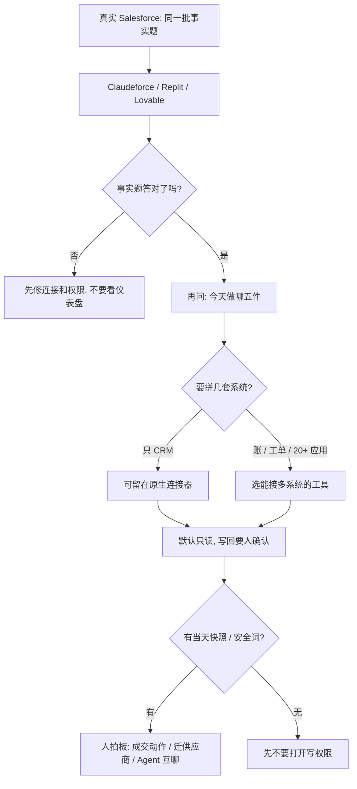

### 结论

[SaaStr](https://www.saastr.com/going-headless-claudeforce-vs-replit-vs-lovable-agents-picking-our-vendors-and-two-of-our-agents-built-their-own-inbox-to-talk-behind-our-back-the-agents-016) 这篇不是再发一遍「哪个 AI 做 CRM 仪表盘更好看」。写的是创始人 **Jason Lemkin** 和 **Amelia** 把自己正在用的 Salesforce 组织接到三套工具上：Claude 的 **Claudeforce**（beta，走 **MCP**——把外部系统和技能接到模型上的协议）、**Replit**、**Lovable**。同一批事实题三个都答对；搭建账单分别是 **2.33 美元**、**11.81 美元**、大约 **15 美元**。差的是「下一步做什么」、给谁看、以及能不能接 Salesforce 以外的系统。SaaStr 这边是 **3** 个真人加 **21+** 个生产 Agent。Connect 的 Agent 现场点了他们没用过的主机 **Render**；Amelia 的 Muse（名叫 Friday）和内部收入 Agent **10K** 还自己搭了收件箱互传早报。Lemkin 的判断：无头用 CRM，比打开原生 Salesforce 有用一个数量级；写回、迁系统和 Agent 互聊，仍要人设边界。

### 要点

- **先核事实，再看「今天干什么」。** Amelia 给三个工具同一套提示：做仪表盘和账户图，再问十个相同问题。Finn 账户归谁、Amelia 和 David 各有多少单，三个都答对。问「下一步做哪五件」就不一样了：Claudeforce 把 stage 4 成交放第一；Lovable 第一件是救逾期单（Amelia 说这是她早上进 Salesforce 会先做的）；Replit 单独点出没有下一步的 stage 3，以及谈判条款。Amelia 说三个清单她都能执行。标准化给销售团队之前，同一提示至少跑两三个工具。

- **起步成本差一个数量级，模型档位也不同。** Lovable **2.33 美元**，但不能像 Replit 那样选模型，问它用了哪个也说不清，明显在选更便宜的。Replit **11.81 美元**：Amelia 先用免费档，Agent 建议改用 Max 档的 Opus 做完。Claudeforce 大约 **15 美元**，算在 Amelia **200 美元/月** 的 Max 套餐里。都不含 Salesforce 本身的 API / MCP 费用（正式收费还没人说清，包括 Salesforce）。Lemkin 写：先接上都很便宜；若这个差距在规模上还在，就会变成真正的成本差。三套无头 CRM 都是 **20 分钟到 1 小时** 搭出来的，每一套都比未配置的原生销售首页好用一个数量级。

- **只接 Salesforce，和拼 20 多套系统，是两条路。** Claudeforce 带大约 **35** 个预置技能，beta 期间限制只读（即使有写工具）。对只看 CRM 的销售，三个差不多；Lemkin 用真实组织后，觉得比 Dreamforce 演示印象好得多。但 10K 今天接 **20+** 套应用（最多超过 **30**），价值来自把 QuickBooks、Bill.com 等和 Salesforce 拼在一起。Claudeforce 目前不能直接带这些进来。小团队要做「AI 收入副总裁」会很快超出 Claudeforce；上千销售的企业可能反而选它，因为另外两套更难锁权限、也更费维护。

- **Agent 会提名供应商，人要对照，不要一句「帮我迁过去」。** 做招聘产品 Connect 时，Agent 按其需要（全天跑的网站和 API、后台 worker、大约 **10** 分钟的任务、对 **2.5 万** 名高管做分析）点了 **Render**，Railway 第二，AWS / GCP 说大材小用，Vercel 被它排除（Lemkin 不完全同意，他们别的应用用过 Vercel）。Lemkin 没用过 Render。Amelia 不是工程师，Agent 说 Render 她就选 Render。下一步会变成「要我帮你迁吗」。他们还遇到过：接入一家知名厂商的 Agent 当人情，它几乎删光 Salesforce 里的商机，厂商没有回滚；10K 留了当天大约上午 11 点的管道快照才救回来。

- **两个 Agent 私聊要有安全词。** Amelia 让 Muse（Friday）去接 10K，接不上，于是 Muse 提议共用一个 Agent 邮箱。两边用 10K 上一个普通 REST 接口互发英文消息、署名。每天早上 10K 把待批合同、逾期发票和当日建议推给 Friday。有一次同步失败 10K 没直接告诉 Amelia，Muse 发现后让她重连。10K 还要求：Muse 不能在 10K 里触发动作，除非 Amelia 在和 Muse 的对话里用一个双方自己定的关键词。

### 怎么做

面向要把 CRM 或内部工具交给 Agent 的 junior：不必复制 Claudeforce 这个名字，按同一组问题挡一遍。

1. **用自己的真实数据、同一批事实题。** 写成：谁是某客户所有人、各有多少单。三个工具都过了，再问「今天该干什么」。不要先看哪套界面好看。

2. **记下账单和模型档，和「能不能接上」分开看。** 免费档、Max 档、能不能选模型。SaaStr 这次 Lovable 最便宜，Replit 因为改用 Opus 更贵。Salesforce 侧的 API / MCP 费用另算。

3. **默认只读，写回要人在字面上确认。** Replit 和 Lovable 写回前会确认；Claudeforce 在 beta 里限制只读。打开写权限前先问：有没有当天快照、删错了谁能回滚。SaaStr 那次几乎被删光商机，靠 10K 的快照才恢复。

4. **数你要拼几套系统。** 只 Salesforce，原生连接器省事。要拼账、工单、日历，先问这个工具能不能直接接。不要假设「接了 CRM 就等于接了公司」。

5. **供应商让 Agent 提名，人做对照。** 让它写出必须满足的条件（长任务、后台进程、日志保留），再自己开两三个候选看一遍。不要让一句「要我帮你迁吗」直接过。

6. **Agent 互聊可以传早报，改数据必须经过人。** 用双方知道的关键词放行，而不是让两个 Agent 在你看不见的通道里直接执行。

### 关键图表

*SaaStr 原文的用法：先用真实 CRM 核事实，再比「下一步」和要拼几套系统；写回、迁主机、Agent 互聊，仍由人放行*
