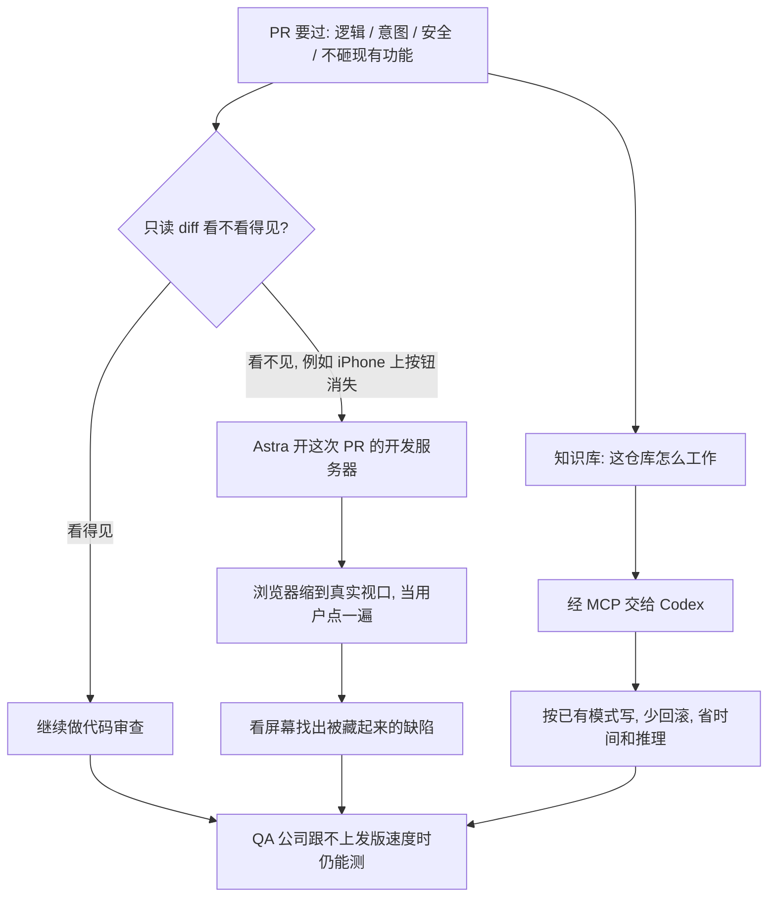

### 结论

[OpenAI](https://openai.com/index/greptile-code-review-codex-astra) 这篇客户故事写的是代码审查公司 **Greptile** 已经怎么用 AI 把「读完 diff」推进到「真的跑起来当用户去砸」，不是再发一篇模型发布稿。Greptile 做会审查、会测改动的 Agent，并且带着整仓上下文。联合创始人兼 CEO **Daksh Gupta** 的原话是：他们干的是减少缺陷、让软件更可靠。只读代码不够——按钮在 iPhone 视口里消失这种事，眼睛扫 diff 经常看不到。他们用 **GPT-6 Astra** 的**计算机使用**（computer use：模型自己开浏览器、点页面、看屏幕）给 PR 开开发服务器、把窗口缩到 iPhone 大小、模拟用户走一遍。Gupta 的判断：第一次可以把「找个用户来砸你的应用」自动化，大公司才敢跟着模型发版的速度走。另一头，他们把仓库 **Knowledge Base**（把代码库怎么工作写成人和 Agent 都能读的说明）经 **MCP**（把外部系统接到模型上的协议）交给 **Codex**；Gupta 说已有**数千**客户接上。他们盯的是 AI 写出的代码多久被回滚：**给 Agent 上下文之后，回滚更少，客户省时间，也省推理。**

### 要点

- **验收 PR 有四件事，其中几件必须把应用跑起来。** Gupta 把验证拆成：逻辑对不对、是不是开发者想做的那件事、安不安全、会不会砸掉已有功能。前半段读代码往往够；后半段不够。他举的例子很具体：网站在 iPhone 上有个按钮消失了。Astra 给这次 PR 起开发服务器，把浏览器缩成 iPhone 视口，再当用户往下点；模型能看屏幕，才能发现那个被藏起来的按钮。这不是「再写一条更严的 lint」，是补上代码审查本来看不到的那一层。

- **QA 公司跟不上现在的发版速度，所以要把「当用户去砸」收进同一条流水线。** Gupta 说：请一家 QA 公司把你每次改动都测一遍，相对模型已经把写代码加速到什么程度，慢得不现实。他们的用法是：审查和测试共用整仓上下文，计算机使用负责「跑起来、看一眼、点一下」。大公司要的是敢发，不是多一份测试报告。

- **模型变强，攻击也会变容易；Daybreak 要让创业公司也用得起更强的防守。** Gupta 写的是：更强的模型让利用应用变得更容易，以前不太像目标的公司也会被盯上。他们想让创业公司也能把系统守住。**Daybreak**（OpenAI 面向行业客户的合作项目）被他用来补这一层：用起来要安全，而且客户的防守要压过对方的进攻。这篇没有给出攻防前后的数字，只把这件事标成和「测行为」并列的产品活。

- **少回滚靠的是把仓库怎么工作交给写代码的 Agent，不是再催一版模型。** Greptile 的知识库给人和 Agent 读同一套「这仓库怎么工作」。经 MCP 接到 Codex 后，Codex 按客户已有模式写，而不是凭空猜。验收指标是回滚次数：上下文给够，回滚下降，省下的时间和推理拿去做新活，而不是把同一处改两遍。Gupta 说他们自己也是 Codex 的重度用户，几乎每个职能都在用，工程尤其多。

- **下一截瓶颈是「想法变成能跑的软件有多快」，不是模型够不够聪明。** Gupta 觉得很多活的智力已经够用，所以看重 **Ultrafast**（更快出结果的那一档）当加速杆。更长的目标是：改关键企业软件、发出去，要像发一个 side project 一样容易；OpenAI 帮他们补的是这件事需要的验证，而不是再换一个聊天窗。

### 怎么做

面向正在给 PR 上 AI 审查、却还只让模型读 diff 的 junior：不必复制 Astra 或 Greptile 这个名字，按同一组顺序挡一遍。

1. **先写清「读代码看不见、跑起来才看得到」的那一类缺陷。** 例如某个视口按钮消失、某条用户路径走到一半空白。这是计算机使用要补的活，不是再加一条静态规则。

2. **给一次 PR 起能点的环境，再让 Agent 当用户走预定路径。** 开开发服务器、缩到真实视口、看屏幕、点关键按钮。路径写成几步可重复的检查，不要一句「帮我测一下」。

3. **审查、行为测试、安全分成三件活，不要塞进同一个提示。** 逻辑和意图可以继续读 diff；会不会砸现有功能要跑起来；防利用是另一条。Greptile 把后两件分别交给计算机使用和 Daybreak。

4. **写代码的 Agent 必须读你们自己的仓库说明。** 把「我们怎么分层、接口怎么命名、测试怎么补」写成人和 Agent 都能读的知识库，接到 Codex 或你们正在用的编码 Agent。验收看回滚和返工，不看「它回了很长一段字」。

5. **省下的推理拿去做新活。** Gupta 的算法是：上下文给够 → 回滚少 → 时间和 token 省下来。如果回滚没动，先查知识库是不是过时，不要先换模型。

6. **人仍对「能不能跟模型的速度发版」负责。** Agent 可以当用户去砸、按现有模式写；合并、对客户说「我们测过」，还是人看证据再拍板。

### 关键图表

*OpenAI 原文的用法：审查之外补一层「跑起来当用户去砸」；知识库接到写代码的 Agent 之后，回滚和推理一起降*
