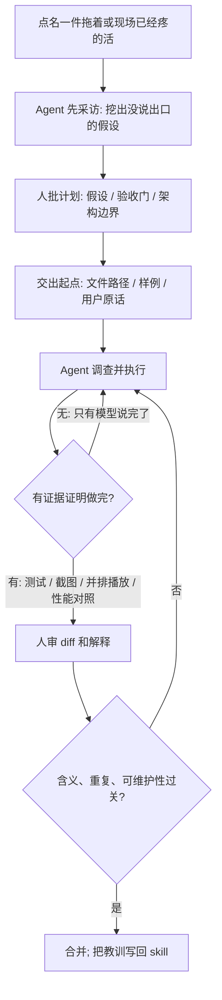

### 结论

[GitHub](https://github.blog/ai-and-ml/github-copilot/how-3-java-champions-are-using-github-copilot-for-increased-productivity) 这篇不是再讲一遍「Copilot 写代码很快」。**Julien Dubois** 问了三位 **Java Champion**（社区公认、长期写 Java 的专家）：**Vlad Mihalcea**、**Patrick Baumgartner**、**Frank Delporte** 在真实产品和开源里怎么用 [GitHub Copilot](https://github.com/features/copilot)。三人各自交了一件本来会拖着不做、或很难下手的活：Vlad 把 Hypersistence Optimizer 的性能事件历史页从「估计要几周、一直推迟」压到大约 **两天**；Patrick 把约 **900** 张、**15** 套课表从 Reveal.js 迁到 Marp，大约 **8–10** 小时，而不是一周以上；Frank 给 Copilot 两个文件路径，大约 **半小时** 拿到 [Pi4J](https://pi4j.com/) 第五颗按钮不响的 PR。他们共同的用法是：人负责上下文、验收和能不能合并；Agent 负责调查和执行。速度快，但「做完」要有证据。

### 要点

- **先交一件一直拖着的具体活，不要先改「怎么写代码」的身份。** Vlad 是 [Hypersistence](https://vladmihalcea.com/) 创始人，长期写高性能 Java 持久化。他早就想做一页 Optimizer 事件历史，用来看性能改进有没有落到应用上。没有 AI 时，他估要几周，所以一直没开。Copilot 在 IntelliJ 里当能一起查代码、一起做原型的同事，这页会随下一版 Optimizer 发出。他仍审计划和生成代码：目标是加快自己，不是把自己换掉。文档和博客口吻，他用 **65** 篇已发文章做成 skill（给 Agent 的可复用说明），让草稿像自己写的；维护期更长的产品，再加一条「最少惊讶」——新代码要像仓库里已有的写法。难想的用带大上下文的重模型；发报告、写发布说明、核文档，换更省 token 的轻模型。

- **迁课表能从一周以上压到约 8–10 小时，是因为先写清约束，再用截图和并排播放当验收，不是一句「帮我迁完」。** Patrick 在 42talents 带团队，同时自己上课。那 **15** 套 Reveal.js 片子已经跟学生打磨过：里面有代码、动画，还有现场改 JavaScript 的互动例。丢一小块，课堂上的故事就断。手工迁他估要一周以上，而且很可能继续拖。做法是先分析现稿、定目标、写计划、列不能动的内容、给样例，再从结构改到细节。然后生成 Reveal.js 和 Marp 的截图，做视觉和算法对比，再做一个能并排播放、手验动画的小应用，连导出的 PDF 也对过。Agent 不能只报「迁移完成」。错别字可以自动改；内容、版本、日期、含义变了，必须人点头。他的原则是：**委托执行，不委托责任。**

- **现场反馈要先变成能复现的测试；给 Agent 看的材料，可以比给人看的更密。** 他做的终端界面在 Linux / WSL 上没问题，有人直接在 Windows 的 CMD 或 PowerShell 里跑，表单里的回车被吞掉。他们让 Copilot 把反馈收成可复现的界面测试：Linux 上用 tmux 操作，PowerShell 里学到类似的流程，复现、本地修、追到 Tamboui 上游并合入。测试说明一度太长，塞不进上下文，他就让 Copilot 重设表示法：用 `步骤 → 步骤 → 输入`，只在关键处加注释。这不是为了更好读，是为了语义不丢、Agent 还能执行。另一件完全不同的活：身边有人要练小学数学，他和 Copilot 一起查间隔重复、即时反馈、自适应难度，做成一到四年级的加减乘除（含带余除法）。他本想做成「全世界通用」，调研后改成先对齐瑞士课表，并做成德 / 法 / 意 / 英四语。故意没有后端，孩子的数据留在设备上，页面挂在 GitHub Pages。现在朋友之间已经在用。

- **难复现的现场 bug，先圈两个文件，再要解释和测试；半小时出 PR，人仍要批能不能进主干。** Frank 在 Azul 做技术写作，也维护 Foojay.io。他参与的 Pi4J 让 Java 程序读写树莓派上的电子元件。2026 年 2 月发的 V4 用了 **FFM**（Foreign Function & Memory API，Java 直接调本地库的接口）。测过才发，仍有人报：接 **5** 个输入按钮时，前四个按下有反应，第五个完全静音，没有异常、没有日志。旧的 gpiod 插件、同一套硬件和同一份应用是好的，问题在新的 FFM 代码里。他把 [issue #622](https://github.com/Pi4J/pi4j/issues/622) 派给 Copilot coding agent，并点了两个起点：provider 类和 `FFMDigitalInput`。大约半小时后有了 PR。每个输入都有一个事件监视器，堵在本地 `poll()` 里等内核报告 GPIO 变化；这些监视器跑在**虚拟线程**上。虚拟线程一旦堵在本地调用里，就卸不回载体线程，等于一直占着。树莓派 4 有 **4** 核，调度器就有 4 条载体；登记 4 个输入，4 条载体全停在 `poll()` 里，第五个监视器建得出来，却永远排不上。Frank 追问：虚拟线程不就是为了摆脱平台线程上限吗？为什么四个虚拟线程会堵死四核？解释本身也是交付物，后来写进评审和文档。Pi4J 里这类 PR 都要维护者审过才进；他在别的项目里也一样，因为 Agent 很容易复制已有方法、或把该合并的逻辑再写一遍。

- **非平凡任务不要一句话开工；「做完」要能举证，教训要写回 skill。** Patrick 已经几乎不用补全，改走 Agent：要看稿、看代码、看中间结果时用 VS Code；大块执行用终端里的 coding agent。去 JavaLand 的大约 **4** 小时路上，他用手机指挥 Agent 探一个优化 Spring Boot 自动配置加载的 Maven 插件，到站时已经有能跑的插件、CI、对照样例应用的性能测试和报告。他不是在手机上写 Java，是在审、决定、发下一句。非平凡任务他常先让 Agent **采访自己**，把还没说出口的假设挖出来——他一度同时支持 Spring Boot 3.5 和 4.x，后来发现 3.5 路径不必留，拆掉很痛。计划要能看见假设、验收门、是否贴合现有架构、有没有多余活。重构的门可以是测试过、该动的文件都动了、文档已更新、没有留下 TODO；迁课表的门是截图、视觉 diff、动画、PDF 和内容完整性。他还有自己的质量套件，把 Checkstyle、PMD、Spring Modulith 架构检查收成 Agent 能读的报告：改 → 跑检查 → 读发现 → 再改，直到没有发现。人仍然要自己点一遍软件。有 CLI 时他往往不用再加一层 **MCP**（把外部工具接到模型上的协议）。

### 怎么做

面向已经会在 IDE 或 Copilot app 里开会话、但还容易「一句话开工、模型说完就算完」的 junior：不必复制监控页、课表或树莓派，按同一组分工挡一遍。

1. **先点名一件一直拖着、或现场已经疼的活。** 写成谁在用、做成什么样算数。Vlad 的标准是「下一版能看见性能改进有没有落到应用上」；Frank 的标准是「第五颗按钮也要有反应」。不要第一句就「帮我全面提升生产力」。

2. **开工前先让 Agent 采访你，再出一页计划。** 问清假设、验收门、现有架构里不能动的部分。Patrick 同时做 3.5 和 4.x 的弯路，就是意图没冻住就加速的代价。你批完计划再执行。

3. **把你已经知道的起点交给它。** 两个文件路径、一份现成课表、一条用户原话，都比「请调查整个仓库」便宜。你对邻域有直觉时，不要让它从零搜。

4. **「做完」改成证据，不要停在模型的自我宣告。** 迁界面就对截图、并排播放、导出物；修 bug 就先写在旧代码上会失败的测试；做优化就对照样例应用跑性能。门按任务定，原则不变：Agent 要能证明定义被满足。

5. **人审能不能进主干。** 看有没有复制已有方法、有没有把该合并的逻辑再写一遍、文档和口吻像不像这份仓库。错别字可以自动改；含义、日期、对外行为变了，必须人点头。

6. **把这次的教训写回 skill，下次当默认。** 口吻、最少惊讶、测试必须先红、维护审计（README、CI、Dependabot、CodeQL）都可以变成下一次的起点。模型按任务换：重推理用重模型，核文档用轻模型。

### 关键图表

*GitHub 原文三位 Java Champion 的共同用法：人圈范围、定验收、批能否合并；Agent 调查和执行。做完要有证据，不要停在「迁移完成」*
