### 结论

[LangChain](https://www.langchain.com/blog/how-numan-built-an-eval-first-ai-health-coach-with-langgraph-and-langsmith) 这篇不是再讲一遍「怎么搭一个会聊天的健康 Agent」。写的是英国数字健康公司 **Numan** 已经在真实患者路径上跑 **Nu**——一个 AI 健康教练。Numan 帮人管体重、激素和性健康等长期状况；不少减重项目的患者每天打开 App 记进度。Nu 要做的是高质量生活方式教练，但不能诊断、开药或替人做临床决定——这是受监管医疗里的硬线。团队后来发现：真正决定体验和能不能发版的，不是先把自动化堆满，而是**评测标准写得对不对**。同一张 **LangGraph** 图（把 Agent 画成可执行步骤）既服务患者，也跑评测；**LangSmith** 记下轨迹和实验。换一组 **frontier** 供应商（当前最强的那一档模型）对照，从「通常要数周手工测」压到大约 **一天**。安全类回归不过，改动自动进不了生产。

### 要点

- **教练是一段对话，不是一道有标准答案的问答题。** 他们一开始用了常见做法：一份输入、一份期望输出，再用 **LLM judge**（另一个模型按评分标准给回复打分）评单条回复。这对问答机器人够用，对教练不够。行为教练很少有「对这一句的唯一正确答案」；一句话安不安全，要看它前后的对话。Nu 得先弄清患者卡在哪，再给建议，并在对方往临床里推时守住边界。把全库分数平均掉更糟：几条坏回复几乎拉不动总分，对话看起来合规，其实已经越线。固定例子还制造过误报：有一轮低分后来发现是评测自己的错——量表要求两轮之内同时做到共情、探问和建议，而真人教练会把这些摊在整段对话里。Nu 在按教练的节奏走，窄评测却判它失败。

- **把患者下一句提前写死，评测会评到一场从未发生的对话。** 单轮固定例子不行，他们试过写好患者接下来每一句，再一回合回合喂给 Nu，最后让 judge 看整份记录。judge 看见的字变多了，问题没变：第二句已经写死，它就不看 Nu 第一句实际说了什么。Nu 只要说了脚本没料到的话，后面每一句都在回一场假对话。这两种失败，决定了他们后来拆成两层：单条回复能看清的，用带主题的固定数据集；必须看到整段对话形状的，另做一层，不再用脚本假装患者。

- **上线的那张图，就是拿来测的那张图。** Nu 是一张 LangGraph：一个 **supervisor**（总调度）把活交给专项子 Agent，每个专项有自己的提示词和工具，负责一块教练领域。这样加一个新专项便宜，评测面也一样。路由对不对、用药问题答得是否安全、安全门有没有拦住该拦的——这些单条回复就能判定。他们按教练质量、安全、用药问询、路由、摘要等主题各做数据集，**按类别**打分，不再出一个总分；每条量表只问「这一句能证明什么」，不再因为 Nu 把对话摊开而扣分。容易做错的做法是另写一套评测脚手架、复制一份提示词直接调模型——脚手架和线上一旦漂移，分数就在测另一套系统。Numan 的原则是：**我们发出去的东西，就是我们测的东西。** 每一条评测都打进患者真正对话的那张图，可以打整张图，也可以打一个子 Agent。

- **换模型快，是因为评测套件能对着任何配置重跑，不是因为「换一个更强的名字」。** 规模上来以后，他们问：supervisor 和专项做的认知工作不一样，是不是该用同一家供应商？今天 Nu 跑在两家 frontier 上，按 Agent 选：一家给 supervisor，另一家给专项。评测是开放的、按主题拆开的数据集，可以指向任何配置。同一套数据对着两家并排看，一次供应商迁移大约一天，而不是数周手工点选。对照结果直接从 LangSmith 里读：真实对话和模拟对话都落成 **trace**（一次调用的轨迹），评审在轨迹上批注，数据集和实验也住在同一处。

- **监管边界要写成发版门，量表要由临床的人签字，不要停在工程师起草的提示词。** 按英国 **MHRA**（药品和医疗产品监管机构）的口径，带医疗目的的软件——给临床建议、诊断、推荐治疗——会变成医疗器械。Nu 被设计成 wellness 产品：生活方式教练和健康教育，不是临床护理。安全探针按类别计量，回归失败会挡住发版。他们调的是 **safe-completion**：越界问题时，用教练的口吻改道到允许范围，而不是冷冰冰拒绝。图里还有守卫节点：发出去之前，安全守卫按固定临床安全规则审一遍；不安全的草稿打回 supervisor 重写，一直失败就换成安全兜底，不把坏回复交给患者。健康教练每天抽看真实对话，标定什么算安全漏过。更新的一层仍是原型：交给评测一份患者人设、场景、Nu 该挖出的问题和回合上限，用更便宜的模型演患者，跟真实 Agent 多轮对谈，再按类别给整份记录打分。人设是生成的，才能探到固定例子遇不到的绕法。这一层曾降低越界很严重的范围违规；用药问询评测并行当回归门，避免改提示词时把已经信得过的行为改坏。他们也撞过量表自相矛盾：漏服一次药，一条说拒绝并转到临床，另一条说用患者说明书里的一般事实做 safe-completion。一个提示词满足不了两条。稀缺资产不是提示词——能干的模型从有限上下文就能起草——而是评测标准。贴着监管线的标准，要由既懂临床、也懂这条线的人写并签字。模拟层在临床签字之前，不挡发版，也不支撑任何安全声明。

### 怎么做

面向正在把对话 Agent 接到真实用户、尤其是旁边有合规或安全线的 junior：不必复制 Nu 或 LangGraph 这个名字，按同一组分工挡一遍。

1. **先写清「谁在用、哪条线不能过」，再谈模型。** Numan 的线是：教练和健康教育可以，诊断、开药、替人做临床决定不行。你的线可能是「不能改生产」「不能对客户承诺价格」。写成对方能听懂的一句话。

2. **单条回复能证明的，和整段对话才能证明的，分开测。** 路由、安全句、固定政策，用带主题的固定数据集，按类别打分，不要一个平均分。教练节奏、有没有先问清障碍、对方换一种说法想绕线，用模拟对话，不要把用户下一句写死。

3. **评测打进要上线的那条链路。** 不要另写一套只在评测里存在的提示词。新专项或新供应商来了，同一套主题数据集对着新配置重跑。Numan 用这一下，把一次供应商对照从数周压到一天。

4. **把边界做成每次改动都跑的探针，回归失败就挡住发版。** 发出去之前再过一道守卫；坏草稿重写，重写仍坏就走安全兜底。目标写成 safe-completion：守线，但仍像在帮忙，而不是甩一句拒绝。

5. **贴着监管或安全线的量表，交给领域的人签字。** 工程师起草够把脚手架跑起来，不够拿去声称「我们测过安全」。Numan 的做法是：临床的人拥有量表；工程师仍对每一次提示词改动负责。

6. **人抽看真实对话，用漏过和误报回头改量表。** 他们现在是教练每天抽样；下一步是线上评测先标出可疑对话，人从标过的开始看。先把「什么算好」写对，后面的分诊和提示词优化才可以自动化——他们已经用离线优化环对着一条行为基准提高分数，没有手调提示词。

### 关键图表

```mermaid
flowchart TD
    A["患者打开 App: 减重等日常进度"] --> B["同一张 LangGraph: supervisor 交给专项子 Agent"]
    B --> C["安全守卫审将发出去的回复"]
    C -->|不安全| D["打回重写; 仍失败则安全兜底"]
    C -->|安全| E["患者看到教练回复"]
    B --> F["固定数据集: 路由 / 安全 / 用药 / 摘要"]
    B --> G["模拟对话: 人设 + 场景 + 回合上限"]
    F --> H["按类别打分: 不平均掉"]
    G --> H
    H --> I["LangSmith: 轨迹 / 批注 / 对照实验"]
    I --> J{"安全回归过? 临床已签量表?"}
    J -->|否| K["挡住发版"]
    J -->|是| L["上线; 教练每天抽看真实对话"]
```

*LangChain 原文的用法：患者和评测走同一张图；单条能看清的用固定集，整段对话用模拟；安全回归和临床签字的量表挡住越界发版*
