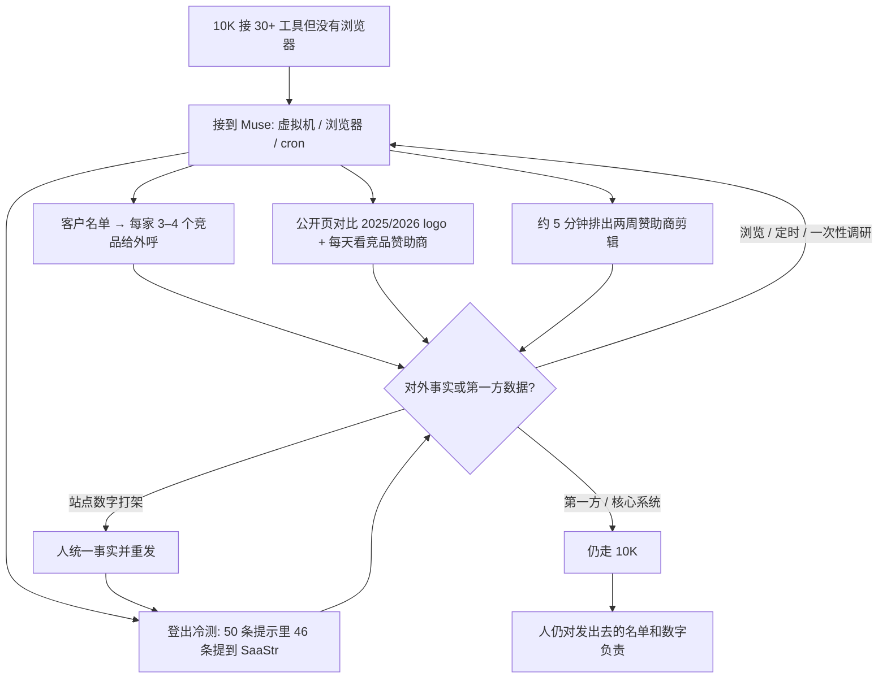

### 结论

[SaaStr](https://www.saastr.com/how-saastr-uses-muse-for-gtm-5-jobs-we-didnt-want-to-build-into-our-own-agents) 这篇不是再发一遍「GTM 该再加一个 Agent」。创始人 **Jason Lemkin** 写的是自家已经怎么处理「主 Agent 接了三十多个工具，却进不了浏览器」：**10K**（他们的主 **GTM** Agent：获客、内容和活动那条线）在 **Replit** 上自建，接了超过 **30** 个工具，管大部分获客；它全程待在 Replit 里，没有浏览器，所以访问网页、登出账号、按日程盯页面，对它都很难。他们把这类活交给 **Muse**（带虚拟机、自带浏览器和 **cron**——定时任务——的个人 Agent）：可以按每天或一天两次排活，还能连跑几小时。验收写在原文里：首席 AI 官 **Amelia Lerutte** 让 Muse 登出后冷测，SaaStr 在 **50** 条提示里出现 **46** 次；Jason 用大约 **5** 分钟，让它排出两周赞助商剪辑。第一方数据和对外数字，仍由人看过再定。

### 要点

- **先拆掉「核心 Agent 没有浏览器，登出测不到、竞品页看不了」这层，不是再往 10K 里塞一套爬虫。** 原文把 Muse 写成最近一个越过「加一个 Agent、就要减一个」这条家规的例外。10K 已经接 30 多个工具，但进不了网页。Muse 给的是虚拟机、自带浏览器和定时任务；Claude Desktop 一类也能凑，但更难一直跑着。他们用 Muse 干的是不想写进 10K、也不想再开一个 Replit 应用的循环活。人还是决定哪份名单能给外呼、哪组数字能上站的人。

- **Amelia 验收的是登出后有没有被提到，不要只看「自家 Agent 说我们 AEO 很好」。** **AEO**（答案引擎优化：被 ChatGPT、Gemini 这类模型当成答案引用）这条，Amelia 把 saastr.com、saastr.ai 和 SaaStr AI Annual 站点交给 Muse，对方说要几个小时。它登出账号，自己列「SaaStr 该是答案」的问题，再冷问 ChatGPT、Gemini 和它够得着的其他模型。SaaStr 在 50 条里出现 46 次。多数没出现的，追到自家站点：有的 Agent 引用往年 SaaStr Annual 数字，有的引用 2027 站点，参会和受众对不上。他们把事实统一后重新发布。登出才测得准：自家 Agent 带着历史和上下文，会偏向你。10K 已经做一部分 AEO，Muse 仍抓到它漏的，因为它不能登出浏览。

- **外呼名单和续约率要能从公开页核验，不要把客户表长期留在对话里。** Amelia 把全部历史客户名单交给 Muse：在约、流失、媒体、SaaStr AI Annual，都给了；明确说不要拿去训练，做完就删掉这场对话。她要的是每个客户过过的三到四个竞品，带公司名和域名。这份名单交给外呼 Agent 之后，表现超过他们现在跑的其他外呼打法。赞助商续约率这条，她没告诉 Muse 谁是客户，只让它对比 2025 和 2026 年 SaaStr AI Annual 页面上的 logo，再对两年都办过的同类活动做同样对比。算出来的续约率明显高于多数对照活动；这个数进了给其他 Agent 看的文档，因为它们可以自己去核对，证言做不到这一点。

- **每天盯竞品赞助商页、两周剪辑排期，要靠浏览器加定时任务，不要为此改造 10K。** Muse 按自己的日程每天看 SaaStr AI Annual 和竞品活动的赞助商页，谁在别处投了、谁第一次出现，他们当天能看见。这是最需要自带浏览器和 cron 的活；写进 10K 就得自己做抓取、排程和对比。剪辑那条，Jason 一大早让 Muse 从每个赞助商的 SaaStr AI Annual 场次里抽一段对创始人有用、不要广告片的片段，每天下午发一条。Muse 在 YouTube 找到场次，过第三方接口，排出两周，并自己设了和别的内容对比的 **A/B 测试**（把两种内容一起发出去，看哪个更好）。Jason 大约花了 5 分钟。赞助商会后多一轮曝光，他们多两周本来要人做的内容。

- **10K 管第一方和核心系统，Muse 管要浏览、要定时、一次性调研的活，不要把核心 Agent 改成万能爬虫。** 原文分工：Salesforce、账单、进线、外呼回复、Prospector 队列走 10K；要浏览器或日程、一次性调研、否则就得新开应用的活走 Muse。Jason 自己那只 Muse 叫 **Carson**，原话是：这五件活没有一件是更好的 10K，都是 10K 从来没被建成的活——登出浏览、每天看一页、没人盯也能连跑几小时。家规其实不是「加一个、减一个」，而是别为每件新活去改建核心 Agent。

### 怎么做

面向已经有一只接满内部工具的获客 Agent，却发现「登出测不到有没有被模型引用」「竞品赞助商页没人每天看」「会后剪辑还要人剪两周」的 junior：不必复制 Muse、10K 或 SaaStr 这个名字，按同一组顺序挡一遍。

1. **先写清卡在哪一步。** 「主 Agent 接了几十个工具，但不能登出打开 ChatGPT」「竞品活动的赞助商页没人每天看」「会后剪辑还要人从 YouTube 里挑」。写成对方能听懂的一句话：浏览、定时和一次性调研可以交给带浏览器的 Agent，第一方数据和对外事实必须人点头。这是应用问题，不是再往核心 Agent 里塞爬虫。

2. **先把活拆开，不要为每件新活改建核心 Agent。** 摸得到 Salesforce、账单、进线、外呼回复的，留在已有那只 Agent。要访问网页、登出账号、按每天或一天两次跑、连跑几小时的，另用带虚拟机、浏览器和定时任务的 Agent。Claude Desktop 一类也能凑，但原文说更难一直跑着。

3. **客户名单只进一次性对话，做完就删，不要拿去训练。** 要的是每家客户的三到四个竞品名和域名，交给外呼 Agent 去跑。原文这条现在超过他们其他外呼打法；没有外呼的，他们建议从这条开始。

4. **AEO 要登出冷测，不要问自家 Agent「我们表现好不好」。** 把该被当成答案的站点交给它，让它自己列问题，再冷问 ChatGPT、Gemini 等。对不上的数字，先回自己站点统一事实再发布。没有 `robots.txt` 或 `llms.txt` 的，可以让它先采访你，再把文档发到站点上给其他 Agent 读。

5. **用一件真的活验收，不要只看「浏览器开关能打开」。** 「50 条提示里有没有 46 条提到你」「外呼名单有没有超过现有打法」「公开页算出的续约率能不能进给其他 Agent 核对的文档」「会后剪辑人是不是大约 5 分钟就排出两周」。原文验收 Amelia 的是 46/50 和那份竞品名单；验收 Jason 的是大约 5 分钟的两周排期；验收每天盯页的是谁在别处投了、谁第一次出现。续约率原文只写明显高于多数对照活动，没有给出百分比，不要把没有写出的数补进去。

6. **人还是放行的人。** Agent 可以登出冷测、对比 logo、每天看竞品页、排出剪辑。哪份客户名单能给外呼、哪组参会数字能上站、核心系统何时仍走 10K，仍由负责人看过再定。

### 关键图表

*SaaStr 原文的用法：Amelia 用 Muse 登出冷测，50 条提示里 46 条提到 SaaStr；Jason 大约 5 分钟排出两周赞助商剪辑。10K 仍管第一方和核心系统。人还是决定哪组数字能上站的人*
