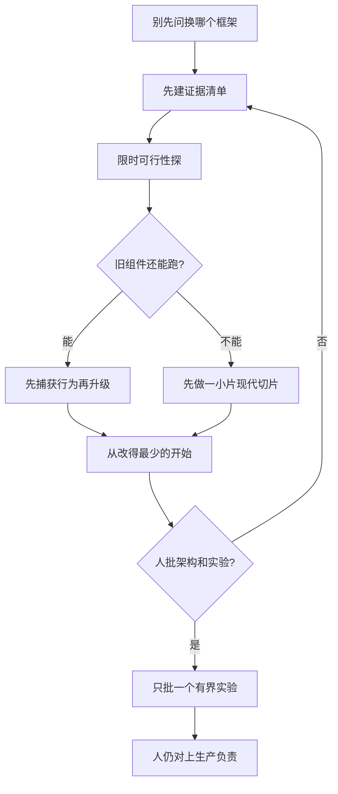

### 结论

[GitHub](https://github.blog/ai-and-ml/github-copilot/how-to-choose-the-next-safe-step-in-application-modernization) 这篇不是再发一遍「该换哪个框架」。工程师 **Sam Quakenbush** 写的是已经怎么处理「现代化一开口就是换技术栈」：先查清现在还能跑什么，再收集能当回归网的证据，最后才选下一步实验。他把这套顺序写进公开的 **`doc-and-modernize` agent skill**（Agent Skill：一份以 `SKILL.md` 为中心的说明目录，Copilot 碰到相关任务时加载），自己用同一套方法过了四个公开应用——从小的 Node.js 游戏到大的 Java **ERP**（企业资源计划：进销存、财务、制造那套）。验收写在原文里：**PiggyMetrics** 在 JDK 8 上 `account-service` 跑了 **14** 个测试，**5** 个过、**9** 个错在嵌入式 MongoDB 下载返回 403，他没有据此重画架构，最后 Java 8 升到 21、范围内模块从 **9** 个收到 **7** 个；**ADempiere** 合了 **30** 个现代化 **PR**（拉取请求：给同事审的改动），到第一份可搬运演示用了 **102,587.72** 个重建的 Copilot credits，并把第一笔现代业务伙伴写入和冻结的旧结果对照。credits 不是美元成本，也不是「每个屏幕都现代化完了」。架构判断仍由负责人定。

### 要点

- **先拆掉「标签叫遗留，就该换框架」这层，不是再选一个更新的运行时。** 「Java 微服务」不会告诉你生产钉的是哪一版 **JDK**（Java Development Kit：编译和跑 Java 的那套工具）、测试能不能跑、别的系统靠哪些接口。「遗留单体」也不会告诉你业务核心坏了，还是一个下线的平台依赖让它起不来。原文要先建一份小证据清单：清单和锁文件、装/编/测/打包装/跑的已验证命令、容器和 CI 里钉死的运行时、API / 库表 / 文件格式 / 用户流程这些对外契约，以及应用仍在用的到期框架。不确定就标成「写在文件里 / 推断 / 未核实」。两份文件 Java 版本对不上，先解开，不要把猜测当发现。人还是决定哪份清单能拿去提案的人。

- **PiggyMetrics 验收的是「已知行为有没有被找回来」，不要把测试依赖下载 403 当成该重写的证据。** 这个演示项目钉着 Java 8、Spring Boot 2.0.3、Spring Cloud Finchley、Zuul、Hystrix 和旧的 `spring-security-oauth2`。限时可行性探：`mvn -pl config -am compile` 退出码 0；`mvn -pl account-service -am test` 14 个测试里 5 个过、9 个错。那 9 个追到 `Failed to load ApplicationContext`，嵌入式 MongoDB 下载返回 HTTP 403，钉死的二进制还是 i386，在 Apple Silicon 上跑不了。探的不是整应用都能跑，也不是集成行为都对；它把下一步收窄成：先换测试依赖、再跑受影响的测试，再动生产栈。后续顺序是：用 Testcontainers 在旧栈上拿到绿灯基线，把基线放进 GitHub Actions，再把 Java 8 升到 21、Spring Boot 升到 3.3，在原有接口后面换 Zuul / Hystrix / 旧 OAuth。Eureka 和 Cloud Config 留下；给退役 Hystrix / Turbine 用的两个监控模块拿掉，范围内从 9 个模块收到 7 个。这些版本描述的是这次实验，不是今天该选的目标。

- **同一套方法在不同系统上给出不同答案，不要把「升大版本」当成默认现代化。** **BrowserQuest** 留下画布渲染、寻路、世界模型和游戏循环，把 Node 0.4.7 升到 22，两套过时的 WebSocket 换成 `ws`，并补上测试和 GitHub Actions：升级加替换。**DOOM** 留下渲染器、35 Hz 模拟和 WAD 游戏数据格式，把 X11 画面和 OSS 音频换成 SDL2，平台代码改到现代 64 位：保住核心、换平台。DOOM 的检查冻结的是现代化之后引擎自己的输出，防的是以后再回归，并不能独立证明和当年那份二进制对等。点出这个限度，才是在选诚实的安全等级。

- **ADempiere 验收的是「第一笔业务写入能不能对上旧结果」，不要把 30 个 PR 说成整套 ERP 已现代化完。** 规模变了，方法没变：可复现构建、运行时迁到 JDK 21、保住 SOAP 契约的同时把 XFire 换成 CXF 和 Jakarta、捕获旧网页行为、给部分用户开一条现代网页路径。第一笔现代业务伙伴写入，对照的是从旧应用冻结下来的结果。固定测量报告覆盖到第一份被接受的可搬运演示：30 个已合并的现代化 PR、102,587.72 个重建的 Copilot credits。credits 不是美元；报告也写明不是每个屏幕、每套生产部署都改完了。他停，是因为概念验证的问题已经答完。把剩下做完是产品资助决定，不是再要一次技术证明。停在这条边界，也是方法的一部分。

- **Skill 管程序，组织管政策，不要让 Copilot 替你批架构。** 公开 skill 的分叉很短：旧组件还能以可接受成本跑起来，就先捕获行为再升级；不改就跑不起来，就先做一小片能核验的现代切片再扩大。skill 可以要求仓库证据、有界实验、明确的安全等级（L0 没有可用回归网，到 L4 约定范围内有 lint / 单测 / 行为 / 端到端的 CI 门）和能跑的退出条件。批准哪些运行时、系统有多关键、能留多少剩余风险、哪份旧结果能当标准答案、谁能宣布生产改动完成，仍要组织自己给。skill 该让这些决定看得见，不该替你做。

### 怎么做

面向已经能让 Copilot 改仓库，却一听到「现代化」就先问换哪个框架的 junior：不必复制 PiggyMetrics、ADempiere 或 `doc-and-modernize` 这个名字，按同一组顺序挡一遍。

1. **先点名一个有主人、有业务价值、能看见一条流程的应用。** 「哪份清单还对不上生产」「哪条用户流程还能复现」。写成对方能听懂的一句话：起草证据清单和限时探可以自动，换架构和宣布完成必须人点头。这是应用问题，不是再换一个更会改依赖的模型。

2. **先建证据清单，再提案。** 清单、锁文件、入口、可部署组件；装、编、测、打包装、跑的命令；容器、CI、部署文件里钉死的运行时；对外契约；仍在用的到期依赖。不确定就写「未核实」。拿这份清单和系统负责人对过，再谈改什么。

3. **做一次限时可行性探，不要一上来重画架构。** 装依赖、用现有工具链编译、启动组件、跑至少一个有意义的测试。时间盒到了就停。旧应用还能以可接受成本跑，就先捕获对外行为再升级；不改就跑不起来，就先把最薄的一条有用流程迁到受支持的技术上、核过再扩大。这时候要求一整套旧测试全绿是循环论证：把测试套件找回来，本身就是现代化的一部分。

4. **按组件从改得最少的选项开始，不要把「代码旧了」当成重写理由。** 能力还要不要，先问主人。还要的话按顺序想：保留、升级大版本、换被弃的依赖但保住设计、包一层再换内部、没有负责任的升级路径才重写。已知漏洞没有补丁、依赖在要求的运行时上失败、现有设计达不到已测量的可靠性目标，才构成往更扰的选项升级的证据。

5. **用一件真的活验收，不要只看「skill 能加载」。** 「14 个测试里那 5 个过的，升级后还在不在」「测试依赖 403 有没有被误当成该重写」「第一笔业务写入能不能对上冻结的旧结果」「安全等级有没有诚实写出还剩什么风险」。原文验收 PiggyMetrics 的是旧栈基线先绿，再升 Java / Spring；验收 ADempiere 的是可复现构建、新旧路径并行、一笔对照过的业务写入。L4 门也不能证明所有可能行为都对。API、库表副作用、文件、渲染输出和业务流程，往往是跨框架还能比的点。

6. **人还是放行的人。** Agent 可以列证据、跑限时探、起草 skill、开有界实验。哪条契约能当标准答案、下一步批哪个实验、何时宣布生产改动完成，仍由负责人看过再定。一次只批一个实验，不要整组合仓重写。

### 关键图表

*GitHub 原文的用法：Sam 用 Copilot 的 `doc-and-modernize` skill 先收集证据再选下一步。PiggyMetrics 14 个测试里 5 个过、9 个是 Mongo 下载 403，没有据此重写；ADempiere 合了 30 个 PR，核一笔业务写入。架构判断仍由人定*
