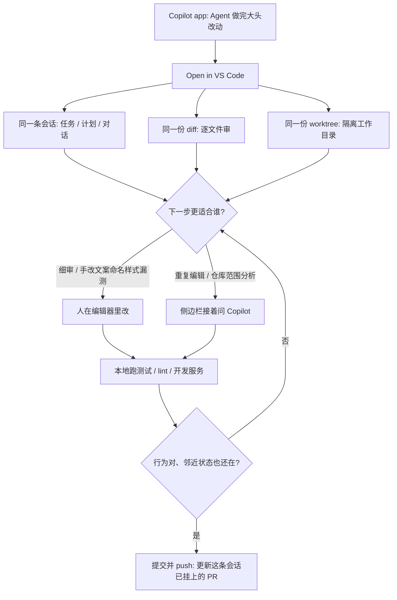

### 结论

GitHub 的 **Kayla Cinnamon** 写的是开发者每天都会卡的一步：Agent 已经在 [GitHub Copilot app](https://github.blog/ai-and-ml/github-copilot/how-to-continue-a-github-copilot-app-session-in-vs-code) 里把大头改完了，你却要进 **VS Code** 看 **diff**（这次改了哪些行）、改几句、本地跑起来再发。以前好像只能二选一：留在会话里，或在编辑器里从头开。其实不用。会话里点 **Open in VS Code**，原来的对话、改动和 **worktree**（这份会话用的那份隔离工作目录）一起过去。Copilot 扛重复、耗时的活；人接手做细审、手改和本地验证。

### 要点

- **会话带走的不只是改过的文件。** 一条会话还记下任务、计划和当时怎么改出来的。Cinnamon 的要求是：动手前先在 Copilot app 里看一眼任务和已完成的工作。不要把历史摘要复制进新聊天。VS Code 打开的是同一条会话，侧边栏里还能接着问「为什么改这个函数、不加 helper」。

- **Open in VS Code 一次接上三件东西。** 会话上下文（任务、计划、对话）还在；Agent 改过的文件和行可以直接审；编辑器打开的是会话用的那份 worktree，不是另检一份仓库再自己对分支。若弹出多个编辑器或 VS Code 安装，选你平时用的那个。你是在继续，不是在重建。

- **先按人写的改动来审，再决定手改还是接着问。** 源码管理视图里逐文件看：是不是在解决你要的问题、有没有跟仓库约定、错误和边界有没有处理、测试有没有盖到这次行为、有没有改不相干的文件。标签、报错文案、变量名、样式、漏测、仓库特有写法，往往手改更快。你改的是同一份 worktree，不必在目录之间拷文件。

- **本地跑通再推，推的还是这条会话已经在跟的 PR。** 用集成终端跑仓库自己的安装、测试、lint、开发服务；界面改动还要看不同视口，以及加载、空态、错误态。Ready 之后用源码管理或终端提交并 `git push`。因为打开的就是会话对应的 worktree 和分支，推上去会更新已经在跟踪这份活的 **pull request**，不用另开一份检出再手工接回去。

### 怎么做

面向已经能在 Copilot app 里开会话、也熟悉 VS Code 和 Git 分支的 junior：不必复制某一次演示，按同一条交接挡一遍。

1. **先确认 Copilot app 和 VS Code 登的是同一个 GitHub 账号。** 还要有权限在这份仓库里改、并推到会话对应的分支。没有进行中的改动，就谈不上交接。

2. **在 Copilot app 打开要继续的那条会话，看一眼任务和已完成的工作。** 不要先写一份摘要、再开新聊天。上下文已经在会话里。

3. **点 Open in VS Code。** 若有多个安装，选你要用来审 diff、跑终端的那一个。打开后核三件事：侧边栏是不是原来的会话、源码管理里能不能看到 Agent 的 diff、工作目录是不是这份会话的 worktree。

4. **先审再改。** 打开源码管理，逐文件看实现。不清楚就在侧边栏接着问，例如：说明为什么改这个函数而不是加 helper，以及可能影响哪些行为。要改文案、命名、漏测时，直接在编辑器里改；要仓库范围的分析或重复编辑，再把活交回 Copilot。两边改的是同一份目录。

5. **用仓库自己的命令做本地验收。** 例如 `npm test`、`npm run lint`、`npm run dev`。有 localhost 地址就打开看。界面改动要顺手看邻近状态，不要只验证「点过的那一条路径」。Agent 写的代码按人写的代码来验。

6. **最后再看一遍完整 diff，提交并推到原分支。** 仓库既有的分支、提交、评审和批准流程照走。这条 PR 已经在跟踪这份会话，不必把成品拷到另一份检出。

### 关键图表

*GitHub 原文的用法：Agent 在 Copilot app 里扛大头，人把同一条会话开进 VS Code 做细审、手改和本地验证；会话、diff、worktree 一起走，最后推回原来的 PR*
