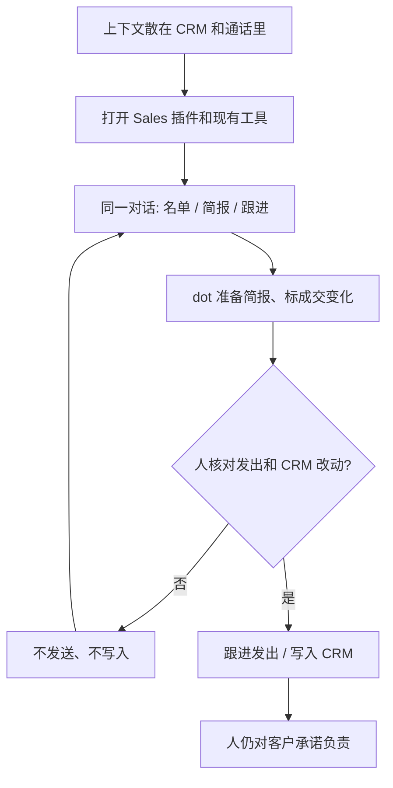

### 结论

[OpenAI](https://openai.com/index/introducing-chatgpt-for-sales) 这篇不是再发一遍「销售也该上大模型」。写的是销售已经怎么处理「客户上下文散在各处」。该追哪些账户、买方还缺什么才会往前走、哪几单该盯，答案往往摊在队友、获客工具、客户通话和 **CRM**（客户关系管理：记客户、商机和跟进的系统）里。**ChatGPT for Sales** 把这些接到同一处：一份给销售用的 **Sales 插件**（plugin：把外部工具接到 ChatGPT 里），加上三十多个新的或加强过的伙伴插件，用来准备会议、改提案、跟进承诺。德国能源采购公司 **NeoBid** 用 HubSpot 加上这套能力做房地产潜客研究、补 CRM、排优先级、写个性化外呼，联合创始人 **Gunnar Gombert** 估计这类手工活少大约 **65%**，省下的时间拿去帮客户优化物业组合的能源采购。人还是核对发出去的内容和写入 CRM 的改动的人。

### 要点

- **先拆掉「该追谁、会上说了什么，还要在 CRM、通话记录和队友之间切」这层，不是再换一个更会写开发信的模型。** 原文把日常活写得很具体：决定追哪些账户、为一次通话做准备、起草会后跟进。销售最好有一份对客户的共同理解；信息不在一处，共同理解就做不成。人还是决定哪封能发出去、哪条承诺能写进客户记录的人。

- **接到团队已经在用的工具，不要把客户资料粘进空白对话框。** 账户侧可接 Salesforce、HubSpot、Close CRM、monday CRM；找买方可接 Apollo、Clay、Common Room，再叠加 ChatGPT 的网页研究；通话可接 ChatGPT 里的 Meetings 插件，以及 Gong、Otter.ai、Granola；报价和协议可接 Docusign、Ironclad、PandaDoc、ServiceNow CPQ。内容侧还能用 Confluence、Guru、Seismic 学流程和产品更新，用语音模式练话术和异议，用 ChatGPT Slides、Gamma、Figma、Canva 做针对这个买方的材料。用哪几个，按你们现有流程选，不要一次全开。

- **验收要看一类具体的销售活少了多少手工，不要只看「接上了插件」。** NeoBid 量的是研究潜客、补 CRM、排机会、写个性化外呼这几步。帕金森研究 **Michael J. Fox Foundation** 的技术负责人 **Sandeep Chellani** 说，关系拓展的人用 Salesforce 插件，能把捐赠潜客和科研伙伴的洞察挖得更深，收集和汇总这些信息的时间和力气也少了。**Sculpted** 创始人 **Jacob Tuwiner** 写：以前在 Clay 里点菜单、对着大表迷路，专家也慢；现在用 ChatGPT for Sales 和 Clay，以前专家要几小时、几天甚至几周才发出去的一出 play（一套可重复的获客动作），可以在几分钟内发出去，步骤不再埋在一张巨表里。

- **会后跟进和成交风险可以让 Agent 起草，写入和发出仍要人点头。** 会后可让 ChatGPT 起草跟进、记下双方同意的下一步、准备客户记录更新；接上 Attio 时，可从 ChatGPT 把下一步存进 CRM。管线侧可用 Backstory 标出该盯的单，用 Data 插件或 Hex 解释管线哪里变了。**Pallet** 的 CEO **Sushanth Raman** 把 ChatGPT for Sales 和 **Rox** 当 GTM（go-to-market：获客和成交这条线）的日常：看清管线、早点看到成交风险，再让团队去推复杂单。也可以让 **dot**（ChatGPT 里常开着的个人 Agent）每天早上核一单、准备会议简报或跟进序列，但原文写的是「给你审」——不是代你发。

- **管理员先开插件和权限，成员再连自己的账号；能不能用，还看套餐、地区和工作区设置。** ChatGPT Business 和 Enterprise 管理员在 Admin Console 里选工作区、打开 Plugins，把 Sales 插件和相关伙伴插件开放给成员装，或给团队默认装上。然后核对需要的应用、以及它们能执行的动作。成员在提示时再完成账号连接。伙伴插件和功能是否可用，因套餐、地区和工作区设置而异。

### 怎么做

面向已经让 ChatGPT 写过开发信或会议纪要，却发现「该追谁还要在三个系统里拼、会上答应的下一步没人写进 CRM」的 junior：不必复制 ChatGPT for Sales 或 NeoBid 这个名字，按同一组顺序挡一遍。

1. **先写清卡在哪一步。** 「潜客研究要从 Clay 拷到 HubSpot」「会前简报要翻三份通话记录」「会后跟进隔天才写，CRM 还是空的」。写成对方能听懂的一句话：起草可以自动，对外发出和写入客户记录必须人点头。这是应用问题，不是再换一个更会写开发信的模型。

2. **先接上你们已经在用的 CRM 和通话工具，不要从空白对话开始粘客户资料。** 管理员在工作区打开 Sales 插件和对应伙伴插件，核对应用能执行哪些动作。成员按提示连上自己的账号。客户名单、通话纪要、产品更新，尽量从已连接的工具来，减少把敏感客户字段贴进聊天。

3. **同一条对话里走完「名单 → 为什么追这个账户 → 外呼理由」。** 原文的管线用法是：用 CRM 信息和 ZoomInfo、Clay 这类研究，排出一份优先账户名单；问清为什么适合、缺什么信息，按团队优先级收窄；再在同一对话里写成带具体理由的外呼。不要名单在一个窗口、理由在另一个窗口。

4. **会前要一份能对上号的简报，会后立刻起草跟进和下一步。** 会前把账户历史、以往通话和买方优先级收进一份简报，看还缺哪些答案，再改成针对这个买方的材料。会后起草跟进、记下双方同意的下一步、准备客户记录更新，人改完再写入。接了 Attio 一类工具，下一步可以从对话存进 CRM，但存之前要看过。

5. **用一次真的跟进验收，不要只看「插件能打开」。** 「潜客研究、补 CRM、写外呼是不是少了一截手工」「会后下一步有没有当天写进记录」「dot 标出的成交风险人有没有核过再动」。NeoBid 估的大约 65%，量的是这几类活动的手工，不是整条销售周期已经缩短了多少。Sculpted 验收的是一出 play 能不能在几分钟内发出去，而不是表更大了。

6. **人还是放行的人。** Agent 可以研究账户、起草简报和跟进、建议下一步、早上把成交变化摆到你面前。哪封能发、哪条承诺能写进客户记录、报价和协议能不能递出去，仍由负责人看过再定。权限给到哪、插件何时该闭嘴，也由工作区管理员先定。

### 关键图表

*OpenAI 原文的用法：把 CRM、通话和伙伴插件接到 ChatGPT for Sales，准备会议、写跟进、盯成交风险；NeoBid 估研究到外呼这类手工活少约 65%。人还是核对发出去的内容和写入客户记录的人*
