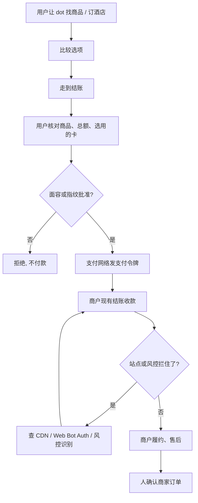

### 结论

[OpenAI](https://openai.com/index/introducing-chatgpt-wallet) 这篇不是再讲一遍「Agent 以后能替你付钱」。写的是已经在用 ChatGPT 查商品、比选项、决定买什么的人，结账时还要把卡号交给网站或 Agent。每周约有 **12 亿** 人用 ChatGPT，其中很多人已经走到「决定买」这一步。**ChatGPT Wallet** 要补的是付款这一截：用户把卡加进钱包一次，之后每笔由 **dot**（ChatGPT 里能代你办事的个人 Agent）去下单，人在批准前核对商品、总额和选用的卡，再用面容或指纹做一次安全校验。Agent 和商户都拿不到真实卡号；支付网络发一张 **支付令牌**（payment token：替代真实卡号的卡号、安全码和有效期）。合作方是 **American Express**、**Mastercard** 和 **Visa**。今天先从美国 **ChatGPT Pro** 订阅者、年满 18 岁、持合格美国发卡的人开始，入口在 dots。商户不必另做一套结账：现有网站和支付系统能收，但防火墙和风控别把 Agent 当成要拦的机器人。

### 要点

- **先拆掉「Agent 要代买，就得拿到真实卡号」这层，不是再换一个更会比价的模型。** OpenAI 的写法是：这是第一只让 Agent 付款、却接触不到用户真实卡信息、并且每笔都要安全校验的钱包；合格争议仍走卡组织原有奖励和保护。人还是决定这一笔能不能花出去的人。

- **卡只加一次，每一笔仍要人看过再批准，不要把「代付」理解成自动刷卡。** 用户先把卡加进 Wallet。dot 走到结账时，人核对商品、总额、选用的卡，再用 Face ID 或指纹批准。每次批准都会留下「人授权 Agent 买了什么」的记录。以后可以按额度、品类或时间预先授权，原文写成「预期」，不是今天已经打开的开关。

- **商户走现有结账，用户直接跟商家成交，不要让 Agent 变成新的收款方。** 人批准之后，支付网络发出支付令牌，扣的是用户选的那张卡。真实卡号既不给商家，也不给 Agent。商家仍管定价、履约、退货和客服；银行和卡组织仍评估交易。American Express 全球创新负责人 **Luke Gebb** 的原话是：持卡人用 Amex 卡时，仍逐笔查看并批准。

- **站点常会误拦 Agent，风控也会把正当代付当成欺诈，这才是商户今天要修的活。** 有些网站会无意挡住 ChatGPT Wallet 或其他 Agent 付款。OpenAI 同时发布了 [Commerce Partner Playbook](https://developers.openai.com/commerce/guides/overview)，让商家用现有网站和系统接待用 Agent 的顾客。马上能对上号的四件事：在 ChatGPT 认领商家并上传带现价和库存的商品源；CDN 或防火墙按 **Web Bot Auth**（用签名证明请求来自已验证的 ChatGPT 浏览器）放行，浏览器访问不需要插件或商品源；跟支付和风控商弄清如何识别 Agent 交易，避免无故拒付或取消，原文点名 Forter、Riskified、Sardine、Signifyd 以及 Adyen、Checkout.com、Stripe；需要结构化操作时再做插件或 **WebMCP** 工具，让 Agent 查库存、管购物车。Playbook 也写了：Wallet 可直接走现有结账页，不必单独接一套 Wallet SDK。

- **先小范围给美国 Pro 用户，用真实下单去磨兼容，不要写成已经全球能用。** 原文写从有限可用开始，是为了向商家、银行和支付网络学习，再扩兼容和可靠性。验收是「dot 能走完一笔人批准过的单，商家订单能确认」，不是「我们发布了钱包」。

### 怎么做

面向已经在用 ChatGPT 帮顾客或自己找商品、却卡在「Agent 没法安全付款」或「站点把 Agent 当机器人拦掉」的 junior：不必复制 Wallet 或 dots 这个名字，按同一组顺序挡一遍。

1. **先写清卡在哪一步。** 「比完价还要自己打开网站填卡」「Agent 要卡号才能代下单」「结账被 CDN 或风控挡成机器人」。写成对方能听懂的一句话：找货和填单可以自动，对外扣款必须人点头。这是应用问题，不是再换一个更会比价的模型。

2. **用户侧：先有 dot，卡加在安全表单里，不要把卡号、安全码写进聊天。** 原文的入口是 dots，面向美国 Pro、18 岁以上、合格美国发卡。加卡一次之后，让 dot 找商品或订酒店；结账时核对商品、总额、卡和运费/订阅条款，再用面容或指纹批准。换设备批准时走原文说的链接或二维码，不要把验证码贴回对话。

3. **批准完成不等于商家已经下单。** 人批准后，dot 继续走结账并回报结果。订单以商家确认为准；结果不清楚时先查商家回执，再决定要不要换一种支付方式重试。取消、退货、退款找商家；拒付、未识别扣款找发卡行。

4. **商户侧：先让已验证的 ChatGPT 浏览器进得来，再谈「Agent 会买」。** 认领商家、更新资料、上传带现价和库存的商品源。CDN 或防火墙识别 Web Bot Auth 签名，确认常规安全策略没有误拦。浏览器访问不需要先做插件。

5. **结账仍用现有页面；风控要认得 Agent 代付，支付令牌不要拿去刷下一单。** Wallet 的令牌走现有结账流。风控若把云端浏览器当成机器人，正当购买会被拒或被取消——去问现有风控和支付服务商怎么识别这类交易。顾客只同意这一笔；不要把这次令牌存下来付另一笔。订阅若现有结账本来就支持周期扣款，仍要单独拿到顾客对周期扣款的同意。

6. **人还是放行的人。** Agent 可以找货、比价、填结账页。哪一笔能批、哪张卡能加、哪家店的防火墙能放行、退货按谁的政策走，仍由负责人看过再定。预先按额度或品类授权，等原文说的增强保护真正可点再测，不要把「预期」当成已经交付。

### 关键图表

*OpenAI 原文的用法：美国 Pro 用户让 dot 代付，每次生物识别批准，商户走现有结账、拿不到真实卡号；站点别误拦 Agent，人还是批准每一笔钱的人*
