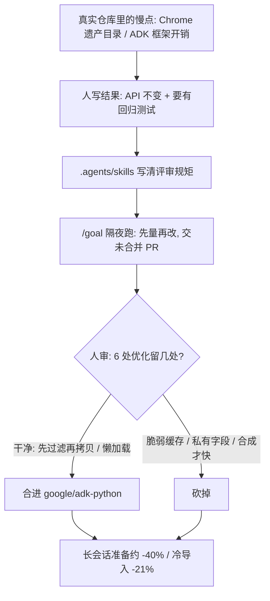

### 结论

[Google](https://blog.google/innovation-and-ai/models-and-research/gemini-models/introducing-gemini-4-argon) 这篇不是再发一遍「换个更强模型」。写的是内部团队已经用 **Gemini 4 Argon**（2026 年 10 月 13 日公开发布的前沿模型）在真实仓库里干活。**Chrome** 要在 Chromium 大约 **4000 万** 行代码里，把网页核心处理从大约 **600 万** 行的遗产功能目录拆开；Argon 一次推进多份干净改动，跨几百个文件的架构重构，几个月的活压到几周。开源 **ADK**（Agent Development Kit，给企业搭 Agent 的框架）团队把评审规矩放进 `.agents/skills`，再写一段「去掉框架开销、不破坏现有应用」的目标。Argon 在 **Antigravity**（Google 的 Agent 开发环境）里隔夜自己跑，优化已进 [`google/adk-python`](https://github.com/google/adk-python)：长会话里内存准备会话大约快 **40%**，冷启动导入快 **21%**。[工程深潜](https://developers.googleblog.com/en/optimizing-a-200000-line-python-codebase-overnight-with-gemini-4-argon/) 写清了提示词、技能文件和人审时砍掉的方案。过去几周，用 Argon 的团队 **agentic**（由 Agent 提交的）代码提交多了超过 **35%**，回滚大约少了三分之一。

### 要点

- **验收看仓库里的时间和回滚，不看「我们上了新模型」。** 发布稿会写 Argon 在 Vals Index（按金融、编码、法律、税务等行业任务比模型）上排第一，上市价每百万 token 输入 **2** 美元、输出 **10** 美元，缓存输入便宜 **95%**（2026 年 11 月 30 日后变为 4 / 20 美元）。对干活的人更有用的是上面那组数：Chrome 工期、ADK 的 40% / 21%、提交 +35%、回滚大约少三分之一。先有真实仓库上的前后对比，再谈换模型。

- **Chrome 拆的是「网页核心」和「遗产功能目录」，不是重写浏览器。** Chromium 大约 4000 万行；要动的是里面大约 600 万行、堆在一起的浏览器功能目录。Argon 帮他们把网页处理从这堆遗产代码里分开，一次推进多份干净改动，跨几百个文件。官方对用户侧的说法是：标签、侧栏、浮窗之间移动还活着的页面时不必重载，少掉一类崩溃。大重构能压到几周，靠的是「多份小而干净的改动并行进」，不是一次丢一个巨型 diff。

- **ADK：人写约束，Agent 隔夜找跨文件瓶颈。** 性能问题很少只在一个函数里。团队没有先点一个热点函数，而是给手册和一段目标：启动、长会话、多 Agent 工作流都不要有明显开销，公开 API 和模型看到的内容不变。工程深潜写：仓库大约 **20.5 万** 行、近 **800** 个源文件、将近 **1.7 万** 个单元测试。第一轮几乎零手册，大约两小时就找到会话拷贝和包导入上的真瓶颈，但改坏了公开 JSON 结构、漏了 mock 边界、只跑了附近 216 个测试。第二轮把维护规矩放进 `.agents/skills`，打开 `/goal`（长目标模式：上下文被压缩后目标还在），要求交一份未合并、带前后数字的 PR。Argon 从晚上 9:11 无人值守跑了 **11** 小时。

- **人做减法，Agent 负责探路。** 隔夜 PR 提了 6 处优化、动了 32 个文件。合进生产的只有两处：读会话时**先过滤再拷贝**（以前每次先深拷贝整段对话，连「只列会话、不要事件」也先拷一遍）；重模块改成**第一次用到再加载**，公开属性仍能被测试 mock。人审砍掉另外四条：弱引用缓存可能串会话、读了 OpenTelemetry 的私有字段、改了历史拼接但独立对照基准的端到端延迟没动、只对合成回放有用的索引。最后合成 22 个文件、17 个新测试函数，提交说明写「Argon generated these changes」。

- **同类活也是「先定结果，再让 Agent 连夜改」。** 研究人员用同一套 Antigravity 流程，把开源量子化学包 **xTB** 预测分子结构最高加快约 **2.3** 倍、构象搜索约 **1.8** 倍，改动已回馈上游。Gemma 4 E2B 在 A100 上经 vLLM 的端到端推理，几天内从大约 **3.79 万** 提到超过 **10.8 万** token/秒（约 **2.85** 倍），token 对齐、质量不降；以前这类活往往要几个月。Isomorphic Labs 用 Argon 读复杂 PDF 和专利、抽出和药物设计相关的信息，以前大约几周，现在大约几小时。

### 怎么做

面向仓库已经大、慢点散落在很多文件里的 junior：不必等一个叫 Argon 的模型。按同一组问题挡一遍。

1. **先写结果，不要先点一个热点函数。** 写成：启动和长会话不要有明显开销；公开 API 不变；每处改动有能抓住回归的测试。ADK 第一轮证明：只给这段，模型也能自己写基准、先量再改。

2. **把评审规矩写进仓库，不要只写在聊天里。** 维护约定、命名、导入、哪些测试必须全绿，放进 `.agents/skills`（或你这边的指令 / 技能目录）。第一轮没有手册，速度上去了，合不进去。

3. **长任务把目标钉住，并要求未合并的 PR。** 用 `/goal` 这类能跨过上下文压缩的机制，明确写：对照 `main` 开一张 PR，描述里写前后数字，不要自己合并。人第二天只审 diff。

4. **人审时做减法。** Agent 会提出一堆「有数字」的改动。先问：会不会改公开行为、会不会读私有字段、独立对照基准上用户能不能感觉到。ADK 是 6 留 2。

5. **自己准备一份 Agent 没见过的对照基准。** ADK 在开跑前写了 `bench_turn.py`：会话一回合一回合变长，模型和工具都是瞬时返回，钟上每一毫秒都是框架自己的开销。只看 Agent 自己报的加速，容易留下「合成测试上很快、真实路径没动」的改动。

6. **大重构拆成多份干净改动并行推进。** Chrome 的做法是一次推进多份小 diff，而不是攒一个跨几百个文件的巨型提交。用户能感觉到的结果（少一次重载、少一类崩溃）写进目标，方便第二天验收。

### 关键图表

*Google 原文和 ADK 工程深潜的用法：人定约束和对照基准，Agent 隔夜探路；人审只留能进生产的改动*
