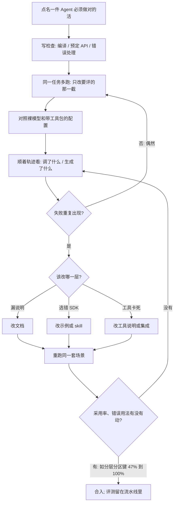

### 结论

[Microsoft Open Source](https://opensource.microsoft.com/blog/2026/10/19/introducing-scope-open-source-evaluation-for-ai-coding-agents) 这篇不是再发一遍「我们开源了一个评测框架」。写的是 **Azure Cosmos DB** 团队已经在用 **Scope**——微软开发者关系组做了一年多、现在按 MIT 开源的 coding agent 评测平台——看 Agent 会不会用对它们的产品。Agent 会自己发现 API、选 SDK、读文档、代开发者调工具；给人测过的体验，Agent 仍可能选错接口、漏掉关键说明、或卡在任务做完之前。高级项目经理 **Jay Gordon** 说：他们用 Scope 对照裸模型和自家 **Agent Kit**（给 Agent 用的工具包），跑了 **8** 个端到端 Cosmos DB 场景、覆盖 **5** 种语言，据此修掉 **20** 个 Agent Kit 问题和 **27** 个文档问题。一次定向的 Agent Kit 更新之后，**分层分区键**（hierarchical partition key：按多层键拆数据，用来避开热点、把查询限制在该扫的那一段）采用率从 **47%** 升到 **100%**；**OFFSET/LIMIT**（跳过前 N 条再取一页；在 Cosmos 里往往要扫过被跳过的那些，贵且慢，通常该用续传令牌）从 **47%** 降到 **0%**。量的是 Agent 有没有用对产品，不是「我们上了评测」。

### 要点

- **人觉得好用，不代表 Agent 会用对。** 产品团队长期做 **DevEx**（developer experience，开发者体验）：可用性测试、访谈、工单。这些仍然要做。但 Agent 已经成为软件的一类用户：它按文档和工具描述做决定，一次演示或一条 CI 过了，说明不了它下次还会选对。模型、Agent 运行时、skill、插件、**MCP**（把外部系统接到模型上的协议）和自定义说明都会改行为；同一次任务多跑几遍，结果也会晃。微软把多出来的这一层叫 **DevAx**（Developer Agent Experience，开发者 Agent 体验）：看 Agent 怎么用你的软件，用证据决定下一步改文档、改 SDK，还是改工具。Scope 要接住的，就是把「再跑一遍、看它卡在哪」变成可重复的实验，而不是一次成功的现场演示。

- **Cosmos DB 验收的是采用率和错误用法，不是排行榜。** 他们问的不是「哪个 Agent 分最高」，而是：在这 8 个场景、5 种语言里，Agent 会不会选对 SDK、会不会用分层分区键、会不会还在用 OFFSET/LIMIT。对照裸模型和 Agent Kit，失败会落成两类具体活：工具包该修的记成 20 个问题，文档该写清的记成 27 个问题。一次定向更新之后，分层分区键从大约一半的任务用对，变成这批场景里全部用对；OFFSET/LIMIT 从大约一半的任务还在用，变成这批场景里不再出现。Gordon 写明：这些数字描述的是被评过的 Cosmos DB 场景，不是给所有 Agent 做总排名。价值在于：看到行为，改一处，再测一次，采用率会动。

- **评测要能指出「改文档、改 SDK，还是改工具」。** Scope 把调查收成三块。文档：Agent 是不是反复漏同一条说明、是不是带着错的假设往下做；改完指导再跑，看这类失败是否变少。SDK：Agent 会不会选中你希望它用的那一套、初始化对不对、API 用得是否符合预期；拿基线和改过的示例或一条 agent skill 对照。工具：命令行或 MCP 卡在哪；用轨迹决定是把工具说明写清楚、把错误信息写成下一步能执行的话，还是改集成本身。例如 SDK 团队可以让 Agent 给样例应用加集成，再看它能不能编过、有没有走预定 API、有没有处理文档里的错误响应。若「找不到条目」反复失败，团队就有一条具体行为可查，而不是一句「Agent 不太行」。

- **任务和标准固定，只改你想评的那一截；「做完」写成可依赖的检查，不要一个总分。** Scope 去驱动现成的 coding agent，包括 GitHub Copilot、Claude Code，以及装了 Copilot 的 Visual Studio Code。你提供有代表性的任务，必要时给一份起始代码，再选 Agent 配置。可配置的 **persona**（人设）用来换模拟用户的立场和说话方式。可复用、带版本的 **profile** 记下每一次运行的工人、模型、Agent 版本、skill、MCP 和扩展。任务和评分标准保持不变，只改你要对照的那一部分；多跑几遍，用来把反复出现的问题和偶然失败分开。成功标准按你的产品写。Scope 把检查收成一张 **DAG**（directed acyclic graph，有向无环图：节点是检查，边是「必须先过谁」），检查可以独立，也可以依赖前置——比如运行时检查要等编译先过。**Judge** 服务再用模型对照这些标准看输出，帮团队看清哪一条过了、哪一条还要查。自动裁判会错，所以还是要人看证据再拍板。

- **失败要能回到某一次工具调用，而不是停在「这次红了」。** 标准级结果只是调查的起点。Scope 在 Agent 干活时把活动流出来，并留下交互和工区快照。团队可以顺着工具调用、看生成的文件，把一条没过的要求和它前面的步骤接上。这些轨迹是「它实际做了什么」的证据，用来把失败收成一条文档、SDK 或工具改动。配置可重复，不保证 Agent 每次行为相同。微软的用法是：任务要代表真实活、同一任务多跑、用人审证据再改产品。Scope 是你自己部署的软件，不是随这篇一起提供的托管服务；本地可以用 Docker Compose 拉起。门户用来配置和查看实验，CLI 和 REST API 用来从脚本和流水线提交、取结果。评测要变成反复出现的产品反馈，而不是上线前做一次。

### 怎么做

面向正在维护 SDK、CLI、MCP 或 skill、已经看到 Agent 会选错接口的 junior：不必复制 Scope 或 Cosmos DB 这个名字，按同一组顺序挡一遍。

1. **先点名一件 Agent 代用户做时必须做对的活。** 写成谁在用、做成什么样算数。Cosmos 的标准是「这批场景里要用分层分区键，不要用 OFFSET/LIMIT」。不要第一句就「全面评测所有 Agent」。

2. **把成功写成几条能独立判定的检查，并写清依赖。** 能编过、走了预定 API、处理了文档里的错误响应，各算一条。运行时检查依赖编译；不要先出一个平均分。

3. **同一任务多跑，只改你想评的那一截。** 模型、skill、MCP、文档示例，一次只动一个。记下配置。反复失败优先查；偶然失败先标成异常，不要据此改产品。

4. **对着轨迹改产品，不要只改提示词。** 漏说明就补文档；选错 SDK 就改示例或 skill；工具报错看不懂就把错误写成下一步能执行的话。Cosmos 把发现收成 20 个工具包问题和 27 个文档问题，再做一次定向更新。

5. **改完立刻重跑同一套场景。** 验收看采用率和错误用法有没有动，像分层分区键和 OFFSET/LIMIT 那样能对上前后数字。排行榜可以后做。

6. **人审证据再对外说「我们测过」。** 自动裁判和单次演示都会漏。抽几条 Trace：它调了什么、生成了什么、失败发生在哪一步。说得清，才值得改下一处。

### 关键图表

*Microsoft 原文里 Cosmos DB 的用法：先对照裸模型和 Agent Kit，把失败收成工具包和文档问题；一次定向更新后，再看分层分区键和 OFFSET/LIMIT 有没有按预期动*
