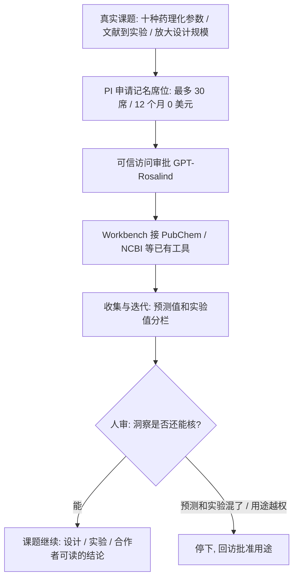

### 结论

[OpenAI](https://openai.com/index/introducing-the-rosalind-academic-plan) 这篇不是再发一遍「生命科学模型更强」。写的是实验室已经在真实课题里用 **GPT-Rosalind**（面向生命科学的专用模型，配 **Rosalind Workbench**：把药物化学、基因组、湿实验辅助等工具编排起来）。**UCSF Zhao Lab** 用它更快收集药物**理化参数**（溶解度、稳定性这类决定药能不能往下做的性质），接上 **PubChem** 和 **NCBI**（公开化学与生物医学数据库），一次覆盖十种药，并分清哪些是模型预测、哪些是实验测得。Bourdenx Lab 的 **Mathieu Bourdenx** 用同一类 GPT 模型查文献、收紧实验和计算方案，迭代更快、能试的假设更多。Stanford / Arc Institute 的 **Brian Hie** 说，现有发现和设计任务能做得更好，也能扩到以前做不到的规模，同时还给生物学研究者看得懂的洞察。为了让更多实验室迈过「买不起席位」这一步，OpenAI 推出 **Rosalind Academic Plan**：合格的美国高校实验室最多 **30** 个 Business Standard（ChatGPT 商业标准档）席位、**12** 个月每人每月 **0** 美元；GPT-Rosalind 仍要走可信访问审批。研究数据默认不拿去训练。目前不含 API。

### 要点

- **验收看课题里的活，不看「我们上了生命科学模型」。** Zhao Lab 的活很具体：十种药的参数、预测值对实验值。Bourdenx 的活是文献 → 实验/计算 → 再试一轮。Hie 要的是规模上去之后洞察还在。先有真实工作流上的前后对比，再谈换模型。

- **专用模型要接上实验室已经在用的工具，而不是另开一个聊天窗口。** GPT-Rosalind 的卖点不是「会聊天」，是 Workbench 能编排药物化学、基因组、湿实验辅助。Zhao Lab 点名的是 PubChem 和 NCBI。工具不到位，十种药的参数还是要人手一份一份抄。

- **预测值和实验值必须分开记。** 药物设计里最容易踩的坑，是把模型估的性质当成已经测过的结果。Zhao Lab 写的是：一边查十种药，一边把预测值和实验测得的值分开，而不是混成一张表。junior 接到「AI 给了个数字」时，先问这是算出来的还是测出来的。

- **降成本的办法是记名席位，不是把钥匙发到群里。** 计划给的是最多 30 个具名成员，由 **PI**（课题负责人）或实验室负责人管权限，并对本实验室的批准用途负责。大学已有 OpenAI Enterprise 协议的，走学校现有入口；没有的，由 PI 代实验室申请。不含 API，就不能拿一把密钥接到自己的脚本上到处跑。

- **人还是判断的人。** OpenAI 的说法是：让更多实验室把科学专长和判断，跟专用推理接在一起。人类基因组计划、CRISPR、mRNA 疫苗这类例子，强调的是学术问题先被问出来、再被做出来。模型加快收集和迭代，不替代课题选择和实验结论。高敏感用途会登记研究语境；有疑问时会回访研究者，而不是一律打断已批准的工作。

### 怎么做

面向正在把专用模型和领域工具接进真实课题的 junior：不必等一个叫 Rosalind 的模型。按同一组问题挡一遍。

1. **先写这周要完成的活，不要先申请「最强生命科学模型」。** 写成：一次查十种化合物的哪几项性质；文献看到哪一步必须变成可做的实验或计算；规模变大之后，给合作者看的仍是人能核的洞察。Zhao Lab / Bourdenx / Hie 都是从自己的课题写起。

2. **把实验室已经在用的数据库和仪器流程接到同一条工作流。** PubChem、NCBI 这类公开库，或你们自己的实验记录、测序管道。只开一个聊天窗口、数字还要人手抄进表格，效率不会变。

3. **输出里强制分栏：预测 / 实验 / 未测。** 模型给的溶解度、结合、稳定性，默认标成预测。实验测得另记。混在一起，后面的人会按假数据做决策。

4. **用记名席位，不用共享密钥。** PI 管谁能进、能做什么。用量按人看。计划明确此刻不含 API，就不要先把专用模型接到无人值守的脚本上。

5. **先问数据会不会拿去训练，再把课题贴进去。** 本计划默认不用于训练。你们机构若另有协议，以机构流程为准。高敏感课题走批准用途，不走「先试再说」。

6. **人审仍看实验和文献，不看模型语气。** 模型负责收集、对照、把下一轮假设写清楚。药该不该往下做、实验该不该开，仍由实验室拍板。

### 关键图表

*OpenAI 原文的用法：实验室用专用模型和已有数据库做自己的课题；席位免费只是把门打开，预测与实验分开、人审结论，才是能发表的工作流*
