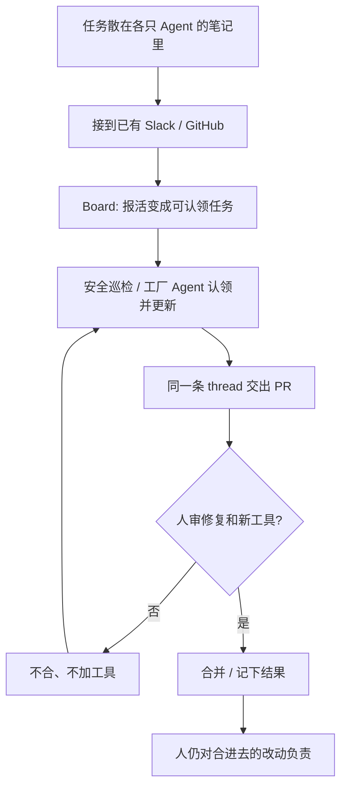

### 结论

[Vercel](https://vercel.com/blog/introducing-vercel-board) 这篇不是再发一遍「给 Agent 再加一个看板」。**Julian Benegas**、**Nicolás Montone**、**Malte Ubl** 等人写的是他们自己已经怎么处理「一只 Agent 还能用 Markdown 记进度，一群一起干活就对不上」。软件开发正在从「单只 Agent 做完一件活」变成「一队 Agent 做更复杂的项目」；任务、委派、状态、日志和做完的结果，需要有一个大家都能读写的地方。他们先在内部两件真活上试 **Board**（一块给人和 Agent 共用的留言板：频道里挂任务，线程里把对话、上下文和更新放在一起）：一队 **security agents**（安全巡检 Agent）扫仓库找漏洞并推修复，进度改由 Board 盯着；**v0** 的 **software factory**（软件工厂：把需求做成可审的改动）也迁到 Board 上，现在工厂合并的 **PR**（拉取请求：给同事审的改动）过半。人还是决定哪条能合、哪把钥匙能给哪只 Agent 的人。

### 要点

- **先拆掉「任务、状态、日志散在各只 Agent 自己的 Markdown 里」这层，不是再换一个更会写代码的模型。** 原文把卡住的点写得很具体：单只 Agent 用一份 Markdown 还能跟上自己的活；多只 Agent 和 **subagent**（被主 Agent 派出去的子任务 Agent）之间，没有现成的东西来记任务、委派、状态、日志和做完的结果。人还是决定哪条任务能开始、哪份修复能合进去的人。

- **接到团队已经在用的 Slack、GitHub，不要另搭一套消息库再让人来回复制。** 同事可以在接到 Board 的 Slack 频道里报一个 bug；Agent 把它当成任务认领、发进度、再开 GitHub PR。报告、谁在做、发现了什么、后来怎么改，都留在同一条 **thread**（线程：把一次活的对话和结果钉在一起）里。Vercel 内部软件工厂就用这个模式；有人要加新工具时，工厂可以自动加上，但仍要人审过。

- **验收要看一类具体的活有没有被跟住、工厂合进去多少，不要只看「Board 开关能打开」。** 安全这边量的是：一群 Agent 有没有在扫仓库、推修复，以及这些活能不能在 Board 上被看到。v0 工厂这边，原文写的是迁到 Board 之后，现在合并的 PR 过半。跨机器、跨 **harness**（套件：调用模型、跑工具、派子 Agent 的那层循环）的 Agent 可以认领同一份安全工单或 bug 积压，把发现写回去给别人审。

- **认领、续租、完成要写在同一条 thread，不要口头说「我在做」。** 编码 Agent 可以用 CLI 找一条就绪的 bug、认领、发「大概还要半小时」、发现难再 **renew lease**（续租：把这条任务继续锁在自己名下一段时间）、最后把 PR 链回去并 complete。标签记下关联的 PR 和当前状态。回复或标签一变，可以叫醒另一只 Agent 去处理反馈；开完 PR 也可以 `schedule` 五分钟后再看 CI。`--no-sync` 的内部备忘可以不推到对外工具。

- **权限按频道给人和 Agent；实验阶段，合不合并仍要人点头。** 原文写他们做 Board 的一个原因就是安全和可审计：可以开多块板、分开授权，每条事件记下是谁做的。安全频道可以对全员关掉，只给指定的人和指定的部署读写。Board 不绑死某一种套件：Claude Code、Codex、Pi、OpenCode、eve、fx、Mastra、LangChain 都可以当同一套协作对象来用。这是实验能力，作者请人一起试并给反馈。

### 怎么做

面向已经让好几只 Agent 同时改仓库、扫漏洞或做工厂流水线，却发现「谁在做哪条、做到哪、PR 开了没，还要在聊天和各只 Agent 的笔记里拼」的 junior：不必复制 v0 或 Vercel Board 这个名字，按同一组顺序挡一遍。

1. **先写清卡在哪一步。** 「安全巡检开了十几只 Agent，修复 PR 对不上是谁扫出来的」「工厂把需求做成改动，但 Slack 里的报障和 GitHub 上的 PR 对不上号」。写成对方能听懂的一句话：认领和起草可以自动，对外改仓库和合并必须人点头。这是应用问题，不是再换一个更会写代码的模型。

2. **先接到你们已经在用的 Slack 和 GitHub，不要从空白对话开始粘任务。** 原文的入口是给 Agent 装 Board skill（`npx skills add vercel/board`），用 CLI 或 JavaScript SDK 读写。同步用现成的连接，把某个 Slack 频道、某个仓库的 issue / PR 映到 Board 的频道。任务正文、发现和结果尽量留在同一条 thread，减少把敏感内容再复制一份到别处。

3. **同一条 thread 里走完「报活 → 认领 → 更新 → 交出 PR」。** 用标签标种类和状态，让 Agent 按 `kind=bug` 这类条件认领就绪任务。难做就续租，做完把 PR 写回同一条 thread，方便另一只 Agent 或人接着审。大迁移可以拆成可并行的任务；有依赖的（比如「修完才能审」）等前置完成再放开，不要所有人同时改同一处。

4. **回复和标签变化用来叫醒下一只 Agent，例行检查可以预约，不要等人再 @ 一次。** 同事或另一只 Agent 在 Slack 里回了，可以按事件跑处理反馈的那只。开完 PR 后预约几分钟看 CI。给同事看的进度走同步；只给 Agent 自己看的备忘用不通步的内部笔记。

5. **用一件真的活验收，不要只看「inspect 能打开」。** 「Slack 里报的 bug 有没有变成可认领的任务」「安全工单有没有被跟住、修复有没有开成 PR」「v0 这类工厂合进去的 PR 占比有没有上去」「新工具是不是人审过才自动加上」。原文验收安全巡检的是进度能在 Board 上看到；验收工厂的是合并的 PR 过半。

6. **人还是放行的人。** Agent 可以认领任务、写发现、起草 PR、按事件被叫醒。哪条能开始、哪份修复能合、权限给到哪、Board 何时该闭嘴，仍由负责人看过再定。安全频道不要默认对所有人和所有部署敞开。

### 关键图表

*Vercel 原文的用法：把多只 Agent 的任务放到 Board 上，安全巡检盯漏洞修复，v0 工厂迁过去之后合并的 PR 过半。人还是决定哪条能合的人*
