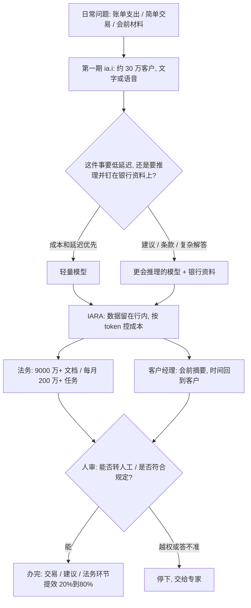

### 结论

[OpenAI](https://openai.com/index/itau-generative-ai) 这篇不是再发一遍「银行也上了大模型」。写的是巴西 **Itaú** 已经在受监管的业务里用生成式 AI 干活。对外是 **ia.i**：一层可用文字或语音打开的对话入口，把活期账户、信贷、信用卡、保险等交互收进同一处，需要时再接到人工专家。第一期大约 **30 万** 客户，目标是 **2026** 年底覆盖全部客户。对内是 **IARA**（银行自己的治理和编排平台）：按内部政策给团队受控访问不同模型。法务方案在 **9000 万+** 文档仓库上跑，每月超过 **200 万** 任务，部门流程里部分环节提效 **20% 到 80%**。CTO **Carlos Eduardo Mazzei** 的标准是：先解决日常问题，技术尽量不被察觉；模型只是手段。

### 要点

- **验收看日常能不能办完，不看「我们上了对话银行」。** Itaú 和 Grupo Consumoteca 的调研写：约 **80%** 的巴西人想把财务理得更清楚，约 **65%** 希望有持续给建议的财务副驾。ia.i 覆盖的是账单里一笔支出是什么、投资建议、WhatsApp 上办一笔方便的交易。先有真实客户路径上的前后对比，再谈换模型。

- **简单问题和要推理的问题不要塞进同一个模型。** Mazzei 的说法是：从最在意成本和延迟的简单请求，到必须推理、并且要把回答钉在银行资料上的复杂解答，OpenAI 的一组模型能覆盖。**Customer DNA**（大约 **7000 万** 客户的财务上下文：需求、习惯、人生阶段）在治理下由 GPT 等模型协助维护和补全。一套产品里用一组模型，而不是押一个「最强」。

- **先服务一小批，再谈全量。** 第一期大约 30 万客户，用来看人到底怎么用，而不是一天铺到全库。下一步才是产品试算、开通，以及按收入、支出和习惯做定期分析。目标是 2026 年底覆盖全部客户。不是每一步都适合纯对话：文字、语音、图像和点击要能在同一条体验里切换。

- **法务提效来自读自己的仓库，不是另开一个聊天窗口。** IARA 让信息留在银行上下文里，受控访问模型，并盯 **token**（模型按文本块计费的单位）效率，整套方案才经济上站得住。法务侧自动读、析、解 9000 万+ 文档，每月 200 万+ 任务。IARA 同时管三件事：按 token 控成本、答得准、落实内部规定。受监管行业里，这层先有，才能既快又可控。

- **同一层智能也给客户经理用，省下来的时间要回到客户身上。** 会前摘要、准备会议、弄清一个具体问题、列出以前来不及想的方案。银行对这套内部落地的预期是：客户关系时间大约多 **3** 倍，服务最快快约 **1** 倍，对话有效程度大约高 **3** 倍。人还是见客户的人；模型把准备和整理先做掉。

### 怎么做

面向正在把对话入口和内部文档方案接到真实业务的 junior：不必复制 ia.i 或 IARA 这个名字，按同一组问题挡一遍。

1. **先写这周客户或同事反复问的那件日常事。** 账单里一笔支出、一笔简单交易、会前要读的材料。Mazzei 的要求是：直接、简单、对方记得住。先有一件能办完的事，再申请「最强金融模型」。

2. **按成本和是否必须推理拆模型，不要一条链路通吃。** 查余额、走固定流程，优先低延迟、低费用。给建议、解释条款，才上更会推理、并且能钉在你们自己资料上的模型。

3. **第一期只给命名的一小批用户。** 看他们从哪进来、卡在哪、何时必须转人工。Itaú 用大约 30 万客户学真实用法，再谈全量。

4. **文档和客户数据留在自己的上下文里，模型访问走同一道门。** 统一看出站费用、答得准不准、是否符合内部规定。法务这种仓库，先数清文档量和每月任务，再谈「我们上了阅读 Agent」。

5. **对话和按钮一起留。** 不是每个动作都适合用自然语言。文字、语音、图像、点击可以在同一条路径里换。需要专家时，明确接到人，不要让模型硬答。

6. **内部先省时间，再对外铺同一层能力。** 客户经理的会前摘要、客服弄清一个具体问题，先能量出「省了多少准备时间」。Itaú 的预期数字是关系时间、服务速度和对话有效程度，不是「我们给全员开了聊天窗口」。

### 关键图表

*OpenAI 原文的用法：先用一小批客户验证日常路径，再用治理平台把模型和行内资料接上；法务仓库和客户经理准备，验收看任务量和省下的时间*
