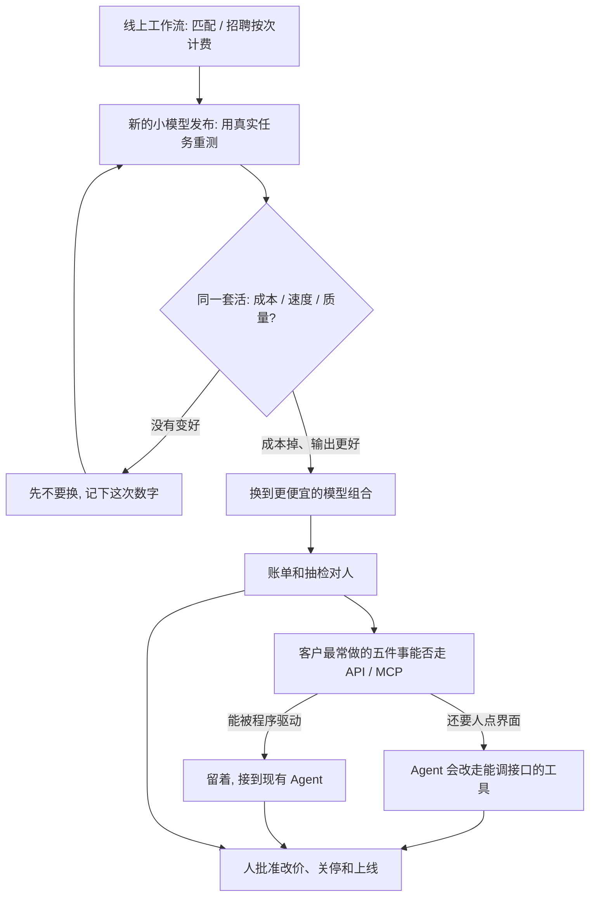

### 结论

[SaaStr](https://www.saastr.com/jasons-takes-on-this-weeks-20vc-a-72-cost-drop-on-our-own-app-the-100m-acquisition-bar-and-doordashs-third-competitor) 这篇不是再讲一遍「模型越来越便宜」。创始人 **Jason Lemkin** 写的是自家 **SaaStr Connect**（AI 匹配和招聘应用）已经怎么换到 **Haiku 5.5**（Anthropic 更小、更便宜的模型）和更便宜的模型组合：同一套工作流总成本降了 **72%**，还更快、输出更好。从 2025 年初到现在，尽管公开的 token 价格和评测图一直在掉，他们跑的 **agentic**（让模型按步骤调工具把活做完）工作流按次计费从没便宜过。这是第一次在自己账单上看到。他们现在跑 **21** 个 Agent；**Canva** 用了 12 年，因为 Agent 登不进去就关了。验收不是「我们换了新模型」，而是同一套匹配/招聘活，账单少了七成，并且每次有新的小模型发布，都用真实任务重测模型组合。

### 要点

- **先拆掉「评测图在掉、自己账单却没掉」这层，不是再换一个更会写匹配结果的模型。** Lemkin 的原话是：从 2025 年初起，不管 token 价格和评测怎么画，他们跑的 agentic 活按次计费都没便宜过。上线时定一次模型组合、之后再也不动，多半在大幅超付；已经用真实任务重测的对手，可以用更健康的毛利率把你压下去。Connect 换组合之后，成本、速度和输出质量第一次一起动。

- **用生产里的真实任务重测，不要拿公开评测当账单。** 新的小模型一发布，就把线上那套匹配、招聘工作流再跑一遍，看同一份活要花多少钱、快多少、输出好不好。原文的收束是：推理成本掉 **70%**，已经够改毛利率，值得把这活排进日程。设一次就不管，是在用过期价格服务现在的流量。

- **价值写在工作流和结果上，不要按 token 加价。** 同一周里，OpenAI 把大致同类的能力卖得大约便宜 **30%**，开源权重模型也在往下拉价。如果产品的卖点主要是「我接了某个模型」，价格会跟着能力一起掉。Lemkin 的判断：按模型能力定价的公司，要准备一年内降价 **30% 到 40%**；按你交出的结果、你卡住的工作流来定价，那些不会像 token 那样通缩。

- **产品要让 Agent 不登录界面也能把五件常见活做完，否则它会改走能调接口的工具。** SaaStr 跑 21 个 Agent，用 Higgsfield、Opus 这类能被程序驱动的工具。Canva 不是其中之一，用了 12 年后关掉。DoorDash 已经给外部 Agent 做了 **MCP**（Model Context Protocol：让 Agent 按约定调用产品能力的接口）。把客户最常做的五件事列出来，逐项看今天能不能走 API 或 MCP；还要人点界面的那件活，Agent 会交给别人。

- **常驻 Agent 的人均成本要单独算，不要拿「能写代码的产品大约 4 到 5 美元」当账单。** Replit、Lovable 把虚拟机起停打磨之后，服务成本大约每人每月 **4 到 5** 美元。Lemkin 原以为一直在线的 Agent 会接近这个数，实际可能超过 **20** 美元，重度用户更贵。混在一起的平均值会把那 10% 的重度用户藏起来，而他们往往是最爱发帖的人。定价前先把这层成本拆开。

### 怎么做

面向已经把匹配、招聘或客服做成 agentic 工作流、但模型组合还是上线时那一套、账单也没跟着公开价格掉的 junior：不必复制 Haiku 或 Connect 这个名字，按同一组顺序挡一遍。

1. **先写清这套活现在每月花多少、输出好不好。** 匹配、招聘、纪要、投放，哪一段在按次计费。写成对方能听懂的一句话：换模型和重测可以自动跑，改价、关停工具和把 Agent 接到生产必须人点头。这是应用问题，不是再换一个更会补全的模型。

2. **每次有新的小模型发布，用线上真实任务重测，不要看公开榜。** 同一份 Connect 那样的工作流，记下成本、时延和抽检质量。SaaStr 原文是换到 Haiku 5.5 和更便宜的组合后，总成本降 72%，还更快、更好。没这组前后数字，不要宣称「我们用上新模型了」。

3. **报价对准结果和工作流，不要对准 token。** 模型能力大概会再便宜 30%。你真正能守住的是「匹配到人」「招聘流程跑完」「客户不用登录也能让 Agent 调用」。能力从哪家模型来，可以换；这套活归谁，要写进定价。

4. **列出客户最常做的五件事，看 Agent 能不能走 API / MCP。** 还要人点界面的，就是下一次会被绕开的口。SaaStr 关 Canva，是因为 21 个 Agent 登不进去；能被程序驱动的工具才留着。

5. **把常驻 Agent 的人均成本从平均值里拆出来。** 先算消费最高的 10% 用户要花多少，再定订阅价。Replit 那种能起停的环境和一直在线的 Agent 不是同一张账单。平均值好看，挡不住重度用户把你做亏。

6. **人还是拍板的人。** Agent 可以换模型、起草关停清单、走 MCP 调产品。哪次重测能上线、哪家工具能停、报价能不能降，仍由负责人看过账单和抽检后再定。

### 关键图表

*SaaStr 原文的用法：用真实任务重测模型组合，同一套匹配招聘活成本降 72%；Agent 登不进的工具会出局，人还是看账单和抽检再放行的人*
