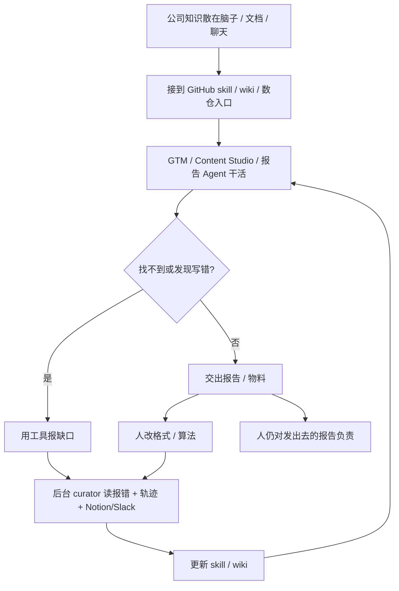

### 结论

[LangChain](https://www.langchain.com/blog/knowledge-factory) 这篇不是再发一遍「给 Agent 再塞一点上下文」。**Harrison Chase** 写的是自家已经怎么处理「公司怎么干活、标准是什么、数据在哪」还散在人脑子、文档和聊天里，干活的 Agent 拿不到。他们把这套收集、整理、维护公司知识再交给 Agent 的系统叫 **knowledge factory**（知识工厂）。内部 **GTM**（获客、内容和活动那条线）和 **Content Studio** 的 Agent 已经靠它跑；**LangSmith Engine**（扫轨迹并建议修复的 Agent）还给每只 Agent 各维护一份。人还是决定哪份报告格式能用、哪条收入算法能写进 wiki 的人。

### 要点

- **先拆掉「公司知识只在人脑子里，Agent 做不了演示、外呼和报告」这层，不是再换一个更大窗口的模型。** 原文把卡住的点写得很具体：最能干的同事知道该找谁、去哪查、为什么要这样做；这些知识常常是 **tacit**（没写下来、只在脑子里转的）、不完整、散在各种文档里。Agent 已经能做演示、发布视频、外呼；缺的是这份公司知识。人还是决定哪份知识能交给 Agent 的人。

- **要维护的是三类知识，不要把会变的数再抄一份。** **Skills**（技能：按公司规矩做事的说明书、脚本）——同事之间口口相传、以前常常没写下来的那套。**Domain knowledge**（领域知识：不常过期的业务事实）——产品、客户、竞品、组织是怎么回事。**Data access guidance**（数据入口说明：数据在哪、怎么查）——数已经在 Snowflake、Databricks 这类源里且是最新的，就不要另维护一份副本，只维护怎么查。

- **干活的 Agent 负责报缺口，整理交给后台 curator，不要让干活的顺手改知识库。** 干活时找不到、或发现写错了，就用工具至少报「哪里不对」，可选地建议正确更新。真正改知识的是 **curator agent**（策展 Agent：后台按节奏整理知识的 Agent）：它能读 Notion、Slack 等原文散落处，能读 **traces**（轨迹：Agent 实际怎么干活的记录），也能读报上来的缺口。让干活的 Agent 自己改，知识会变乱、互相打架。

- **知识存在哪不是最先要定的；先把报缺口和补缺口这条环跑通。** 原文说可以存在 GitHub 的 skill、Notion 单文件、LangSmith **Context Hub** 的 **OKF**、或 Neo4j 知识图。策展 Agent 要会读写这些格式。行业在程序性记忆上已经收敛到 skill；语义记忆还没有统一标准，所以不要过早把格式做复杂。

- **验收要看一件反复做的活下次会不会少改，不要只看「知识库开关能打开」。** 原文用做收入报告走完一遍：原始收入数在 **BigQuery** 和 **Salesforce**；LangChain 风格的报告 skill 在 GitHub；**ARR**（年经常性收入）怎么算在公司 wiki；怎么查 BigQuery / Salesforce 作为 skill 放在 Context Hub。Agent 发现列改名了，当场对上正确列，再用工具报上去。财务负责人同步改了几处格式，并要求所有 LangChain 文档用新页眉。当晚策展 Agent 看到报错和这段来回，把「用新列取数」和「用新页眉起草」写进相应 skill。下次不必再教一遍。

### 怎么做

面向已经让 Agent 出演示、写外呼或出周报，却发现「每次都要再教一遍公司算法、格式和该查哪张表」的 junior：不必复制 LangChain 或 knowledge factory 这个名字，按同一组顺序挡一遍。

1. **先写清卡在哪一步。** 「收入报告每次都要人改页眉」「列改名了 Agent 才现场猜」「ARR 怎么算只在财务负责人脑子里」。写成对方能听懂的一句话：起草和查找可以自动，对外发出的报告和收入算法必须人点头。这是应用问题，不是再换一个更大窗口的模型。

2. **先接到已经在用的仓库、wiki 和数仓，不要从空白对话开始粘文档。** 做事的说明书进 GitHub skill；不常变的业务定义进 wiki；会变的数留在 BigQuery / Salesforce，只维护怎么查。原文说目标不是先把一切写完再让 Agent 开工，而是干活时暴露缺口，补上之后下次更好。

3. **给干活的 Agent 一把报缺口的工具，不要让它自己改知识库。** 找不到或发现写错了就报；建议更新可以附上。整理、消矛盾、对照 Notion / Slack / 轨迹，交给后台按节奏跑的策展 Agent。

4. **从一条会反复做的工作流开始，不要先建全公司知识图谱。** 原文建议：选一条反复做的活，看 Agent 卡在哪，把那一环补上。收入报告就是这条环：跑报告 → 报列改名 → 人改格式 → 当晚策展 Agent 改 skill。

5. **用一件真的活验收，不要只看「知识文件能打开」。** 「列改名有没有被报上来」「财务改过的页眉下次还要不要再教」「ARR 定义有没有从 wiki 进报告，而不是 Agent 自己发明一种算法」。原文验收的是：当晚 skill 已更新，下次取数用新列、起草用新页眉。

6. **人还是放行的人。** Agent 可以起草报告、报缺口、在后台整理 skill。哪条收入算法能写进 wiki、哪份格式能对外、知识工厂何时该闭嘴，仍由负责人看过再定。

### 关键图表

*LangChain 原文的用法：干活的 Agent 报缺口，后台 curator 连夜对照轨迹和原文补 skill；内部 GTM、Content Studio 和 LangSmith Engine 已经这样跑。人还是决定哪份格式和算法能用的人*
