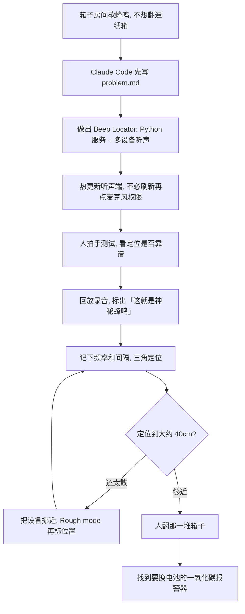

### 结论

[Simon Willison](https://simonwillison.net/2026/Nov/9/mysterious-beeps) 这篇不是再讲一遍「给 Agent 接上麦克风」。搬家后的杂物间还堆着没拆的箱子，两周前房间里开始间歇蜂鸣，间隔远到站着听也找不着，他又不想把箱子全翻一遍。于是让 **Claude Code** 做出 [Beep Locator](https://github.com/simonw/beep-locator)：一台 Python 网页服务当指挥，两台 iPad、一部手机、一台 MacBook Pro 和一台 Surface Ultra 当听声端，把声源三角定位到大约 **40cm**，再只翻那一堆，找到一只急着换电池的旧 **一氧化碳报警器**。人的活是确认「这就是那一声」、拍手测试、把设备挪近；写代码、查 2007 年的测距论文、给听声端热更新，交给 Agent。

### 要点

- **先拆掉「站在房间里凭耳朵翻箱子」这层，不是再换一个更会写音频代码的模型。** 蜂鸣间隔太长，人站着听会烦，箱子又多。Willison 的提示几乎就是问题本身：房间里有东西在响，我找不到；想用手头的笔记本、手机、iPad 同时听，帮我定位。验收写在原文结尾：系统按设计工作，给出大约 40cm 的位置，那一堆里就是过期报警器。没这句，仓库里多一个定位 Demo 也不算把活做完。

- **先写 `problem.md`，再让它动手；研究可以自动做，设备别一刷新就得重新点麦克风权限。** 他在 iPhone 上开 **Claude Code Cloud**，用 **Opus 5.5** 的 Extra thinking，对着空仓库先让它写清问题。Claude 自己找到并读了 2007 年的 **BeepBeep** 论文：只用喇叭、麦克风和设备间通信，就能在现成手机上做声学测距。研究看起来靠谱之后，他才说：试着做出来，并给听声端加一种能远程下发新代码、让它们自动跑起来的机制。后来 **Fable 5.2** 发布，他在笔记本上接着跑。Opus 已经写好听声端的 `installModule()`：服务端经 **WebSocket**（浏览器和服务器保持连线、随时收发消息）把新代码热更新上去。有的设备一刷新页面就要再点一次麦克风权限；热更新是为了设备摆好之后，人可以走开，让 Agent 继续改。

- **设备互相发声来标定位置不够用，人先在图上大致拖到位，再用已知声音验收。** 听声端用二维码或链接加入，理想情况是它们对打声音、自己估出相对位置，实际效果不好。他加了 **Rough mode**：先把图标拖到房间里大概所在的位置，再交给声音去微调。拍手测试用另一种符号画在地图上，用来确认系统真能定位一种已知声源，而不是只对神秘蜂鸣装懂。每个符号带 `HH:MM:SS` 时间戳，日志里能回放各设备录到的片段；回放时暂时关掉麦克风，避免把扬声器当新的蜂鸣。人听过、点「这就是神秘蜂鸣」之后，系统才记住频率和间隔，继续听、继续收紧位置。

- **定位够近了再把设备挪过去，不要一上来就追求厘米级；人还是掀箱子、换电池的人。** 大概位置有了之后，他加了「重新摆放设备」：不必重启每台听声端，切到重摆、Rough mode 再标一次，上一轮还能只读回看。多余的那台设备，地图会建议一个更有用的摆放点。原文截图里，神秘蜂鸣被圈在 MacBook Pro 附近大约 41cm 内，并提示在某点再加一台听声端，位置大约还能再紧 **12%**。Agent 可以听、可以对齐录音、可以建议下一台放哪；揭开那堆箱子、换掉报警器电池，仍是人做。

- **编码 Agent 可以没有原生听觉，照样能靠浏览器麦克风干活。** Claude 还不能直接听现场，但能跑分析和采集音频的 JavaScript / Python。Willison 让它起网页服务，连上多台听声设备，再经 WebSocket 给这些「耳朵」热更新代码，然后几乎可以离开，让它查音频日志、改配置。GitHub Universe 上 **Martin Woodward** 有过类似做法：把活动徽章用 USB-C 接到电脑，再拿摄像头对着屏幕，让编码 Agent 看见刷新后界面对不对。给 Agent 接上能感知现场的通道，比再写一段更聪明的测距公式更先要做。

### 怎么做

面向房间、机柜或工位上有间歇声响、又不想把东西全拆开的 junior：不必复制 Beep Locator 或一氧化碳报警器这个名字，按同一组顺序挡一遍。

1. **先写清声音隔多久响一次、你不愿意翻的是什么。** 「箱子太多、间隔太长、站着听会烦」比「做一套三角定位系统」更像一句能验收的问题。起草 `problem.md` 可以交给 Agent；哪一堆能翻、电池能不能换，必须人点头。这是应用问题，不是再换一个更会做 FFT 的模型。

2. **先让 Agent 写问题、查有没有现成做法，再让它建。** Willison 原文是空仓库先写问题，Claude 自己找到 BeepBeep 论文之后才动手。论文和 Demo 只能证明「现成设备也许听得见」，不能代替你在自己房间里跑一版。

3. **听声端要能热更新。** 手机、平板、笔记本用浏览器开麦克风即可加入，不要给每台装客户端。页面一刷新就重新要权限的，把设备摆好之后 Agent 就改不动了。热更新代码、人走开继续改，是这套活能收工的原因。

4. **用一种你听得见的声音先测，再标记真正要找的那一声。** 拍手、敲门、已知的测试蜂鸣都可以。地图上用不同符号，日志里能回放。人听过、标过「就是它」，系统才该记住频率和间隔。没这步，定位圈再小也可能是在追回声或别的响动。

5. **粗位置有了，把设备挪近再收一圈，不要一上来要厘米。** 互相发声标定不够，就在图上先拖到大概位置。Willison 原文是大约 40cm 就够翻那一堆。建议的下一台听声点可以看，但人决定挪不挪。

6. **人还是掀开现场的人。** Agent 可以起服务、对齐录音、建议摆放。哪一声算数、哪一堆能翻、报警器电池要不要换，仍由负责人核对后再做。找到过期一氧化碳报警器，才是这套活的验收，不是仓库里多一个定位 Demo。

### 关键图表

*Willison 原文的用法：人确认那一声、拍手测试、掀开箱子；Agent 写代码、热更新听声端、收紧定位。大约 40cm 够翻那一堆，人还是换电池的人*
