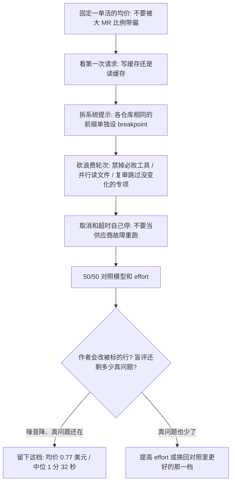

### 结论

[Cloudflare](https://blog.cloudflare.com/obsessive-inference-optimization) 这篇不是再讲一遍「换个便宜模型就能省钱」。写的是他们自己已经在跑的 **AI 代码评审**——协调器（coordinator）把活分给专项评审，再按风险档决定审多深。4 月均价大约 **1.19** 美元，还能接受；8 月底涨到大约 **2.46** 美元，架构几乎没改。9 月中他们让 Agent 去查 token 花在哪，并要求砍得狠。对照最贵那两周的均价 **2.43** 美元，现在均价 **0.77** 美元，大约少 **68%**；中位耗时从 **4 分 9 秒** 降到 **1 分 32 秒**。大约 **40%** 的节省来自评审代码本身，其余来自换模型和调 **effort**（同模型「想多久、调几次」的档位）。更便宜不等于更差：代码质量评审开高 effort 时，真问题大致还在，噪音和虚高的严重级别少了很多。

### 要点

- **账单涨，往往是「每次会话更长、调用更多」，不是某一天突然多审了几个大 MR。** 他们把各档评审的比例固定后再画图，均价仍从 3 月约 **1.22** 美元走到 8 月约 **2.32** 美元。最贵档占比从 **59%** 升到 **65%**，因为模型更强、工程师提交更大，但这解释不了大部分涨幅。8 月初全体专项改到 Anthropic，单次从约 **1.38** 美元升到 **2.03** 美元——内部评测里这批模型对这份活更好。内部规范评审 **Codex** 落到 Claude Opus 4.7，单次从约 **0.25** 美元升到 **0.88** 美元，比协调器还贵。缓存命中率从 4 月 **85.7%** 升到 9 月 **97%**，但每次评审的 token 从约 **91 万** 涨到约 **299 万**：命中率再高，量翻三倍照样贵。

- **Anthropic 的提示缓存只认「从对话开头一直没变的前缀」。** 前缀（prefix）就是请求最前面那一段：工具定义、系统提示、最先发出去的消息。只有在这段末尾放 **cache breakpoint**（告诉接口「请把到这里为止的前缀存下来」），下次才能复用。写入大约是普通输入价的 **1.25** 倍，读回大约 **0.1** 倍，条目约 **5** 分钟没人读就会过期。优化前，一次会话的钱大约是：输出 **23%**、写缓存 **43%**、读缓存 **34%**。代码质量评审平均 **16.6** 次模型调用，写入约 **7.2 万** token，读回约 **108 万**——每一次都把整段对话再送一遍。要省钱，就要让**每次会话的第一次请求去读已经有的前缀**，并且让一次评审少打几轮。

- **各仓库共用的那 1.1 万到 2.1 万 token，原来几乎存不成「大家都能读」的前缀。** 他们从 9 月 14 日起记录每个专项第一次调用的用量，以及第一段系统提示的哈希。第一次请求打中缓存的比例只有 **14%–26%**。原因在 OpenCode v1 怎么拼系统提示：Agent 提示和环境信息（工作目录、日期）塞在同一块，唯一的 breakpoint 在这块末尾。仓库一变，整块都变，A 仓写下的前缀 B 仓读不了。9 月 16 日他们在 Agent 提示末尾加标记，用插件拆成两块：前半段字节各仓库相同，单独设 breakpoint；技能列表关掉，工具描述也不许随任务变。同一天，Codex 把规范索引、skill 和参考文件列表直接写进提示，不再用前三轮工具去读文件。Codex 调用从 **15.9** 次降到 **9.6** 次，单次从 **1.12** 美元降到 **0.72** 美元。两处合计，均价从约 **2.47** 美元降到 **2.02** 美元。

- **接下来砍的是「模型根本不该打的那一轮」。** 9 月 21 日和 23 日那批改动单独看都不炫，合在一起大约每次少 **0.20** 美元：子评审看得到「发最终评论」的工具，**57%–76%** 的会话会去调、被服务端拒、再花一轮恢复——工具定义本身大约还占 **2900** token；代码质量评审 **64%** 的回合只调一次工具、常常只读一个文件，后来改成第一轮并行读共享上下文和全部补丁（上限约 **150 KB**）；大约三分之二的任务是同一 MR 的第二次及以后，全量复审时 AGENTS.md 评审约 **56%** 可跳、性能约 **23%**、文档约 **13%**；OpenCode 把结果交回模型再写没人看的摘要，大约每次 **0.07** 美元；超时曾被当成供应商故障、用同一时限重来；GitLab 的 Kubernetes 执行器取消任务时不给脚本信号，抽样 **446** 个已取消任务里 **358** 个仍跑到写完。代码质量、安全和性能三个专项还共用同一段第一请求：相同工具、同一份规则、带齐补丁的 MR，自己的指令放在后面。缓存要等写入方开始流式输出才能读，三个专项又同时开工，所以第二、第三个最多等 **20** 秒。人会稍慢一点，每个专项大约少 **9** 美分。

- **模型和 effort 贡献了更大头的节省；便宜了还要回头数「作者有没有改被标的那些行」。** 按发布和配置切窗口（他们写明这不是严格对照实验），大约 **1.67** 美元的降幅里，代码改动占 **0.65** 美元，模型和 effort 占 **1.06** 美元。协调器丢掉另外两档，只留中等 effort——同模型全量档大约快 **20%**。后来随机对照里，Opus 5.5 中等 effort 和 Opus 5 在结论、关键发现上没有可测差别，就切过去；Opus 5.5 高 effort 更贵，发现没有明显增加。Opus 5.5 单价更低，大约只解释 **0.20** 美元；9 月初以来读缓存大约少 **82%**、写缓存少 **54%**、输出少 **67%**。10 月 3 日把 Sonnet 评审 **50/50** 拆成 5 和 5.5，两天半后 5.5 在代码质量、性能、安全上分别大约便宜 **62% / 58% / 47%**，单价相同，差在用得少；发现数差不多，10 月 5 日全部切到 5.5。Sonnet 5.5 中等 effort 平均 **1.7** 次调用（以前 **6.2**），一半以上一轮结束、不再打开仓库里别的文件；高 effort 平均 **3.4** 次。他们担心审浅了，又把代码质量 **50/50** 拆中等/高：高 effort 大约贵 **61%**，关键加警告大约多 **58%**，折合约每次多 **2** 美分，值得留下，所以代码质量改走高 effort。超过五分钟的评审从 **37.9%** 降到 **0.7%**；今天的 **99** 分位比 4 月四分之三的评审还快。代码质量高 effort 的关键加警告大约少 **40%**，但作者对严重发现的改动率从 **34%** 升到 **59%**，每千次评审里「标了并且下一推改了那些行」大约 **132** 对 **145**，误差范围内；四个专项合计从 **229** 升到 **321**。两家模型盲评 **657** 条发现：重要发现每次约 **0.28** 到 **0.30**，重叠；被判「严重级别虚高」的从每次 **0.46** 降到 **0.14**。中等 effort 会丢掉真问题（随机对照里，被改动的发现大约只剩高 effort 的四分之一），所以代码质量不停留在中等；性能在中等 effort 上重要问题大约少 **64%**（大约每 **24** 次全量评审少 1 条），安全大约少四分之一但统计不显著，下一步是给这两项试高 effort。

### 怎么做

面向已经在仓库里跑评审 Agent、或任何高频调用模型的 junior：不必复制 OpenCode 或 Anthropic 这个名字，按同一组检查挡一遍。

1. **先固定「一单活」的口径，再谈省钱。** 他们画的是同一套风险档混合下的均价，避免某一天大 MR 多就看起来暴涨。你的口径可以是「一次评审」「一次客服会话」「一次夜间批处理」。

2. **打开供应商控制台，看每次会话的第一次请求是在写缓存，还是在读缓存。** 把各次任务都相同的工具定义和系统提示单独放在最前面，单独设 breakpoint；日期、仓库路径、技能列表、会变的工具描述，全部放到 breakpoint 后面。目标是：A 仓写下的前缀，B 仓几分钟内能读到。

3. **数一轮会话打了几次模型、有几次是被拒绝后的恢复。** 子 Agent 不该看见它调用必败的工具；能并行读的文件不要连问四轮；同一 PR 的复审，先判断哪些专项没有新 diff。结果已经写进 MR 之后，不要再把整段对话交回去写没人看的摘要。

4. **取消和超时当成产品行为，不要当成「再跑一遍」。** 编排器取消了，你的脚本还要自己查任务状态并停；超时和供应商故障分开处理，不要用同一把时限死循环。

5. **换模型和 effort 用对照，不要用偏好。** 同一活拆 50/50，看单价、调用次数、关键发现，再切。更便宜的模型如果只是少说话，先确认少的是噪音还是真问题。

6. **质量不要停在「严重发现变少了」。** 抽一批关键和警告，看作者下一推有没有改被标的那些行；有余力再用另一家模型盲评：重要、次要、重复、错误、无法从 diff 核实。Cloudflare 的代码质量在高 effort 上大致还找得到同样多的真问题；性能在中等 effort 上已经丢掉真问题。省下的钱，要能对着这两张表说话。

### 关键图表

*Cloudflare 原文的用法：先让各仓库共享可复用的提示前缀，再砍浪费调用，最后用对照换模型和 effort；便宜了仍要数「标了有没有人改」*
