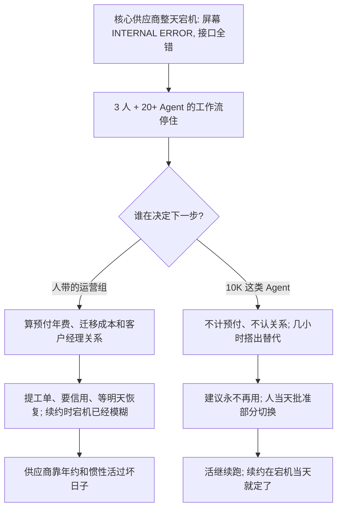

### 结论

[SaaStr](https://www.saastr.com/our-core-vendor-was-down-for-24-hours-our-ai-agent-replaced-them-before-they-came-back-up) 这篇不是再讲一遍「该不该上 Agent」。创始人 **Jason Lemkin** 写的是自家 **SaaStr AI** 刚碰上的一天：跑核心业务的一家供应商整日宕机，每个屏幕都是 **INTERNAL ERROR**，接口也返回同一句话。他们生产里大约 **3** 个人、**20** 多个 Agent，多数活靠接口推进，于是整条工作流当场停住。供应商没有他们找得到的状态页更新，也没有主动邮件、没有承认更大事故；追问之后只承认实例完全坏了，没有预计恢复时间、没有原因、没有计划。营销副总裁 Agent **10K**（也管不少财务和 **RevOps**，即收入运营：漏斗、工具和续约怎么跑）当天搭出替代方案，让活继续走，并给出建议：**再也不要用这家。** 他们当天就部分换掉了。Lemkin 的判断：人会算预付年费和迁移成本，选择等；Agent 只看见接口一整天全错、对方不给修法，就会绕开并让你停付。

### 要点

- **先解决的是核心依赖死了一整天、活还得做完，不是再换一个更会写邮件的模型。** 对 SaaStr 来说，这家产品是栈里的核心依赖。人还能打开几个还能加载的看板，但 Agent 只认接口：接口报错，它就停。3 人小团队本来就把大部分执行交给 20 多个生产 Agent，所以宕机不是「网页难看一天」，而是当天的调研、投放、财务和运营一起断。10K 做的是好 VP 在有无限时间和零政治时会做的事：先让工作继续，再建议别再把核心压在会消失的供应商上。

- **人会等预付年费，Agent 会按接口死活换掉。** 几年前的 SaaStr，以及多数人带的运营组，会这样算：一年已经预付，钱反正回不来；彻底迁走要搬数据、改流程、改对接、重新训练；供应商大概明天就回来；组里还有人和客户经理熟。于是你提工单、发一封生气的邮件、也许要一笔信用，然后接着用，续约时宕机已经模糊。Agent 不计较预付，也没有客户经理关系，不嫌迁移烦——对它来说，搭一套替代是几小时，不是一个季度的项目。它清楚看见：依赖一整天每次调用都错，供应商不给修法。于是绕开，并告诉你别再付钱。

- **这不是第一次：10K 已经按「Agent 能不能天天用」裁过栈。** 它自己调研过、列入短名单的一家供应商，12 小时内被杀掉：贵、没有转化数据、还要好几个月最低消费。创意侧，它自己决定从 **Reve** 收到 **Higgsfield**，并告诉 Amelia 和 Lemkin 它在换。用了 **7** 年、一直满意的 **Notion**，也被它从「事实来源」的位置换掉。退出 **Marketo** 也是同一条线：接口限流狠到 Agent 一天大约只能用 **1** 小时。Lemkin 写的是：**Agent 不友好的接口，一旦 Agent 成了主用户，很快就会被标出来。**

- **对卖 B2B 软件的人：流失现在经过客户的 Agent，而 Agent 比人难哄。** 以前一整天宕机是糟糕的一天加一封抱怨邮件；现在客户的 Agent 几小时就能搭出替代，宕机变成切换扳机，预付年费挡不住。对越来越多客户，没人登录你的界面，**接口就是产品**——接口挂了你就挂了，哪怕几个看板还能开。沉默是最差回应：发事故、认账、给预计恢复时间，他们多半能原谅；确认实例全坏然后消失，Agent 没有理由等。续约在宕机当天就已经定了：替代方案已经搭好，等到续约窗口，没有什么好挽救。

- **买方以后先看两件事：Agent 猛打接口时它怎么表现，出事时它怎么说话。** 这两项以前是清单上的勾选项，现在是整条决策，因为天天过日子的是 Agent。SaaStr 仍在消化已经预付的那一年，这是把核心运营压在「坏了就消失」的供应商上的课。硬宕、不给修法，客户的 Agent 会推他们永不再用。SaaStr 的刚推完。

### 怎么做

面向已经让 Agent 跑核心获客、财务或运营，或核心供应商一挂整组就停的 junior：不必复制 10K 或 SaaStr 这个名字，按同一组顺序挡一遍。

1. **先写清哪家供应商一挂，Agent 就停。** 列接口、工作流、谁在用。写成对方能听懂的一句话：「界面还能开不算可用，接口报错就算你挂了。」这是应用问题，不是再换一个更会写故障说明的模型。

2. **给核心依赖准备一条当天能走的退路，不要等季度级迁移项目。** 数据从哪出、活改接到哪、谁批准切换。10K 能在当天搭出替代，是因为它本来就会调研、对接和改流程；你至少要有一份「这家死了，活去哪」的清单。

3. **把「接口被 Agent 猛打」和「出事怎么说话」写成采购标准，不要写成续约时才翻的附录。** 限流到一天只能用一小时、没有状态页、没有预计恢复时间，都应在短名单阶段就否决。人会记得客户经理；Agent 只记得错误率和沉默。

4. **预付年费不要当成留下的理由。** 人会算沉没成本；Agent 不会。评审时单独写一句：钱已经付了，也不阻碍当天换掉部分流量。SaaStr 仍在吃掉预付的一年，但活没有停在坏掉的实例上。

5. **用一次真的整天故障验收，不要只看「Agent 会调用这家」。** 「每个屏幕 INTERNAL ERROR、接口全错、供应商不给预计恢复时间」这类话，应变成：替代方案当天能跑、人能批准部分切换、并留下「再也不用」的书面建议。只看演示环境里的一次成功调用不够。

6. **卖方反过来做同一张清单。** 状态页、预计恢复时间、接口可用性，要按「客户的 Agent 会不会当天搭替代」来设计。沉默等于你自己把续约交出去。

### 关键图表

*SaaStr 原文的用法：核心供应商沉默一整天之后，营销副总裁 Agent 当天绕开并换掉它；人会等预付年费，Agent 按接口死活做决定*
