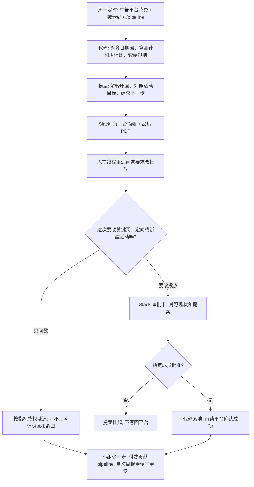

### 结论

[LangChain](https://www.langchain.com/blog/paid-media-agent) 这篇不是再讲一遍「市场该上几个 Agent」。**Amal Irgashev**、**Danny Lambert** 和 **Jan Gomez** 写的是自家小市场组已经怎么用 **Paid Media Agent**，把付费广告从几乎全靠开源和内容获客，扩到六个月内五条付费渠道。付费从 **0** 做到营销 pipeline 的大约 **20%**；**CPL**（cost per qualified lead，每一条合格线索花多少钱）从 6 月到 8 月降了 **30%**，同期月花费大约涨 **60%**；最大社交渠道 LinkedIn 的 CPL 比 1 月低 **40%**。分析报表收回来自己做，大约每月少付给代理 **5000** 美元。早期那套周报从大约 **18 分钟**、刚过 **3** 美元，压到 **85 秒**，大约 **13 倍**快、**40 倍**便宜。Agent 住在 Slack：周一交出带品牌 PDF 的复盘，人点头之后才改投放。

### 要点

- **先解决的是小组盯不住五条付费渠道，不是再换一个会写广告的模型。** 前三年 pipeline 主要靠开源、内容、YouTube、社区和线下聚会。今年 1 月他们要补付费，去够有机流量够不到的新地区和企业决策人，目标是六个月内铺开五条渠道。小市场组立刻碰上三件事：各渠道活动、创意和定向实验对不上；每个广告平台字段不一样；花费、曝光对不上他们真正要的销售咨询、注册和资料下载。产品发布变密之后，靠人盯「现在在跑什么、什么有效、下一步试什么」更吃力。他们要的 Agent 会跟产品发布、起草活动、加关键词、试变体，并把实验提案交给人批；长期则是一条学习环：看数、改一处、看结果、记下教训、下次再用。

- **模型负责判断，数字和硬规则写进代码。** 第一版周报把活动行、关键词、pipeline 记录和落地页检查全塞进上下文，再让模型自己加总、算周环比、给活动分档、写报告。冻结测试集上，单次大约吃掉 **390 万** input token，跑 **1112** 秒，刚过 **3** 美元，而且每次重算，数很难信。后来 Python 负责拉数、对齐日期窗、算合计和对比、套固定规则，把一份短结果写进沙箱；模型只做需要判断的活：把证据连起来、解释可能原因、对照活动目标、建议下一步。硬约束也落在代码里，例如不允许模型因为一周难看就砍掉当前最能贡献 pipeline 的活动——模型改不了这条。

- **每个指标指定权威源，对不上就保留不确定，不要先造一张完美宽表。** 六个平台的 ID、转化定义、归因窗和活动层级都不一样。硬把它们揉成一张「正确 schema」，复杂上去了，数不一定更可信。他们改成：花费、曝光、点击信广告平台；线索、商机、pipeline 信自家数仓。Google 部分视频活动没有关键词，数仓却按关键词去对，大约 **10%** 的 Google 花费在数仓里丢了，平台侧其实是对的。Meta 则相反：平台能说这条广告带来了转化，数仓更清楚那是「联系销售」还是「注册」。规则写进 **wiki**（公司自己的说明书：漏斗怎么转、每条活动要什么、哪个系统管哪个数、团队为什么这么定），并拿掉会让 Agent 查错系统的工具。对不上的地方不补洞，回答里带上源、日期窗和归因模型。

- **工具按需找，不要把两百个 schema 一次性塞进上下文。** 「花出去的广告费换回了多少 pipeline」至少要两套系统：广告平台给花费和点击，**BigQuery** 数仓把活动和网站转化接到合格线索、Salesforce 商机和 pipeline。**Pipeboard** 的 **MCP**（把外部系统接到模型上的协议）露出两百多个广告平台工具；6 月时，即便只读目录，光工具名、说明和参数就要大约 **3.8 万** token，而多数问题用不到。他们改成三件套：按问题搜最多八个工具、只给选中的加载完整 schema、经自家服务器执行；写入投放另走审批。数仓侧是「描述有哪些表和字段」加「跑一条分析查询」，而不是每换一种切法就新做一个固定工具。目录方案把第一轮打到大约 **1.2 万** token，对照里比塞全量 schema 大约便宜 **4 倍**，评判质量相当。目录后来几乎涨到三倍，上下文成本大致没涨。六十次线上对照里：固定工具适合例行问题，更深的问题会诚实说做不了；带查询接口的版本能回答所有分析题。两边都留着：常见问题走快路，没预料到的问题现查。

- **分析要接到可审批的动作，隔离也要写死。** 只出数的 Agent 还是一块更好看的看板。它能在 Slack 里提案：加关键词、改地理定向、新建搜索活动。付费组以外的人可以问表现和 pipeline，只有指定成员能改或批准；服务器先核 Slack 用户 ID，其他人提交会被挡住，提案继续挂起。批准卡用 Slack **Block Kit** 做：对照现状和提案，可改，批准后由代码写回广告平台，并再读一次确认成功。跑五条渠道时，他们试过「每平台单独跑」「一个 Agent 包打」「父 Agent 派一个子 Agent 管一个平台」。单独跑最简单，但拼不出跨渠道结论；最后用父加子，让父上下文保持小，每平台自己带数据和限制。隔离不会自动发生：两个子 Agent 曾写到同一处并共用「做完」标记，第一个结束，第二个以为自己也做完了；子 Agent 验证不了 PDF 时会空转烧 token。后来每个平台有自己的报告位置和完成态，子 Agent 只留三件工具——读上下文、计算、渲染——渲染成功就收工。

### 怎么做

面向已经在跑付费、小组被报表和改投放拖住、或已经让模型「直接看原始花费表写周报」的 junior：不必复制 Paid Media Agent 这个名字，按同一组顺序挡一遍。

1. **先写清谁在盯渠道、哪类活在挤战略。** 对账、周报、加词、改定向、试创意——列出来，并写清「谁都能在 Slack 里问数，只有指定的人能改投放」。这是应用问题，不是再换一个会写广告的模型。

2. **把 Agent 当新来的付费分析师来配工位。** 沙箱、能算数的库、当前数据和公司说明书。LangChain 用 **Deep Agents** 当 harness（套在模型外面的运行时：文件、代码、计划、子 Agent），每个请求一台 **LangSmith Sandbox**（隔离的微型虚拟机，32 GB 盘和 shell），装上 pandas、DuckDB、openpyxl，以及出 PDF 用的 WeasyPrint 和 Jinja2；业务知识是六个 **skill**（按做法写的说明书，只先露出标题和简介）加十九页 wiki。软件和 wiki 打进快照后，平均启动大约少 **10** 秒。内容组的沙箱会更像剪辑台，财务组可能只要表格和数仓——工位跟岗位走。

3. **系统提示当地图，不要当百科。** 一句角色，加上怎么干活、数从哪来、结果怎么呈；playbook、wiki、索引都是指针。skill 写「换一家公司也能用」的做法；wiki 写自家活动、7 月为什么那么定。当天花费和 pipeline 用实时工具（他们有 **218** 次这类调用）。该可复现的计算、日期窗、账户对齐和硬安全阀写进代码。

4. **入口可以有两个，运行时只留一套。** 他们一度做成两张图：周一重报告用大模型和沙箱，Slack 要秒回就用便宜模型和只读工具。五周后每个新能力都要做两遍，Slack 打不开附件，也回答不了周一 PDF 的追问。后来同一套运行时按能力档启动：定时任务几乎只看到派活工具，Slack 拿到更宽的读、数仓和投放工具；每个线程自己的沙箱和检查点。托管在 **LangSmith Deployment** 上，负责托管、扩缩和定时。

5. **先在便宜、可核对的结果上拍板，再允许写回。** 数字由代码产出；模型解释和下建议。改投放走审批卡，代码落地后再回读平台。复杂到很多广告组、批量改、多轮修订时，Slack 会不够用——他们正把这类活挪到专用界面，Slack 留下问数、看建议和点批准。

6. **用真实问不住的问题，决定下一步该补哪条连接。** 反复答不好的问题，才值得去做更干净的关联、更清楚的定义，或单独做工具。优化 token、费用和耗时要跟完成率和回答质量一起看，砍到做不完题就没意义。他们已把 Paid Media Agent 开源，可接上自己的账户和公司上下文。

### 关键图表

*LangChain 原文的用法：付费分析从「人盯六张表」改成 Slack 里出复盘；数字交给代码，判断交给模型，改投放仍要指定的人点头*
