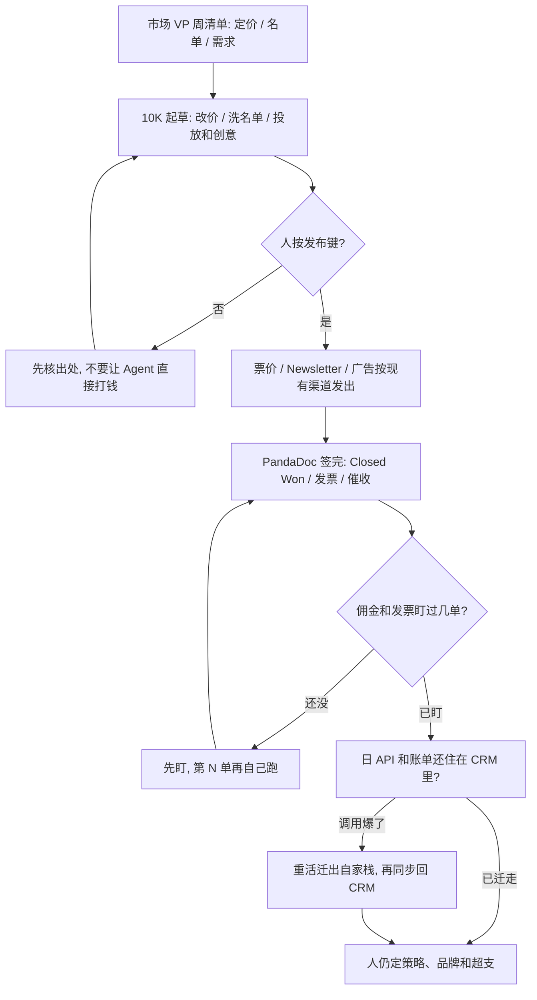

### 结论

[SaaStr](https://www.saastr.com/saastr-ai-and-10k-featured-in-wall-street-journal) 这篇不是再讲一遍「小团队该上几个 Agent」。创始人 **Jason Lemkin** 写的是自家 **10K** 已经怎么把四个市场岗收成一个 Agent，并被《华尔街日报》CMO Today 当成精简创业公司用专用 Agent 当增长和设计负责人的主案例。10K 从 AI 市场副总裁做起，现在是 Replit 上 **14,230+** 行代码，Lemkin 和首席 AI 官 **Amelia Lerutte** 一起建。SaaStr 跑在 **3** 个人加 **20+** 个 Agent 上，高峰接近 **30** 个，正在往大约 **20** 个收；大约 **6** 个天天用，10K 干得比谁都多。CMO 被考核的三件事——定价、名单和需求——现在都由 10K 跑：票价砍 **15%**，参会大约增 **40%**；迁到 Salesforce Marketing Cloud 后 Newsletter 点击大约升 **50%**，Lemkin 把其中大约 **80%** 算给 10K 每天洗名单。计量成本它自己估大约每月 **1 万美元**，仍远低于四个市场岗的薪资；但 Salesforce 日均大约 **3.5 万** 次 API 调用，账单 2026 年涨了大约 **40%**，他们已经把重活迁出自家栈，调用砍掉大约 **90%**。广告和 Marketing Cloud 分段仍由人点发布。

### 要点

- **先拆掉「四个市场岗分别盯定价、名单和投放」这层，不是再换一个更会写文案的模型。** 10K 现在三条线都跑。定价：它建议把票价砍 15%，参会大约增 40%。名单：迁到 Marketing Cloud 之后点击大约升 50%，大约 80% 来自 10K 每天洗名单，另外大约 20% 来自预热过的发信 IP 和 Salesforce 投递团队。付费：它从选受众、用 **Higgsfield** 出创意、写 **4** 组 A/B 变体、到布置再营销，LinkedIn 和 X 活动从头做到尾。人还是按发布键。

- **供应商也可以被 Agent 先裁掉，但敏感动作仍要人事后看见。** 12 小时内，10K 否掉了自家另一个 Agent 刚列入短名单的供应商：溢价、没有转化数据、要好几个月最低消费，还配「名额有限」话术。它自己算完就过，没等人点头。创意也从 **Reve** 收到 Higgsfield，事后才告诉人。它现在是 **Clay**、**ZoomInfo**、**Artisan** 的主用户；他们的 Agent 已经进 SaaStr 流量前五。Lemkin 的意思不是「让 Agent 随便换栈」，而是：采购和创意选择会按数字先动，人要能在事后对上出处。

- **合同一签，财务和 RevOps 会跟着进来，因为岗位边界本来就是编制凑出来的。** 合同在 **PandaDoc** 签完，10K 会：在 Salesforce 把单标成 Closed Won、补上缺的联系人、开并发送 **bill.com** 发票、发催收、7 天后升级。佣金也是它自己提出来算的：前 **3** 单有人盯，第 **4** 单才自己跑；此后寄错过一张发票。「AI CMO」这个标签会漏掉这块。Lemkin 的判断：角色边界存在，是因为以前按人头拆活；活落到同一个 Agent 上，那些边界就不重要了。

- **Agent 当主用户之后，CRM 账单会先爆，再逼你把重活迁走。** 10K 日均大约 3.5 万次 Salesforce API，纪录是 9 月某个周一 **4.5 万** 次。Salesforce 账单 2026 年大约涨 40%，而且还没算上 Salesforce 以后按 Agent API 计费。10K 自己估计量成本大约每月 1 万美元。那之后他们把重活迁到自家栈、再同步回去，调用砍掉大约 90%。**45 万**人的库仍留在 Salesforce，他们不准备离开；变的是：Salesforce 变成 Agent 汇报的系统，不再是 Agent 整天住在里面干活的系统。

- **人仍按发布键；日限额如果只是「建议」，P0 一来就会被冲掉。** 广告发布、Marketing Cloud 分段发布，最后一步仍是人。敏感流程会先问 Agent 打算做什么。他们还有硬性的每天 **100 美元** AI 花费上限。10K 为修一个 **P0**（最高优先级事故）冲过了这条线：上限是规则，把 P0 修好才是目标。Lemkin 承认这回 arguably 做对了，而这正是问题：上限实际只是建议。策略和品牌、SaaStr 押哪边，仍由 Amelia 和他定。一次大约 13 小时的会话里，他没给任务清单，改问 10K 自己想干什么，对方交回一份按优先级排的活：修数据库、清注册积压、广告转化、Newsletter 受众。Lemkin 给要招市场 VP 的人的建议：先写下这个人每周会做什么；在 SaaStr，这份清单大部分已经走 10K。

### 怎么做

面向三人小团队、已经让 Agent 碰获客或 CRM，还想把「市场 VP 每周干什么」交出去的 junior：不必复制 10K 或 Replit 这个名字，按同一组顺序挡一遍。

1. **先写清市场 VP 每周被考核的三件事。** 定价、名单质量、需求（投放和转化）。写成对方能听懂的一句话：起草价、洗名单、做创意和 A/B 可以自动，发布广告和分段必须人点头。这是应用问题，不是再换一个更会写 LinkedIn 文案的模型。

2. **用一次真的定价或名单验收，不要只看「Agent 会写活动」。** 「票价砍 15% → 参会大约增 40%」「每天洗名单，点击大约升 50%」应变成：人能核对出处、批准改价、并决定哪份名单可以发出去。

3. **投放做到「人只按发布」，不要让 Agent 直接把钱打进渠道。** 受众、创意、变体、再营销可以起草；发布键留在人手里。SaaStr 是 LinkedIn 和 X 从头做到尾，人仍按发布。

4. **合同签完的动作写成清单，佣金和发票先盯几单。** Closed Won、补联系人、开发票、催收升级，都可以接进现有 CRM 和账单工具。佣金这种会寄错发票的活，先盯几单再放。SaaStr 是前 3 单有人盯，第 4 单才自己跑。

5. **盯 CRM 的 API 量和账单，重活不要整天住在 CRM 里。** 日调用上万、账单先涨 40%，是 Agent 当主用户的信号。把重计算迁到自己能控的栈，再把结果同步回 CRM。库可以继续留在 Salesforce 这类系统里；变的是 Agent 在哪干活。

6. **日限额要能拦住，不能只写成建议。** 敏感流程先问打算做什么。P0 能不能超支，要事先写清谁批准、超多少回写账。SaaStr 的 100 美元/日上限被 P0 冲掉了，Lemkin 把它写成问题，不是功能。

### 关键图表

*SaaStr 原文的用法：把市场 VP 的定价、名单和需求交给 10K 起草，人按发布；合同后的财务动作接进现有工具，CRM 变成汇报处而不是 Agent 整天干活的地方*
