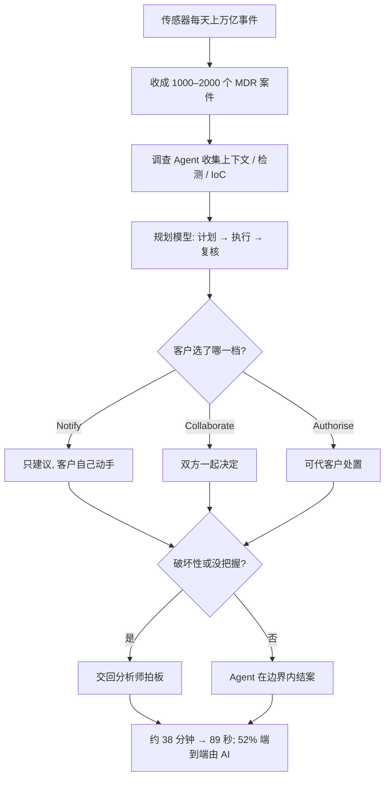

### 结论

OpenAI 这篇客户故事写的是网络安全公司 **Sophos** 自己怎么用 **Daybreak**（OpenAI 面向行业客户的合作项目，把前沿模型和对方的领域知识接在一起）做威胁调查，不是再发一篇「AI 能抓黑客」的口号。Sophos 保护超过 **62.5 万** 家组织。中心产品是 **Sophos Fusion**——一套把自家产品和 500 多家第三方传感器收在一起的防御系统，里面包含 **MDR**（Managed Detection and Response，托管检测与响应：客户把告警交给 Sophos，由对方的安全运营中心调查并处理）。这些传感器每天产生上万亿条事件，收成大约 **1000–2000** 个案件，交给 **9** 个安全运营中心（SOC）。以前主要靠人，平均大约 **38 分钟**；CTO **John Peterson** 说这已经好过 **96%** 的专业 SOC。接上 Daybreak Agent 之后，用 Agent 的案件平均响应大约 **89 秒**，调查时间降 **96%**；大约一半（**52%**）MDR 案件由 AI 端到端处理。Peterson 的判断：扩的是算力，不是等量扩稀缺的安全分析师；分析师把时间还给例外、升级和拍板。

### 要点

- **先把领域知识接进 Agent，不是再给分析师一个聊天窗。** Peterson 的原话是：Sophos 出对抗攻击的经验和手册，Daybreak 出能规模化用这些经验的模型。目标不是「多一个工具」，而是让同一套 know-how 覆盖每一个客户。Agent 要会的是他们自己的威胁情报、响应手册和客户上下文，而不是通用聊天。

- **调查先收齐材料，再走「计划 → 执行 → 复核」。** 调查 Agent 为每个案件收集客户上下文、检测结果、**IoC**（Indicator of Compromise，失陷指标：用来判断系统是否已被入侵的痕迹，例如可疑地址、文件哈希）和相关情报。规划模型再做一轮 **plan–execute–review**：写出调查计划、执行步骤、交出摘要和推荐处置，给分析师看。别的 Agent 可以执行一部分响应。以前调查和响应主要靠人；现在大约一半案件走自动化，仍在分析师标定的边界里。

- **客户三种操作模式，人和 Agent 用同一套边界。** MDR 给客户三个档：**Notify**（Sophos 查完并建议，客户自己动手）、**Collaborate**（双方一起决定再行动）、**Authorise**（Sophos 可直接代客户处置）。人做或 Agent 做，边界一样。Peterson 写得很硬：任何他们不放心交给 Agent 的事，都交回人判断。破坏性动作尤其如此。

- **量的是时间和结案率，不是「我们上了 Agent」。** 官方对上的数字是：用 Agent 的案件从大约 38 分钟降到 89 秒；**52%** 的 MDR 案件端到端由 AI 处理；客户看到的调查更快、也更齐。Sophos 把这理解成：用算力去扩覆盖，而不是按案件量等比例加人。分析师去看威胁、例外和必须拍板的决定。

- **下一步仍是扩展响应能力，但安全基本功不能丢。** Peterson 说会继续把 Agent 能做的响应做深、把用例做宽。他对其他安全负责人的建议不是「明天再上一个模型」，而是回到补丁、终端防护、**MFA**（多因素认证）、网络分段和扎实的安全运营。补丁只覆盖厂商已经知道的漏洞；分层防护加上能干活的运营，比再买一个聊天窗更要紧。

### 怎么做

面向正在给值班、客服或内部调查台上 Agent 的 junior：不必复制 Daybreak 这个名字，按同一组问题挡一遍。

1. **先写清手册和边界，再让 Agent 动手。** 把「接到告警后查什么、什么能自动做、什么必须升级」写成可执行步骤。不要先丢一个空白聊天窗给值班。

2. **调查拆成收上下文和做计划两段。** 先收集客户、检测、指标和相关情报；再让模型写计划、执行、交摘要。人和 Agent 都看着同一份摘要拍板。

3. **客户（或内部需求方）选操作档，不要默认全自动。** 对上 Notify / Collaborate / Authorise 这种选择：只建议、一起做、还是代做。档位写进产品，不要写在某次提示词里。

4. **破坏性动作留给人。** 删资源、断网、改生产、对外沟通，Agent 可以准备材料和建议，放行仍由人做。量的是「几分钟结案」，不是「无人值守」。

5. **用时间和结案率验收。** 记下上线前平均处理时长、有多少案件零人工走完、有多少被正确升级。抽几条真实案件：摘要是否够分析师拍板，而不是只看「Agent 回了字」。

### 关键图表

*OpenAI 原文的用法：先把手册和客户档位接进 Agent，再压缩调查时间；破坏性动作仍由人放行*
