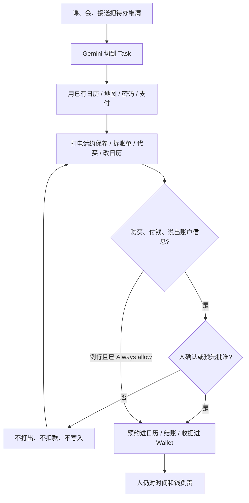

### 结论

[Google](https://blog.google/innovation-and-ai/products/gemini-app/tasks-in-gemini-free-new-features) 这篇不是再发一遍「助手又能聊天了」。**Josh Woodward**（Labs、Gemini 应用和 AI Studio 副总裁）写的是课、会、接送已经把待办堆满的人，怎么把下一件活交出去。他把 Gemini 从 **Chat** 切到 **Task**（任务模式：让 Gemini 去办事，而不是只回一句建议），用家里已经在 Google 里的日历、地图、密码和支付，让它同时打两家最近的经销商约 **2019 Honda Odyssey** 的保养、拆一笔意外的 **389 美元**电费账单、比较 USB-C 充电器并结账、把晚饭食材加进 Instacart。约保养含等候音乐，他自己没听，日历上的周五清晨档不到 **五分钟**就写好了。电费账单的主因是热泵大约下午 4 点、正好赶在峰时电价里启动——他和妻子自己翻 PDF 和邮件找不到。充电器还用到一张优惠码，多省 **10 美元**。Google 写明目标是给 Gemini **省时间和钱**。人还是在「购买」这类关键步骤点头的人。

### 要点

- **先拆掉「约保养、看账单、买日用品还要自己排队、自己翻邮件」这层，不是再换一个更会聊天的模型。** 原文把对象写得很具体：课、会、送学把一天填满、待办还在往上堆的人。邮件、日历、密码、照片、文件和支付卡已经在 Google 里的，不必把这些敏感资料再送到别处。人还是决定哪通电话能打、哪一笔能花出去的人。

- **Task 做的是一整件活，不要理解成多回了几句建议。** 故障灯亮了之后，Josh 的原话是：面包车该保养了，请打最近两家经销商，看接下来一个月里怎么约上周五清晨。Gemini 靠 **Personal Intelligence**（个人智能：已经知道你开什么车、住在哪）在 Google Maps 上找最近的店，同时打两家，选接受预约而不是只接待 walk-in 的那家，对照 Google Calendar 里有空的时段，把周五清晨写进日历。对方一接起来，Gemini 会说明自己是 AI；商家随时可以退出；未经允许，它不会把支付或私人账户信息说出去。打电话目前在印第安纳、路易斯安那、明尼苏达、蒙大拿、内布拉斯加不可用。

- **账单和购物要接到已有密码和支付，不要把卡号或门户密码贴进对话。** 上月那笔 **389 美元**电费，Josh 允许 Gemini 用新的 Google Password Manager 集成进公用事业门户，并让它分析邮箱里过往账单。几分钟后对上热泵在峰时启动。假期回俄克拉荷马要买 USB-C 充电器时，Gemini 用 Google 的 Shopping Graph 比较选项，追问功率和颜色，再用 Google Pay 结账，并找到一张优惠码多省 **10 美元**。支付走 **Agent Payments Protocol（AP2）**（代理支付协议：用数字令牌代卡号）；合作方是 Mastercard、Visa，American Express 原文写成即将支持。卡的积分、返现和购买保护仍在；可以事先设硬支出上限。收据和物流进 Google Wallet，该钱包从当天起扩到 iOS。

- **零碎待办可以边走边加，学校邮件可以直接转给助手。** 早上冰箱空了，Josh 用新的 **RCS**（富通信短信：能发图、能接着同一条对话的短信）发「把千层面、草莓、黄瓜和香草冰淇淋加进 Instacart 订单」；出门看见空麦片盒，拍一张跟一句「这个也加」。Gemini 加好后，把结账交回 Instacart。今天 Gemini 接了六十多个常用应用，开发者可以申请加入 Connected Apps Platform。夫妻俩还用它整理医疗账单、保险续期和孩子日程：把一批学校邮件从 Gmail 转到 **gemini@google.com**，不到一分钟日期都上了日历并邀请了妻子；它还发现篮球训练冲突，问要不要发短信给另一位家长换车。

- **关键步骤要停下来问人；例行允许可以记住，但地区和功能并不是全球已开。** 任务跑在 Google Cloud 的 **Agent Compute Engine** 里：给这个账号单独开一台硬件隔离的虚拟机，不跟别人共用。执行中途可以加指令；点「Buy」前要确认或预先批准，指令含糊会追问。加 Cheerios 进购物车这类已经信任的例行，可设 **Always allow**，免得每次打断。这次更新免费铺向美国、日本、韩国、加拿大、澳大利亚和印度数亿人，用的是 **Gemini 4 Hydrogen**；一组进阶功能先从美国开始。网站有时会让助手走到最后一步再把屏幕交回给你点按钮。原文也写了：任务仍会失败或做偏，看到就点「踩」。

### 怎么做

面向日历、邮件和账单已经堆着，却还在自己排队、自己翻 PDF 的 junior：不必复制 Gemini Task 或 Honda Odyssey 这个名字，按同一组顺序挡一遍。

1. **先写清卡在哪一步。** 「经销商电话要听等候音乐」「电费账单只有总额、原因要自己翻几个月的 PDF」「学校通知分散在十封邮件里」。写成对方能听懂的一句话：查找、排队、起草可以自动，对外打电话、写入日历和扣款必须人点头。这是应用问题，不是再换一个更会聊天的模型。

2. **先用已经在同一套账号里的日历、地图、密码和支付，不要把卡号或门户密码贴进对话。** 邮件和日历在 Gmail / Calendar、店在 Maps、密码在 Password Manager、卡在 Google Pay 的，让任务去读这些，而不是再复制一份到别处。账单分析、代买东西，都建立在你点头允许的连接上。

3. **把 Chat 切到 Task，一次只交一件能验收的活。** 原文的入口是打开 Gemini，把主屏从 Chat 拨到 Task，直接说下一件要办成的事。美国还可把邮件转到 `gemini@google.com`，或在应用 Settings → Channels 里开通「Text with Gemini」并核验手机号（需美国号码和符合条件的运营商）。不要把「比较充电器」和「把孩子下周日程全部写进日历」塞进同一句含糊的话。

4. **关键步骤等人，例行才记住。** 点购买、对外付钱、说出支付或私人账户信息，按原文要确认或预先批准。加已经信任的购物车条目，可以 Always allow。商家侧：Gemini 一接通会说明自己是 AI，商家可以退出。电话功能先核对自己所在地区是否可用。

5. **用一件真的待办验收，不要只看「Task 开关能打开」。** 「两家店有没有同时打、日历上有没有写下周五清晨」「389 美元那种账单有没有对上具体电器和时段」「充电器有没有在支出上限内结账、收据进没进 Wallet」「学校邮件的日期和冲突有没有当天写进日历」。Josh 验收约保养的是不到五分钟、自己不用听等候音乐；验收电费的是找出峰时热泵，而不是又生成一份摘要。

6. **人还是放行的人。** Agent 可以打电话、翻账单、比较商品、改日历、往购物车加货。哪一通能打、哪一笔能花、哪封学校通知能写进家庭日历、任务何时该闭嘴，仍由负责人看过再定。任务失败或做偏时点「踩」，不要假装这次已经办成。

### 关键图表

*Google 原文的用法：Josh Woodward 把待办交给 Gemini Task，用已有日历、地图、密码和支付打电话约保养、拆电费账单、代买东西；点购买前要人确认，人还是决定哪一笔能花出去的人*
