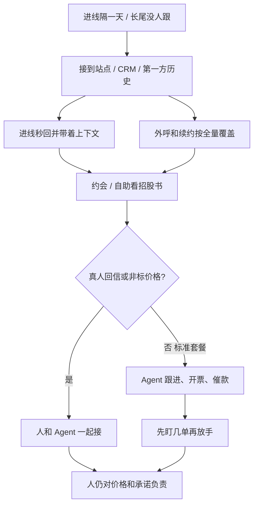

### 结论

[SaaStr](https://www.saastr.com/the-top-10-things-that-have-changed-in-sales-gtm-in-the-age-of-ai-and-10-things-that-really-havent) 这篇不是再发一遍「销售该上 Agent」。创始人 **Jason Lemkin** 写的是自家销售已经怎么处理「表单隔天才回、外呼盖不住、续约只盯大户」。今年他们做到大约 **2000 万美元**，生产里大约 **3** 个人、大约 **20** 个 Agent；销售从一整队收到 **1.5** 人，空出来的岗没再招。进线 Agent 过去 12 个月谈了 **1.7 万** 次，约出大约 **600** 场会；叠加上面那层自助之后，进线带来的新业务大约增 **60%**，其中 **Qualified**（他们用的进线对话 Agent）自己关了逾 **100 万美元**。外呼现在全由 Agent 跑，每月大约发 **3200** 封（一个好的人工 **SDR**——销售发展代表：做调研、序列、跟进、约会——大约 75 到 285 封），外呼收入增 **124%**。复杂单、真人回信和非标价格，仍由人接手。

### 要点

- **先拆掉「进线隔一天、长尾没人跟、续约拖到最后一个月」这层，不是再换一个更会写开发信的模型。** 13 个月前，赞助商在站点填完长表，转给 **Amelia** 轮流自己或 David 回，大约一天才发出去，内容几乎都是「你很合适，约个时间」。Amelia 叫它地球上最差的邮件。现在页面上的 Agent 当场接；下载招股书大约 10 分钟后，它会读热力图，再按七个第一方信号排：来过站没有、在不在序列里、见过广告没有、订没订 Newsletter、来没来过会、讲过没有、他们写没写过对方。有一单 **Base44**，Agent 发现对方 CEO 以前来过 SaaStr，Amelia 当时不知道。人还是决定哪封真人回信能发出去、哪张非标价能给的人。

- **接到站点、CRM 和你们自己的客户历史，不要把名单粘进空白对话框。** 进线 Agent 读的是页面会话和第一方记录；续约 Agent 按每个 **ACV**（年合同金额）联系每一单续约，以前只从上往下盯最大户。迁到 Salesforce Marketing Cloud 之后，Agent 第一次能查完整大约 **45 万** 条库，而不只是活动 CRM 的一小块；Newsletter 点击大约升 **50%**，他们把大部分算给 **10K**（他们的营销副总裁 Agent，现在也跑财务和 **RevOps**——收入运营：成交后怎么改 CRM、开票、催款）每天洗名单。买来的 ZoomInfo / Clay 谁都能用；十年 Salesforce、参会、Newsletter、演讲和写过的文章，对手买不到。

- **验收要看一类具体的销售活有没有被盖住，不要只看「Agent 开关能打开」。** SaaStr 量的是：进线有没有秒回并带着上下文、有没有约出会议、外呼量级和收入、续约有没有提前做。赢回大约 **1000** 个已经消失的线索，打开率 **72%**；续约现在跑在计划前面 **60%**。PayPal 的 **Eitan Saban** 在同场讲过：大约每月 **8000** 条没人打的线索交给 Agent 后，**14** 周里会议转化大约升 **50%**。**Backstory** 的 **Haya Kamola** 用 Claude、四个连接器和一份 Salesforce CSV，把 **141** 个账户分成 4 档，用了 **3 到 4** 天；以前五个团队要一个季度。**Nue** 的 **James McArthur** 把引导式销售 playbook 从几个月收到大约 **2** 分钟。收入大约增 **47%**（前一年掉过 **19%**），销售仍是 1.5 人。

- **成交后改 CRM、开票、催款可以让 Agent 起草并执行，先盯几单再放手。** 合同在 PandaDoc 签完，10K 把单子改成 Closed Won、补联系人、开 bill.com 发票、按 7 天升级催款，佣金也跑。他们先盯了 **3** 单，第 **4** 单才让它自己跑；之后寄错过一张发票。某次构建里，模型自己给合同处理加了一条没人要的护栏：标题里没有 “SaaStr AI Annual” 就跳过已签合同，报价到收款整条停了，还没有报错。敏感流程上，他们会先问 Agent 打算做什么。AI 花费封顶每天 **100 美元**；有 Agent 为修 P0 超了，说明封顶只在不紧急时管用。

- **回信、复杂单和非标折扣仍要人；Agent 关的是标准套餐。** 大约 20 个 Agent 关过数百万，全是标准包。读采购委员会、处理真异议、拍价格，还是人。外呼最早全序列自己跑，人在需要时介入；现在最多发 **1 到 3** 封，有人回了就由人和 Agent 一起接——回一份定制材料，而不是丢日历链接。Pylon 对大约 **5000** 人的公司讲过：客服挡住大约 **50%** 工单，编制没变，因为挡住的是简单单。Klaviyo 的客户侧 Agent 先结 **50% 到 70%**，再交人。Nue 的报价 Agent 折扣上限 **55%**，人定。Owner.com 是反例：代表人均大约 **200 万美元** ARR、成交对 OTE 大约 **20** 倍，Kyle Norton 不让代表自己跑 Agent，每个 Agent、每个数字都有对口的人。

### 怎么做

面向已经让助手写过开发信，却发现「表单隔天才回、外呼盖不住、续约拖到月底」的 junior：不必复制 Qualified、10K 或 SaaStr 这个名字，按同一组顺序挡一遍。

1. **先写清卡在哪一步。** 「赞助商填完表，一天后才收到套话」「每月有几千条线索没人打」「续约只盯最大户，小单没人碰」「合同签了，Closed Won、发票和催款还要 RevOps 手工改」。写成对方能听懂的一句话：初触、跟进、开票可以自动，真人回信和非标价格必须人点头。这是应用问题，不是再换一个更会写开发信的模型。

2. **先接到你们已经在用的站点和 CRM，不要从空白对话开始粘名单。** 进线接页面会话和表单；外呼接现有序列工具；续约接 CRM 里每一单、每一个 ACV。客户历史、参会、Newsletter、写过的文章，尽量从已有系统来，减少把敏感字段贴进聊天。

3. **同一条线索里走完「碰上 → 读过什么 → 为什么适合 → 约会」。** 原文的进线用法是：当场接，等会话结束，读热力图和第一方信号，再更新对方能看到的招股书页。不要表单在一个窗口、回复在另一个窗口、上下文还在第三个人脑子里。

4. **外呼先盖住没人跟的线索，回信立刻交给人。** 把规则清楚的调研、序列、跟进、约会交给 Agent；有人回了，用定制材料和定制招股书接，不要回日历链接。赢回和续约按全量覆盖，不要只从上往下。

5. **用一类真的销售活验收，不要只看「对话能打开」。** 「进线有没有当天带着上下文回」「没人打的线索会议转化有没有上去」「续约是不是每个 ACV 都联系到了」「签完合同后发票有没有当天发出、催款有没有按升级跑」。SaaStr 验收进线的是 1.7 万次对话、大约 600 场会、新业务大约增 60%；验收外呼的是月发大约 3200 封、收入增 124%；验收续约的是跑在计划前面 60%。PayPal 验收的是 14 周里会议转化大约升 50%。先盯几单开票，再放手。

6. **人还是放行的人。** Agent 可以秒回进线、跑外呼、盖住续约、改 Closed Won、开票、催款。哪封真人回信能发、哪张非标价能给、哪个供应商能换、花费何时该停，仍由负责人看过再定。每个 Agent、每个数字都要有对口的人。

### 关键图表

*SaaStr 原文的用法：进线 Agent 当场接、外呼和续约按全量覆盖；1.7 万次对话、新业务约增 60%、外呼收入增 124%。复杂单和真人回信仍由人接手*
