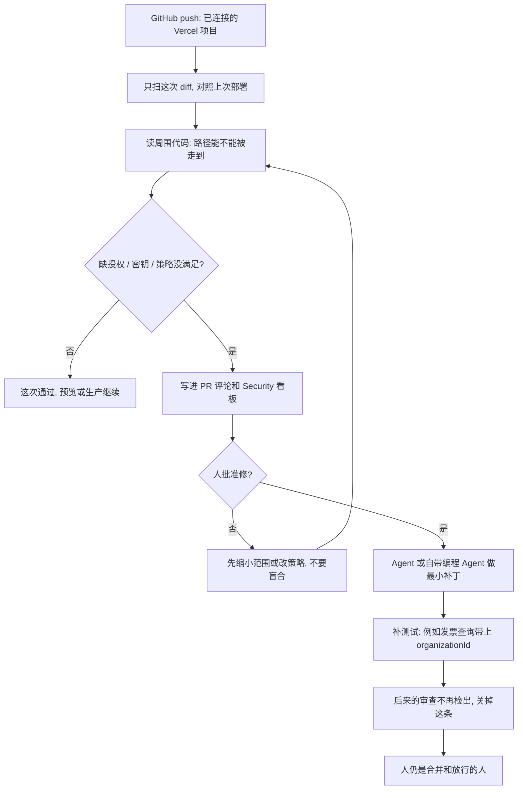

### 结论

[Vercel](https://vercel.com/blog/vercel-security-review) 这篇不是再讲一遍「上线前该跑一遍安全扫描」。**Nate McGrady** 和 **Karim Rahal** 写的是 **Vercel Agent** 已经怎么把 **Security Review**（安全审查：对这次改动追会不会被外人走到）接到每次 **GitHub push** 上。和 Code Review、Investigation 并列：代码一推进已连接的仓库，就只拿这次相对上次部署的 **diff**（改了哪些行）来扫，缺授权校验、密钥露出来这类问题写进 PR 评论和 Security 看板。模式匹配扫描器常漏掉的逻辑洞——比如发票下载只按 ID 查、没看是不是自己组织的——它要靠读周围代码、追这条路径能不能被走到才标出来。扫完是秒级，预览和生产部署都能跑。Agent 可以验证并推最小补丁，仍要你点头。验收不是「我们上了安全 Agent」，而是每次 push 都有审查，越权能回到现有 PR 里修。

### 要点

- **先解决的是每次改动没人做安全审查，不是再换一个更会写漏洞说明的模型。** 前沿模型让旧洞更容易被做成利用；Agent 又在写更多要上线的代码，每家对安全审查的做法不一样，很多根本没有。Vercel 的用法是：默认对每个项目的每次 push 扫一遍，按你用白话写下的安全策略来判。策略可以只绑几个项目，也可以全队共用。例子：任何返回客户数据的接口，都必须确认请求者拥有这份数据。

- **只扫 diff，不要对整仓重跑。** 每次审查拿这次 push 和基线比，只覆盖改动。部署场景里，基线是该分支上一次部署，也就是对照已经在跑的版本。只扫 diff，所以是秒级，预览和生产都能跟。单仓多项目时，范围收到这个 Vercel 项目的根目录，避免把隔壁应用的改动也算进来。

- **缺授权这类逻辑洞，要追「改动能不能被外人走到」，不要只做关键字扫描。** Agent 读 diff 和周围代码，追这条路径怎么被调用、现有防护在不在，报之前再核一次。模式匹配扫描器擅长抓硬编码密钥，但「登录用户改一下发票 ID 就能下到别的组织」这种洞，它常常看不见。Vercel 原文的例子就是发票下载接口：`findUnique` 只按 `invoiceId` 查，没有带上当前用户的 `organizationId`。

- **发现要写进现有 PR 和看板，不要另开一张值班表。** 结果进 Security 看板。私有和内部仓还会给这次提交加 GitHub check，并在 PR 上评论。同一问题不会报两遍；每条发现绑在它第一次出现的那次部署上，合并进生产分支后，生产环境也会标出来。后来的审查在某个环境里再也看不到，就标「不再检出」，PR 评论关掉。每条发现说明漏洞和怎么修，并链到首次出现的提交和部署。企业可以把审计日志送到已有的 **SIEM**（把安全事件归到一处的系统）。

- **修复走看板或 CLI，人还是放行的人。** 看板上可以点 Fix with Vercel Agent：它先确认洞还在，再做最小改动并补测试。也可以 `vercel security vulnerabilities` 把发现拉下来，交给自己的编程 Agent；看板支持复制成 Markdown 或 JSON。破坏性改动仍要人看。公开测试对 Pro / Enterprise 开放；审查本身免费到 2026-11-10，之后按 Agent 费率计，模型 token 按供应商价、不另加价，外加每百万 token 0.25 美元。修复单独按上述费率算。

### 怎么做

面向已经把仓库接到 Vercel、Agent 开始写要上线的代码，但安全审查还停在「有空再扫」的 junior：不必复制 Vercel Agent 这个名字，按同一组顺序挡一遍。

1. **先写清谁对上线负责、哪类洞在漏检。** 缺授权、密钥进仓、返回客户数据的接口没确认请求者是不是主人。写成对方能听懂的一句话：扫描和起草补丁可以自动，合并和破坏性修复必须人点头。这是应用问题，不是再换一个更会写 CVE 说明的模型。

2. **策略写成白话，绑到具体项目。** 「返回客户数据的接口必须确认请求者拥有这份数据」这种句子，应能直接变成项目或全队策略。Vercel 侧可以用 `vercel security policy` 管。先覆盖最怕出事的几个项目，不要一上来全开却说不清要拦什么。

3. **审查接进现有 push 和 PR，不要另做值班台。** 代码推进已连接的 GitHub 仓就该触发。人应在 PR 评论和看板里看到「缺哪段校验、链到哪次提交」，而不是自己把 diff 贴进对话框。单仓多项目时，范围收到本项目根目录。

4. **只拿这次 diff 对照上次已部署的版本。** 不要对整仓做一次「年度扫描」再等人分诊。秒级、每次预览都能跑，漏掉的授权问题才回得去当次 PR。

5. **用一条真的越权验收，不要只看「模型会读 diff」。** 「发票下载只按 ID 查、没带 organizationId」应变成：审查标出来、补丁改成按发票 ID 和组织 ID 一起查、测试补上、人核对出处后再合。Vercel 原文的修法是把 `findUnique({ where: { id: invoiceId } })` 改成 `findFirst({ where: { id: invoiceId, organizationId } })`。

6. **人还是拍板的人。** Agent 扫 diff、起草最小补丁、更新测试。这条洞能不能合、修得是不是最小、生产要不要跟，仍由负责人决定。后来的审查不再检出，才把这条关掉。

### 关键图表

*Vercel 原文的用法：每次 push 只扫 diff，缺授权和密钥写进现有 PR；发票下载这类越权要追路径，最小补丁仍要人点头*
