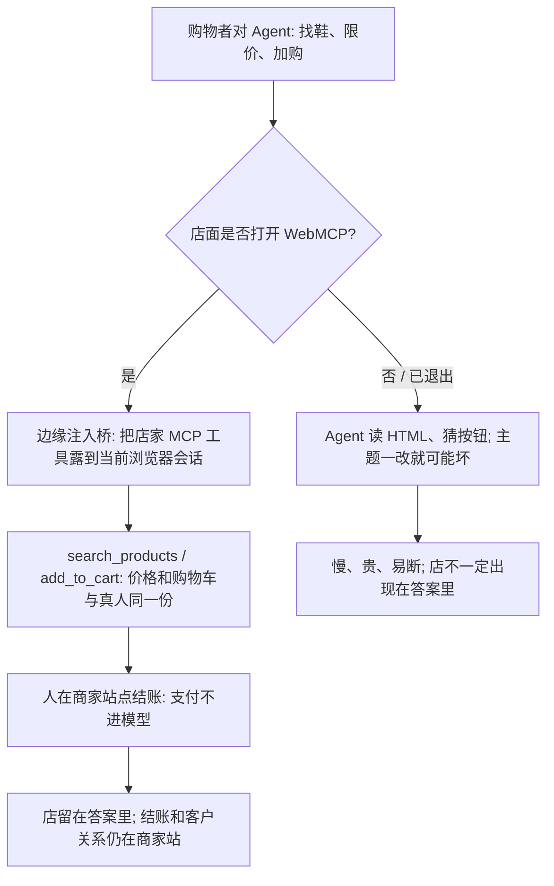

### 结论

[Cloudflare](https://blog.cloudflare.com/webmcp-commerce) 这篇不是再讲一遍「Agent 以后会自己逛街」。**Jenny Lea**、**Max Brosnahan** 和 **Matthew Conroy** 写的是 **Commerce.com** 已经怎么给自家近 **10 万** 个店面打开 **WebMCP**（Google 提出的浏览器标准：页面上直接挂给 Agent 用的结构化工具，比如 `search_products`），让购物 Agent 不再靠读 HTML、猜按钮。没有这套工具时，Agent 点来点去又慢又贵，主题一改就坏；有了之后，它在店面域名、当前浏览器会话里直接搜货、看详情、加购，再拿到结账链接。人自己点结账，支付信息不进模型。商家留住顾客和结账，也不用改主题。Cloudflare 8 月把边缘实现做成预览：打开后在边缘注入一小段脚本，店主不用写代码。Commerce.com 本来就用 Cloudflare 托管这些域名，于是问：能不能一次全开，又让每家店能退出。

### 要点

- **先解决的是 Agent 买不下一双鞋，不是再换一个更会点页面的模型。** 网站是给人点的，不是给 Agent 的。今天多数代购 Agent 还在读页面 HTML：看一眼、猜哪个按钮、点错再试。慢、吃 token，主题换一套就可能全断。Commerce.com 产品管理总监 **Kristina Pototska** 写的是商家已经在问：购物者让 Agent 找东西时，自己的店能不能出现在答案里，结账和客户关系能不能还留在自己站上，而且不要重建站点。WebMCP 对这三件事都有用：Agent 拿到真工具去搜商品、查详情、建购物车、取结账链接，不必在页面上盲走；人还在商家站上买；商家还握着这段关系。

- **同一套购物工具，分两条路给不同 Agent，不要让商家二选一。** Commerce.com 还有服务端 **MCP**（把外部系统接到模型上的协议）。服务端 MCP 给「直接连上店铺」的助手，比如一个人要跨好几家店买东西；WebMCP 给「在购物者浏览器里干活」的 Agent。两边露出的是同一套购物工具，商家不用分开维护。WebMCP 工具跑在购物者当前浏览器会话、店面自己的域名里，Agent 看到的价格和购物车跟真人一样。凭证不交给第三方，访问还发生在商家站上。Cloudflare 只做边缘投递：把 Commerce.com 后端 MCP 服务器的工具定义和动作原样代理过去，工具逻辑仍由商家侧决定。

- **一次全开，退出写进现成规则，不要另做一份十万行白名单。** WebMCP 最初按整个域名区域一开全开。Commerce.com 用 Cloudflare for SaaS，把成千上万个商家个性域名挂在共享区域上，所以既要平台级打开，又要每家店能退出。他们把 WebMCP 接到已有的 **Configuration Rules**（按条件改边缘配置）和自定义主机名元数据：主区域打开，边缘规则读商家元数据；店主在 Commerce.com 后台拨「退出」，Cloudflare 就跳过这家店。规则在出页面前于边缘判定，退出的店不加脚本、不做远程查询、也不多一截延迟。工具包走 `mcp-server-client`：边缘桥把后端 MCP 的定义和请求代理到访问者浏览器。

- **路径和失败都要有退路，预览版才会在真店面上站得住。** 桥最初默认每家店的 MCP 服务器都在 `/mcp`，Commerce.com 的在 `/api/mcp`。后来区域级可配 MCP URL，注入脚本时把自定义路径写进标签。店的 MCP 挂了，或浏览器还不支持 WebMCP，脚本自己退出，店面正常加载，真人购物不受影响。标准还在实验预览：Chrome 要开 `chrome://flags/#enable-webmcp-testing`，也在 Origin Trials、部分 Agent 浏览器，以及 Cloudflare **Kitesurf** 这类开发环境里。

- **人点结账是产品决定，不是模型「还不会付」。** 文章里的例子：你让 Agent「找一双 140 美元以下、10 码的防水越野跑鞋并加入购物车」。没有 WebMCP 时，它会撞上 cookie 横幅、规格下拉框，或把自动化流量挡下来的人机验证。有了之后，它在 `document.modelContext` 上发现工具，通常两次调用就够：`search_products({ query, max_price, size })`，再 `add_to_cart({ product_id })`。购物车在当前会话里即时更新；轮到付钱，Commerce.com 的后端决定流程——人自己点结账。这是商家要留住结账，也是支付细节不进模型消息。

### 怎么做

面向店面、SaaS 平台或已经让 Agent「对着 HTML 猜按钮下单」的 junior：不必复制 WebMCP 或 Commerce.com 这个名字，按同一组顺序挡一遍。

1. **先写清谁在买、谁要出现在答案里、结账必须留在哪。** Commerce.com 的线是：Agent 能搜、能加购，人在商家站上结账。你的线可能是「预约必须回到你们的日历页」。写成对方能听懂的一句话，再谈注入脚本。

2. **给 Agent 页面上的真工具，不要再训练它认按钮。** 搜商品、查库存、加购、取结账链接——工具名和参数按业务写死。主题怎么改，调用合同不要变。浏览器里的 Agent 和直接连店铺的助手，尽量共用这一套。

3. **工具跑在用户当前会话、你们自己的域名里。** Agent 看到的价格、购物车、登录态跟真人同一份。凭证和支付不进模型，也不交给第三方代付。

4. **平台要一次打开时，退出走现成的边缘规则和店主开关，不要维护十万行名单。** 退出的站点应零额外脚本、零额外查找。Commerce.com 是主区域打开，再用主机名元数据跳过单店。

5. **默认路径会对不上；失败必须静默回到真人页面。** MCP 不在 `/mcp` 就做成可配。服务器宕了或浏览器不支持，脚本退出，店面仍能给人用。预览标准先锁在实验开关和可控环境，再谈全网默认打开。

6. **用一句真实购物指令验收，不要只看「页面上出现了工具」。** 「140 美元以下、10 码越野鞋，加入购物车」这类话，应变成两次干净调用，而不是一串猜测点击。加购成功后，人还要能自己点开结账。

### 关键图表

*Cloudflare 原文的用法：近 10 万店面一次打开结构化购物工具；Agent 在当前会话里搜和加购，结账仍由人点，退出的店不加脚本*
