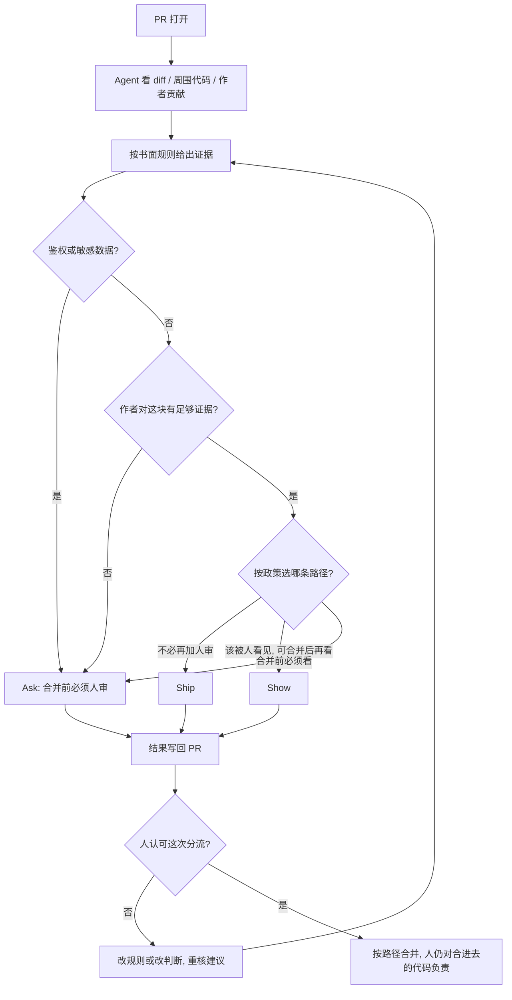

### 结论

[Sourcegraph](https://sourcegraph.com/blog/what-we-learned-building-a-pr-approval-bot) 这篇不是再讲一遍「AI 写完代码还得有人 Review」。**Constantin Nicolae** 写的是他们工程团队已经怎么处理这个瓶颈。编码 Agent 让改动来得更快，真正卡住的是：看懂影响、决定能不能合。仓库规定合并前必须有一次 GitHub 批准，常规小改和需要讨论的大改走同一道门。以前靠 stamp 组（有人喊「谁来盖个章」，空着的同事切过来点批准）把小 PR 往前推，但每次仍要找人、切上下文。他们做了一次 **PR 路由**实验：Agent 看 diff、周围代码和作者对这块的熟悉度，按规则给出证据，再分成 **Ship / Show / Ask**。先只给建议、人审照旧，用反馈改规则，再给符合条件的改动开批准。人还是决定哪条能合的人。验收写在原文里：追着要人盖章的请求变少了；这仍是内部实验，盖章少了不等于评审质量已经量过。

### 要点

- **先拆掉「所有 PR 都等人盖同一枚章」这层，不是再换一个更会写代码的模型。** 写得快之后，瓶颈转到评审。他们本来就对「什么样的改动该怎么看」有不同预期，却被「合并前必须批准」收成同一步。人还是决定这条能不能合的人。

- **Ship / Show / Ask 是三条评审路径，不要理解成 bot 自己合并。** 这套区分来自 2021 年一篇文章，他们拿来用：Ship 按现行政策不必再加人审；Show 该有人看见，但可以合并后再看；Ask 必须有人在合并前看完。Agent 负责检查并给出证据，应用代码按规则选路径，结果写回 PR。

- **熟悉度要有证据，而且只对「这块代码」有效，不要把「在这个仓库合过 PR」当成全仓库通行证。** 现行政策是：有两次已经合并、且经过别人评审的 PR，再加上过去 30 天里对相关代码、测试或技术文档的贡献。在系统一部分干活，推不到另一部分。鉴权检查、敏感数据如何暴露这类改动，不论资历都必须人审。

- **先建议、再放行：把 bot 的理由摊开，人才能反驳规则或判断。** 他们一开始只发建议，人审流程不变；用反馈收紧「怎样才算熟悉」的证据，再回头核对被影响到的建议。理由看得见，才能问：是规则错了，还是这次判断错了。

- **bot 自己也会打断人。少追 stamp 只说明「找人盖章」少了，不说明合并后的 Show 有没有人回头看、评审质量有没有变好。** 评论和反复评估会变成新的打扰。何时开口、何时更新、何时闭嘴，本身就是工作流设计。Show 拿掉等待之后，要靠有人合并后再回来看；熟悉度还得随着人和代码一起更新。原文说这些仍在观察，并预告后续文章。

### 怎么做

面向已经让 Agent 写出更多 PR、却发现「小改也要喊人盖章、大改和小事挤在同一条批准规则里」的 junior：不必复制他们的 bot 或 Sourcegraph 这个名字，按同一组顺序挡一遍。

1. **先写清卡在哪一步。** 「有人在频道里喊谁来 stamp」「常规重命名也要等批准才能合」「该讨论的改动和该快过的改动走同一扇门」。写成对方能听懂的一句话：分流和建议可以自动，对外合并必须符合你们已经写明的政策。这是应用问题，不是再换一个更会写代码的模型。

2. **先把评审预期写成路径，再谈「AI 来批准」。** 至少分清：政策允许直接过的、该被人看见但可以合并后再看的、必须合并前看完的。鉴权、敏感数据、对外承诺这类永远进「合并前看」。没有书面路径，bot 只能学你们现在的排队习惯。

3. **给 Agent 的是 diff、周围代码和作者对这块的证据，不是一句「帮我过审」。** 他们还看作者过往贡献。熟悉度要可核对：例如「这块最近有没有经别人评审并已合并的改动」。证据不足就走 Ask，不要靠职级或印象。

4. **先只发建议，人审照旧；理由写在 PR 上，让人能反驳。** 核对几条真实 PR：建议是否和你们的预期一致、鉴权有没有被错放到 Ship。规则或判断被挑战之后，回头重跑受影响的建议，再考虑给符合条件的改动开批准。工作流他们跑在 GitHub Actions 上；你用现有 CI 能把结果写回 PR 即可。

5. **用一次真的合并验收，不要只看「bot 会评论」。** 「喊 stamp 的次数有没有少」「Show 合并之后有没有人回头看」「鉴权是不是仍必须人审」「bot 是不是评论太多反而打扰」。需要人看时，他们用 Sourcegraph 的 Compare 页看 diff 和周围代码；你用现在已经能看完整变更的工具即可。

6. **人还是放行的人。** Agent 可以读 diff、给证据、建议路径。哪条能 Ship、哪条必须 Ask、熟悉度窗口怎么定、bot 何时该闭嘴，仍由负责人看过再定。盖章请求变少，只说明追人少了；评审质量要另验。

### 关键图表

*Sourcegraph 原文的用法：Agent 看 diff 和熟悉度证据，按 Ship/Show/Ask 分流，少追盖章；鉴权和敏感数据仍必须人审，人还是决定哪条能合的人*
